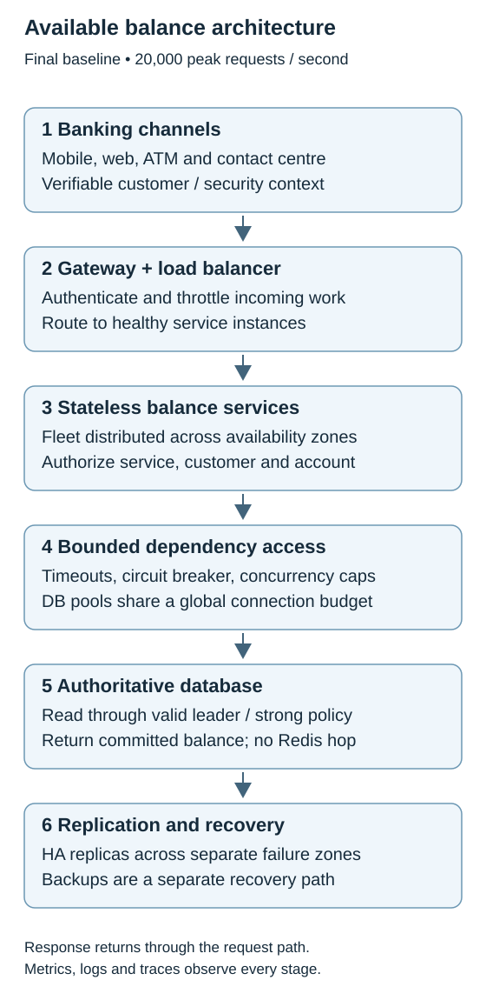
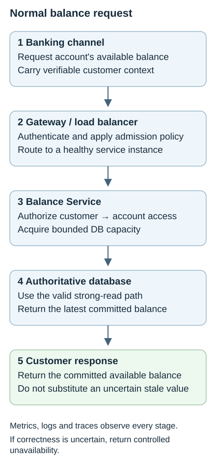
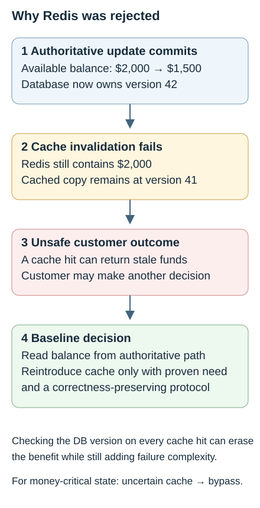
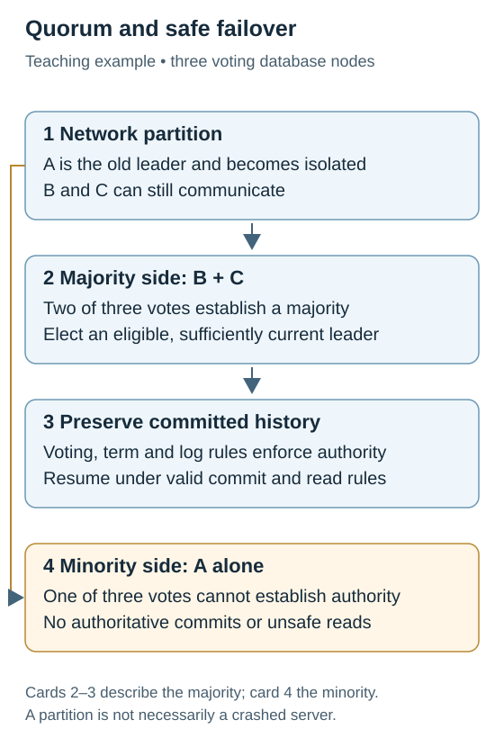
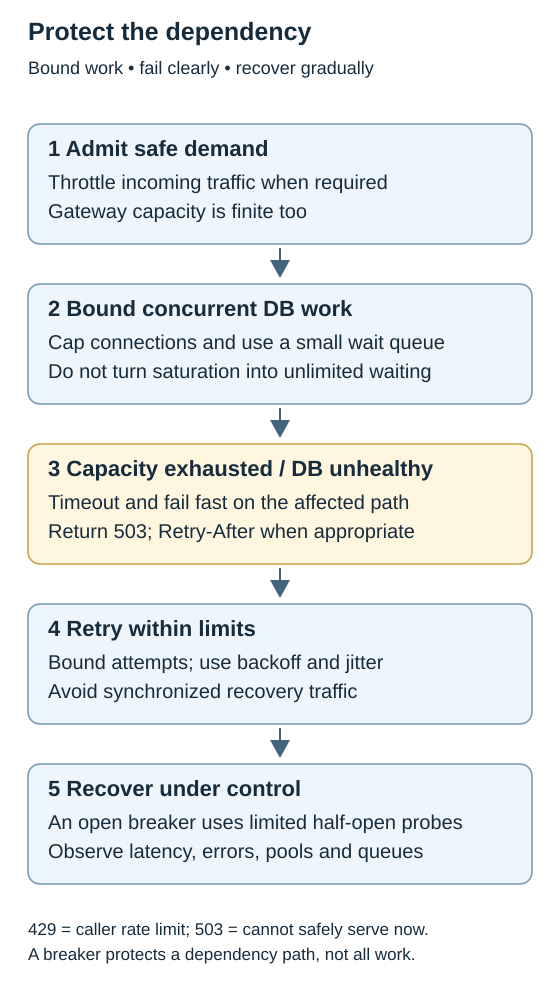

# Topic 1 — Architecture Foundations

[Back to Architecture Drills](../README.md)

**Status:** Complete

This chapter designs a reusable **available-balance service** for mobile banking, web banking, ATMs, contact-centre applications, and other banking systems. The central correctness test is simple: a customer has **$2,000**, spends **$500**, and immediately checks their balance. Once the debit is committed, the service must return **$1,500**, not a stale **$2,000** that could influence another spending decision.

The exercise assumes **10 million customers**, **500,000 daily active users**, **20,000 peak requests per second**, **p99 under 200 ms**, and **99.99% availability**. The final baseline uses multiple stateless Balance Service instances behind a gateway/load balancer, reading through a strongly consistent authoritative database with high-availability replicas, bounded dependency access, explicit account authorization, and observability.

Redis was considered and removed from the critical balance-read path because failed invalidation can expose stale funds. Database sharding was deferred because 20,000 RPS alone does not prove that one logical owner has reached its measured limit. AI remains asynchronous and optional. Exact database technology, node count, commit policy, recovery objectives, and production thresholds remain implementation decisions rather than claims established by the drill.

## Contents

- [Problem & Requirements](#problem--requirements)
- [Final Architecture](#final-architecture)
- [End-to-End Flow](#end-to-end-flow)
- [Component Responsibilities](#component-responsibilities)
- [Data & Consistency](#data--consistency)
- [Scaling](#scaling)
- [Reliability & Failure Modes](#reliability--failure-modes)
- [Security](#security)
- [Observability](#observability)
- [Key Architecture Decisions](#key-architecture-decisions)
- [Constraint Mutations](#constraint-mutations)
- [Adversarial Architecture Review](#adversarial-architecture-review)
- [AI Intersection](#ai-intersection)
- [TPM Delivery](#tpm-delivery)
- [Program Risks](#program-risks)
- [TPM Constraint Mutations](#tpm-constraint-mutations)
- [Production Readiness](#production-readiness)
- [Rollout & Rollback](#rollout--rollback)
- [Concepts Learned](#concepts-learned)
- [Mental Models](#mental-models)

## Problem & Requirements

Return the customer's **current available balance** through mobile banking, web banking, ATMs, and contact-centre applications. The service must also become a reusable capability for other banking systems.

The defining example is a customer with $2,000 who spends $500 and immediately checks their balance. Once the debit succeeds, the next read must reflect the committed change: $1,500, assuming no further updates. A stale $2,000 can influence another spending decision. This is why consistency is a business requirement before it is a database setting.

| Requirement | Decision and consequence |
|---|---|
| Customer population | 10 million customers; 500,000 daily active users **Consequence:** Customer count alone does not determine request load. |
| Peak throughput | 20,000 balance requests per second (RPS) **Consequence:** Size and test the entire request path, including connections and the database. |
| Latency | Under 200 ms; refined to 99% of balance requests under 200 ms **Consequence:** Monitor the successful request fraction under the threshold and p99 latency. |
| Availability | 99.99% **Consequence:** Multiple healthy service instances, separate failure domains, safe DB failover, and spare capacity. |
| Freshness | Strongly consistent available balance **Consequence:** Read through the authoritative path; no silently stale cache or ordinary asynchronous replica fallback. |
| Security | Caller identity plus account-level authorization **Consequence:** Authenticate at the edge and enforce permissions again at the balance service. |
| Financial correctness | No duplicate effects; preserve committed state and accounting rules **Consequence:** Transactional enforcement, durable operation records, and idempotency for balance-changing operations. |
| Failure response | Controlled temporary unavailability when correctness cannot be assured **Consequence:** Bound waiting and protect dependencies instead of returning a plausible but unsafe value. |

**Scope boundary.** The core capability is balance inquiry. Updates and transfers were introduced to test consistency, atomicity, retries, and sharding. The drill did not specify a full ledger schema, balance-calculation formula, payment-processing platform, or distributed-transaction implementation.

**Inputs still requiring production validation.** Average RPS, true concurrent demand, write volume/read-write ratio, record size, storage growth, gateway limits, and measured per-instance/database capacity were not established. The numerical exercises below are sizing examples, not benchmark results. No database product, exact production node count, commit policy, or disaster-recovery time/data-loss objective was selected.

## Final Architecture

The baseline diagram appears before failure mechanics so the normal design is clear first.

### Architecture at a glance

[Open the scalable architecture diagram](assets/balance-architecture.svg)

The gateway admits and distributes work; the Balance Service remains stateless and enforces account access; bounded connection pools protect the database; the authoritative database returns the committed balance through a valid strong-read policy. Replicas support safe failover, while backups support recovery rather than immediate availability.

### Baseline and extensions

The baseline is gateway/load balancing, multiple stateless Balance Service instances, one logical authoritative database with high-availability replicas, and security/observability controls. Redis, sharding, regional placement changes, and cross-shard transfer recovery are extensions introduced only when a requirement or measured limit justifies them.

## End-to-End Flow

[Open the scalable request-flow diagram](assets/balance-request-flow.svg)

1. **Request the balance.** A channel sends the account identifier with verifiable customer and caller context.
2. **Admit and route.** The gateway authenticates, applies traffic policy, and routes the request to a healthy Balance Service instance.
3. **Authorize the resource.** The service validates the calling service and confirms that the end customer may read the requested account. A trusted upstream is not an account-access bypass.
4. **Acquire bounded capacity.** The service uses capped concurrency and a controlled connection pool instead of creating unlimited database work.
5. **Read authoritative state.** The database serves the latest committed available balance through the valid strong-read path.
6. **Return one clear outcome.** The service returns the committed balance. If authority or correctness is uncertain, it returns controlled temporary unavailability rather than a plausible stale value.
7. **Observe the path.** Metrics, logs, traces, dependency signals, and authorization audit events make success and failure diagnosable.

**Supporting capabilities.** Identity, certificates, secrets, observability, and deployment controls support the path. A connection proxy/pooler is optional, not a mandatory hop. Redis may cache eligible non-critical metadata. Any AI analysis runs asynchronously. Shards appear only in the scale extension, with one authoritative owner per shard.

## Component Responsibilities

| Component | Responsibility / boundary |
|---|---|
| Channels | Present balance and controlled failure to the customer; carry trusted identity context **Why:** Multiple banking experiences share one capability **Boundary:** One channel can fail independently; channel checks alone cannot secure all callers. |
| Gateway / load balancer | Authentication integration, throttling, routing, health-based distribution **Why:** Protect and distribute entry traffic **Boundary:** A shared bottleneck or failed routing tier can affect the whole service. |
| Stateless balance service | Account authorization, authoritative reads, bounded dependency calls, operation semantics **Why:** Keeps customer access rules and behavior consistent across callers **Boundary:** Instances are replaceable; shared downstream failure still affects the fleet. |
| DB connection pools / optional proxy | Reuse connections within a shared connection budget **Why:** Prevent per-instance pools from multiplying beyond DB capacity **Boundary:** Pool exhaustion creates waiting even with healthy DB CPU. |
| Authoritative DB | Own balance state and enforce transactional constraints **Why:** Correctness must survive application races, retries, and restarts **Boundary:** Loss of authority means no safe balance response. |
| Replicas / failover mechanism | Replicate state and safely establish a replacement leader **Why:** Survive instance and permitted failure-domain loss **Boundary:** Lag, unsafe promotion, or lost quorum can block recovery or threaten committed history. |
| Backups | Recover stored state after broader loss **Why:** Replication and recovery solve different problems **Boundary:** Without tested recovery, a disaster may leave no dependable restoration path. |
| Identity / secrets / certificate management | Issue, validate, rotate and revoke identities and credentials **Why:** Enforce service identity and least privilege **Boundary:** Shared or unavailable security dependencies can have broad blast radius. |
| Observability / SRE | Detect customer impact, saturation, security events, and degraded redundancy **Why:** Production readiness requires evidence and response **Boundary:** Hidden degradation becomes a late customer-facing incident. |
| Optional Redis / async AI | Cache eligible metadata; analyze operational patterns **Why:** Introduce only with a demonstrated benefit **Boundary:** Neither may become necessary to answer an authoritative balance read. |

## Data & Consistency

The database/ledger is authoritative; app memory and caches are not. Writes go to the valid leader and available-balance reads use its supported strong-read path. Lagging replicas remain suitable only for workloads whose semantics permit stale data. A **replica** copies an owner's state; a **shard** owns a different subset, so replication and sharding solve different problems.

### Redis and the failed invalidation window

[Open the scalable Redis failure diagram](assets/redis-stale-balance.svg)

The rejected path was: DB commits $2,000 → $1,500; invalidation fails; Redis still returns $2,000. Comparing cache version 41 with DB version 42 can reveal staleness, but consulting the DB on every hit largely defeats offloading and a version alone does not prove freshness. Reintroduce balance caching only with measured benefit and a protocol that prevents stale reads; when uncertain, bypass it within the DB's proven fallback capacity.

### ACID is not a distributed freshness guarantee

| Property | Working meaning and example |
|---|---|
| Atomicity / Consistency | All local changes commit or none; declared invariants remain valid. |
| Isolation / Durability | Concurrent work cannot violate the chosen transaction rules; acknowledged commits survive failure. |
| Distributed strong consistency | A subsequent reader cannot observe the older $2,000 after the debit succeeds. |

The useful mistake was treating ACID as proof against stale replica reads. The primary may commit correctly while an asynchronous copy remains behind. Transaction design and isolation protect local execution; read routing and replication policy protect distributed visibility.

### Replication, acknowledgements and safe authority

- **Asynchronous replication** creates a stale-read window; **synchronous acknowledgement** adds latency and can reduce write availability.
- “Leader + any 1 of 3 replicas” can tolerate one replica loss when another eligible copy satisfies policy; all-replica or specific-replica rules behave differently.
- Commit acknowledgement, replica apply state, read policy and election eligibility are separate decisions. Synchronous replication alone does not make every replica current or promotable.

## Scaling

### Capacity exercises that changed the reasoning

| Exercise | Result and implication |
|---|---|
| 20,000 peak RPS ÷ 2,000 safe RPS per instance | **Result:** 10 instances Bare load minimum under the stated exercise assumption; no failure reserve. |
| Lose one of those 10 instances | **Result:** 18,000 RPS remains Autoscaling cannot instantly close the 2,000 RPS gap. |
| Survive two simultaneous instance failures at peak | **Result:** At least 12 instances Covers that specific failure assumption, not automatically an AZ loss, burst, or deployment overlap. |
| New instance takes 90 seconds; weekday demand doubles at 9:00 | **Result:** Pre-scale before 9:00 with startup/health-check buffer Predictable demand should not wait for reactive detection. |
| 20 instances × 50 DB connections | **Result:** Up to 1,000 connections Pools create downstream demand independently of request volume. |
| 100 instances × the same 50 connections | **Result:** Up to 5,000 connections A 5× connection increase can happen even at unchanged customer RPS. |
| DB budget 2,000 connections ÷ 100 instances | **Result:** At most 20 per instance before reserve Allocate less where admin, other services, failover and maintenance need capacity. |

The 12-instance example provides 20% extra capacity above the 10-instance requirement; that is not the same as 20% idle fraction of the provisioned fleet. Runtime headroom must cover expected short-term shocks. A five-year volume forecast informs the roadmap, not the immediate reserve needed before autoscaling reacts.

| Scaling area | Response and remaining trade-off |
|---|---|
| Service compute saturation | Horizontally scale stateless instances and distribute traffic **Trade-off:** More instances multiply connection pools and downstream demand. |
| One DB leader becomes constrained | Optimize queries/indexes, compute, storage and connections first **Trade-off:** Vertical scaling has a ceiling and adds no independent failure domain. |
| Genuine write/storage ownership limit | Shard after measurement **Trade-off:** Routing, rebalancing, hot shards, cross-shard operations and harder recovery. |
| Gateway pressure | Verify throughput, TLS termination, connection and rate-limit capacity **Trade-off:** A gateway is not inherently unlimited. |
| Hot app instance | Inspect sticky sessions, load-balancer distribution and account affinity **Trade-off:** Keep application placement separate from data ownership. |
| Hot database shard | Rebalance/split ranges, isolate hot accounts, revisit partition key **Trade-off:** A single hot account's state cannot necessarily be divided freely; migration is real work. |
| Sudden or short-lived bursts | Headroom, admission limits and pre-scaling where predictable **Trade-off:** Reactive scaling can arrive after the spike. |
| DB pools fill | Global connection budget, smaller pools, optional proxy, concurrency bounds **Trade-off:** Reject or briefly queue excess work instead of manufacturing capacity. |

## Reliability & Failure Modes

Normal flow is only useful if failure behavior is explicit. The central cascade is **slow DB → occupied connections → queue growth → timeouts → retries → more DB pressure**. A dependency can be alive while still consuming enough resources to make the service effectively unavailable.

| Failure | Detection, containment and recovery |
|---|---|
| Service instance crashes | **Behaviour:** Healthy peers carry admitted traffic **Detection:** Health checks, errors, per-instance load **Response:** Remove unhealthy target; reserve absorbs loss; autoscaling restores capacity. |
| DB slows or pools exhaust | Dependency latency, pool wait, p99 and queues rise **Response:** Bound concurrency/waiting, open the breaker and shed excess within the global connection budget. |
| Network fault or retry storm | Calls hang/reset and write outcomes may be unknown; retries amplify demand **Response:** One retry owner, durable IDs, bounded attempts, backoff, jitter and admission limits. |
| Leader/replica failure or partition | Authority, acknowledgement policy or committed history may be at risk **Response:** Elect only an eligible leader under quorum; minority stops and clients reroute. |
| Authoritative layer or AZ unavailable | No safe read, or survivors may overload **Response:** Controlled unavailability unless valid authority and failure-state capacity both exist. |
| Cache or cross-shard extension fails | Cached balance becomes unsafe, or debit and credit split **Response:** Bypass suspect cache; resume/compensate durable transfer state with idempotent effects. |
| Unauthorized internal call | Deny, audit, investigate and narrowly revoke/rotate while preserving demonstrably safe operations. |

### Database HA, leader election, quorum and CAP

[Open the scalable quorum diagram](assets/quorum-failover.svg)

One leader plus two replicas means three DB instances and a majority of two; five voters require three. These are teaching examples, not prescribed production counts. Heartbeat loss reaches an **election timeout** and triggers suspicion—not proof of death. The database's consensus system must combine majority votes with term/epoch, log eligibility and **fencing** so an old leader cannot continue writing and a lagging replica cannot discard committed history.

In a five-node 3–2 partition, only the policy-compliant majority may continue. This is the drill's **CAP** choice: money-critical state favors consistency over minority availability. CAP availability during a partition is not the same as the monthly 99.99% operational SLO.

### Overload protection, backpressure and retries

[Open the scalable overload-protection diagram](assets/overload-protection.svg)

A breaker fails fast on the protected dependency and uses limited half-open probes; it need not disable unrelated operations. A 429 means caller/traffic-class rate limiting; 503 means this request cannot safely run now. `Retry-After` is only a hint. Gateway, service and driver must not each retry independently: assign one owner, one end-to-end timeout and bounded attempts with backoff/jitter only for safe retryable outcomes.

### Timeouts, idempotency and transaction boundaries

A DB can commit and lose the response, so timeout means **unknown outcome**, not failure. Reuse one durable idempotency ID and enforce uniqueness in the authoritative transaction; application check-then-insert can race. Atomicity protects one execution; idempotency protects repeats.

### Sharding and partial transfer recovery

After a measured single-owner limit, shard by account/customer. A debit on Shard 1 followed by failed credit on Shard 2 is partial workflow completion, not split brain. Persist transfer ID, completed/pending steps and retry/compensation status; make every effect idempotent. Saga, outbox and distributed-transaction choices remain future design work.

**Failover is a capacity event.** Losing a zone containing 40% of service capacity while survivors are already heavily utilized can cause a secondary overload even when routing works. Replica count, quorum and survivor headroom must all survive the intended failure. Backups support recovery; they are not immediate failover capacity.

## Security

| Boundary / concern | Required reasoning from the drill |
|---|---|
| Customer device → bank edge | Authenticate the customer; reject bad traffic early; encrypt the connection. |
| Gateway/service → requested account | Authenticate the caller, carry verifiable customer context, and enforce the customer's entitlement to the specific account. |
| Balance service → DB | Use a distinct service identity with only the required database permissions and protected transport. |
| Internal network and credentials | Assume compromise is possible. Use TLS/mTLS, scoped OAuth tokens, least privilege, distinct identities, and centrally managed secret/certificate issuance, rotation and revocation. |
| Stored data | Encrypt DB storage, logs, backups and snapshots with controlled keys; encryption does not repair excessive privilege. |

The channel-only authorization proposal was rejected because new, compromised or misconfigured callers could bypass it. Authentication proves identity; authorization decides what that identity may do to the requested account. mTLS proves service identity, not customer entitlement. Stable party/account IDs, scopes and channel identity are evidence; names and masked PINs are not.

For repeated unauthorized updates: **reject → detect → investigate → contain → recover**. Revoke or rotate compromised credentials and disable only the unsafe capability where trustworthy containment is possible. This is **selective containment / graceful degradation**, not “partial fail open.”

## Observability

| Signal | What it reveals and the decision it supports |
|---|---|
| p50, p95, p99 and fraction under 200 ms | Typical experience and tail delay **Decision:** Detect contention/dependency trouble hidden by averages; assess latency SLO. |
| Availability, error rate, timeouts, 5xx | Customer-visible service outcome **Decision:** Incident response and release risk. |
| CPU, memory, in-flight work, per-instance utilization | Application resource pressure and skew **Decision:** Scale compute only when compute is the constraint. |
| Pool utilization/wait, queue depth | Waiting before the DB can execute **Decision:** Bound concurrency, adjust pools, shed work. |
| DB query/commit latency, throughput, locks, I/O | State-layer bottlenecks **Decision:** Optimize queries/storage or revisit ownership distribution. |
| Retry volume, breaker state | Amplification and dependency health **Decision:** Stop harmful retries; control recovery probes. |
| Replication lag, quorum, leader changes, AZ headroom | Safety and degraded redundancy **Decision:** Validate failover readiness before the next fault. |
| Authorization failures and service identity in audit logs | Unauthorized access and compromised callers **Decision:** Investigation and selective containment. |
| Correlated logs and end-to-end traces | Where time/failure entered the request path **Decision:** Separate gateway, service, network and DB causes. |
| Error-budget consumption | Reliability tolerance already used **Decision:** Slow/defer rollout or prioritize repair. |

Healthy CPU/RAM does not establish health. If p99 doubles, inspect DB/network latency, connection waits, retries, lock contention and slow subsets before adding instances. If app utilization is 40% but DB pools are full, scaling the app may make the actual bottleneck worse.

**SLI / SLO / SLA.** A Service Level Indicator measures reality; a Service Level Objective sets a target against that indicator; a Service Level Agreement defines contractual commitments/remedies. Missing an internal SLO does not automatically trigger an SLA penalty.

**Error budget.** A 99.99% availability target permits 0.01% unavailability under the defined measurement method/window. For a time-based 30-day month, that is **4.32 minutes**. The drill's example of 20 minutes unavailable has therefore already exceeded that monthly budget; it is not an example with remaining time. Request-based budgets use eligible requests instead of downtime minutes, so the operational definition must be explicit.

At **90% of the monthly budget consumed halfway through the month**, defer or tightly constrain non-essential major rollouts, focus on the failure modes consuming the budget, and define evidence for resuming normal change velocity. Reliability fixes may still warrant rollout. A new reporting window alone does not repair an unstable system.

## Key Architecture Decisions

| Decision / disposition | Rationale and trade-off |
|---|---|
| Define consistency before mechanisms | The post-debit observation promise constrains replication, routing and caching—not the reverse. |
| Keep services stateless; DB authoritative | Replaceable instances scale easily, while one logical owner enforces financial correctness. |
| Remove Redis from critical reads | More authoritative DB load is accepted to eliminate silent stale-balance risk. |
| Use a supported strong-read path | Ordinary asynchronous replicas improve read scale but cannot satisfy this freshness promise. |
| Optimize one logical primary with HA first | 20,000 RPS does not justify sharding before measured limits; simplicity is retained until evidence changes the decision. |
| Use cross-domain replicas, eligible election and fencing | Some unavailability is safer than a stale or competing authority. |
| Bound work and coordinate retries | Controlled rejection protects the dependency from queues, connection amplification and retry storms. |
| Enforce authorization and idempotency at authoritative boundaries | Channel checks and application check-then-insert races are insufficient. |
| Keep AI off the synchronous path | Operational recommendations remain possible without model latency, cost or nondeterminism in balance reads. |

## Constraint Mutations

These mutations test limits of the existing architecture rather than replace it wholesale.

| Constraint mutation | Break, response and trade-off |
|---|---|
| 20,000 peak RPS | **New constraint:** 200,000 RPS for 30 minutes **What broke:** Gateway/service capacity, then pools/DB may saturate **Change:** Verify gateway; scale stateless fleet; cap DB concurrency; shed beyond safe capacity **Trade-off:** Throttling protects the system but does not serve all legitimate demand. |
| Existing fleet size | **New constraint:** 10× more service instances **What broke:** Connection pools multiply **Change:** Global budget, smaller per-instance pools, optional proxy **Trade-off:** Application scaling remains bounded by state-layer capacity. |
| AZ loss or cost pressure | **New constraint:** Lose a replica and 40% of capacity, or remove an AZ to save 30% **What broke:** Quorum or survivor capacity may no longer support 99.99% **Change:** Prove election and failure-state headroom before topology changes; shed load if survivors saturate **Trade-off:** Redundancy without capacity is insufficient, and savings cannot silently weaken the SLO. |
| Unconstrained geography | **New constraint:** Canadian state stays in Canada; US state stays in US **What broke:** Cross-border placement and failover options invalid **Change:** Constrain processing, replicas, backups and relevant derived data **Trade-off:** Residency reduces recovery choices. |
| Residency plus compound failure | **New constraint:** Canadian region unavailable or traffic doubles during AZ maintenance; US failover forbidden **What broke:** Permitted recovery and surviving capacity may both disappear **Change:** Build in-country resilience, verify quorum/capacity before redirection, otherwise become unavailable **Trade-off:** Compliance and correctness take priority over prohibited recovery. |
| Latency rises while CPU is normal | **New constraint:** Pools fill, queues grow and 503s spike **What broke:** Waiting is in connections, locks, I/O, network or queries—not necessarily compute **Change:** Correlate pool/queue/DB/network signals; bound concurrency and shed excess **Trade-off:** Controlled rejection is safer than scaling the wrong resource. |
| Localized skew | **New constraint:** One app instance or one DB shard becomes hot **What broke:** Sticky routing or customer/range concentration hides behind fleet averages **Change:** Fix routing; split, rebalance or isolate data ownership when justified **Trade-off:** Resharding is a migration, not a free switch. |
| Cross-shard transfer | **New constraint:** Debit commits; credit shard fails and is retried later **What broke:** Partial completion, duplicate credit and orphaned-state risk **Change:** Durable progress, same logical identity, idempotent effects and resume/compensation **Trade-off:** Idempotency alone cannot identify the unfinished step. |

Additional foundation exercises tested predictable 9:00 AM bursts, 90-second startup, two-instance failure reserve, asynchronous replica staleness, synchronous replica loss, and network partitions. Their calculations and policies are preserved above.

## Adversarial Architecture Review

| Challenge | Initial thinking, final reasoning and principle |
|---|---|
| Where should state live? | **Initial:** Cross-server replication between balance instances **Final:** Keep app instances stateless; persist authoritative state centrally/logically **Principle:** Replicate state in the owning layer. |
| What should own balances? | **Initial:** Redis **Final:** Durable transactional balance/ledger store **Principle:** A fast copy is not automatically financial authority. |
| Can every read use replicas? | **Initial:** Separate write primary from many read replicas **Final:** Asynchronous lag violates the available-balance promise **Principle:** Read scaling is constrained by semantics. |
| What is over-engineered at 20,000 RPS? | **Initial:** Scaling DB instances aggressively **Final:** Start with a logical primary and HA; measure before sharding **Principle:** Do not pay distributed complexity before the workload needs it. |
| Biggest remaining SPOF? | **Initial:** Hot accounts on one shard **Final:** Hot shard is a concentrated bottleneck; leader without failover, shared edge/network/security dependency or region can be broader SPOFs **Principle:** Performance concentration and single points of failure differ. |
| How keep latency low without Redis? | **Initial:** More leader/replica coordination **Final:** First optimize queries, indexes, pools, network and capacity **Principle:** More coordination can add latency. |
| Does autoscaling fix DB pressure? | **Initial:** Add instances **Final:** Each instance adds pools; control global concurrency **Principle:** Scale callers in the context of dependency limits. |
| Does ACID imply fresh replica reads? | **Initial:** No stale reads should be possible **Final:** Primary transaction can be ACID while another copy lags **Principle:** Transaction correctness and distributed visibility differ. |
| Does a DB commit resolve a timeout? | **Initial:** The commit tells us success **Final:** The caller may never receive that response **Principle:** Unknown outcomes require durable identity and reconciliation. |
| Is channel authorization enough? | **Initial:** Avoid repeated checks to reduce load **Final:** Service enforces account entitlement for every supported caller **Principle:** Security must hold at the resource boundary. |

## AI Intersection

| Question | Conclusion |
|---|---|
| Where could AI add value? | Analyze customer/account traffic distribution, hot shards, utilization skew, growth and seasonal peaks; recommend partitioning/rebalancing. |
| Placement and necessity | Optional asynchronous/offline analysis: metrics → recommendation → engineering review. No model belongs in an exact committed-balance lookup. |
| Failure, cost and security | Bad recommendations, inference cost and unsafe movement appear if output is treated as authority; model failure must never interrupt reads or authorize financial-data movement. |
| Deterministic fallback | The conventional service continues; engineers use observed metrics, validation, simulation and approvals when AI is unavailable or untrusted. |

If AI predicts a hot partition, execution still requires engineer approval, shard-map validation, capacity simulation, backups, rollback, replication-health checks, controlled migration and abort thresholds. No numeric threshold or AI implementation was invented.

## TPM Delivery

| Workstream | Dependencies, sequencing and deliverable |
|---|---|
| API and Balance Service | Agree interface, identity and capacity assumptions; deliver gateway policy, authorization, authoritative reads, idempotency and bounded failure behavior. |
| Database / Platform | Turn consistency requirements into schema, indexes, HA/failover, access, connection budgets and measured performance. |
| Security and SRE | Define trust boundaries, tokens, mTLS and credential lifecycle while instrumenting SLIs, traces, capacity signals, alerts and runbooks during build. |
| QA / Integration | Plan early; prove functional, end-to-end, load, resilience, failover and security behavior when components are available. |
| Release | Gate deployment sequence, rollback evidence, operational readiness, residual-risk ownership and final Go/No-Go. |

### Sequence and critical path

**Data/consistency requirements → DB choice and HA topology → schema/access patterns → usable data-layer milestone → end-to-end integration → performance/resilience/security evidence → production readiness.**

API, service, DB/platform and security design can proceed in parallel once boundaries are clear; observability starts during build. DB/platform is the likely technical critical path because the request path cannot be proven without the authoritative store, while Security is a parallel launch gate. A dated plan is still required to confirm the actual critical path.

### Milestones and evidence

1. **Integration-ready data layer:** validated schema/indexes, connectivity, permissions, HA/replication and baseline performance—not merely “schema exists.”
2. **End-to-end and load evidence:** channel → gateway → service → DB → response, including authorization, p95/p99, pools, bursts, retries and backpressure.
3. **Resilience, security and rollback:** exercise instance/AZ/leader loss, slow dependencies, network faults, token misuse, mTLS, entitlement checks and safe reversal.
4. **Go/No-Go:** operational evidence, security approval, runbooks, rollback/failover proof and accountable disposition of residual risk.

**Rollout/migration boundary.** The drill established release ownership, deployment sequencing and rollback validation. It did not select a canary percentage, a legacy cutover method or a detailed data migration. Resharding controls were discussed conditionally; they are not a launch dependency for the baseline.

**Executive communication:** state the condition, quantify exposure, connect it to customer/business consequences and recommend a decision. At 90% error-budget consumption halfway through the month, defer non-essential change or tightly constrain scope with accountable risk ownership; contractual consequences arise only if the SLA terms are crossed.

## Program Risks

| Risk surfaced | Signal, mitigation and contingency |
|---|---|
| DB/platform readiness slip | **Impact:** Blocks genuine integration and failover/performance proof **Early signal:** Schema/connectivity/topology milestone delay **Mitigation:** Resolve dependencies early and baseline performance **Contingency:** Mocks/partial environment for independent work; escalate residual scope/date/resource trade-off. |
| Security arrives late | **Impact:** Launch-critical authorization or certificate issue **Early signal:** Unresolved policy model; repeated security-test failures **Mitigation:** Parallel security work and early trust-boundary decisions **Contingency:** Verified compensating control or launch escalation. |
| Capacity assumptions unproven | **Impact:** Peak or failover outage **Early signal:** Tail latency/pool pressure under realistic load **Mitigation:** Full-path load and failure tests **Contingency:** Pre-scale, bound demand, revise capacity before launch. |
| Over-sharding / unnecessary cache | **Impact:** Extra delivery dependencies and correctness failure modes **Early signal:** Complexity grows before a measured bottleneck **Mitigation:** Optimize simple authoritative baseline **Contingency:** Defer unnecessary components. |
| Observability delayed | **Impact:** Integration failures hard to diagnose; weak operations **Early signal:** Missing traces, SLIs, queue/pool metrics **Mitigation:** Start once architecture has enough definition **Contingency:** Readiness gate prevents unobservable launch. |
| Retry / connection amplification | **Impact:** Scaling action triggers DB outage **Early signal:** Pools/connections/retries rise with fleet growth **Mitigation:** Global budgets and bounded work **Contingency:** Shed traffic and restore dependency health. |
| Cost cuts remove failure capacity | **Impact:** Availability promise unsupported **Early signal:** Proposed AZ removal; high survivor utilization **Mitigation:** Validate quorum and headroom in failure state **Contingency:** Retain required redundancy; seek savings elsewhere. |
| Residency constrains recovery | **Impact:** Otherwise viable failover is impermissible **Early signal:** Cross-border replica/backup/processing dependency **Mitigation:** Design geography constraints into topology **Contingency:** Controlled unavailability when no permitted recovery exists. |
| Error budget nearly exhausted | **Impact:** Major release increases reliability exposure **Early signal:** 90% consumption halfway through window **Mitigation:** Prioritize causes, reduce non-essential change **Contingency:** Leadership decision on bounded scope and residual risk. |
| Unproven rollback / recovery | **Impact:** Failed release or transfer leaves unsafe state **Early signal:** Happy-path tests pass but recovery evidence absent **Mitigation:** Test rollback/failover and durable recovery behavior **Contingency:** Stop release or recover through validated procedures. |

## TPM Constraint Mutations

### Database/platform slips three weeks; launch date fixed

**Find root cause → identify blocked downstream work → calculate critical-path impact → clear blockers/reallocate capacity → parallelize independent work → escalate unresolved trade-offs.**

Quantify downstream impact before assuming a three-week launch delay or adding people. Distinguish dependency, scope, complexity, environment and staffing causes. Mocks may unblock API/service work but cannot replace integration and resilience proof; staffing helps only when work can be partitioned. Escalate unresolved scope/date/resource options with explicit risk.

### Serious authorization flaw one week before a fixed regulatory launch

A regulatory deadline does not make an unacceptable authorization risk acceptable. Assess exploitability, operations and customer impact with Security; then determine whether a **safe compensating control actually removes the exploit path**—for example disabling or restricting the operation or adding a validated authorization check.

If safety is demonstrated, obtain a time-bounded exception and permanent-fix commitment from Security/Architecture, Risk & Compliance, the accountable business owner and technology executive. Otherwise escalate to the formal Go/No-Go or risk-acceptance forum; do not treat a critical defect as a routine waiver. Bring the vulnerability, impacts, feasible controls, residual risk, fix timing and consequence of delay. A non-regulatory release should be postponed rather than accept unnecessary risk.

## Production Readiness

These are **release requirements, not completed tests or signoffs**. Evidence, thresholds, and accountable owners must be assigned before Go/No-Go.

| Gate | Evidence required before Go |
|---|---|
| Development / component validation | Account lookup and authorization, strong-read routing, idempotency enforcement where updates exist, connection budgets, timeouts, and bounded dependency behavior. |
| End-to-end integration | Channel → gateway → balance service → authoritative DB → response works with real security context, logging, traces, and controlled failure behavior. |
| Performance / capacity | Representative peak, bursts, concurrent demand, p95/p99, queue and pool behavior, gateway limits, and autoscaling startup are measured across the full path. |
| Resilience / HA | Service-instance loss, slow DB, pool exhaustion, retry pressure, leader failure, replica loss, AZ loss, network partition, and survivor headroom are exercised. |
| Data / recovery | Commit and read policies, election eligibility, fencing, backups, restore, failover, failback, and any durable operation recovery are demonstrated. |
| Security / InfoSec | Service and customer identity, account authorization, token misuse, mTLS, least privilege, credential rotation, auditability, and containment are validated. |
| Operational readiness | SLIs/SLOs, dashboards, alert thresholds, capacity assumptions, on-call ownership, incident procedures, and executable runbooks are ready. |
| Final Go / No-Go | Gate evidence, accepted residual risks, decision owners, customer-impact limits, rollback readiness, and any time-bounded exception are recorded. |

Exact latency, error-rate, pool-utilization, replica-lag, recovery-time, recovery-point, and rollback thresholds remain to be defined. Drill values are scenarios, not production acceptance criteria.

## Rollout & Rollback

Use **internal validation → shadow observation where safe → small canary → selected traffic or channels → progressive expansion → full rollout**. Shadow traffic must remain side-effect-free; balance-changing operations must never be duplicated merely to compare systems.

| Trigger | Action and recovery check |
|---|---|
| Incorrect balance or authorization result | Stop expansion and route traffic to the last-known-good path. **Recovery check:** Re-run correctness and entitlement tests against representative accounts before resuming. |
| Latency, errors, queues, or DB pools breach agreed limits | Freeze or reduce exposure; inspect gateway, service, network and database saturation. **Recovery check:** Resume only after thresholds hold under representative load and failure headroom is restored. |
| Retry volume or breaker openings rise | Reduce admitted demand and stop amplification before tuning capacity. **Recovery check:** Verify bounded retries, backoff, jitter, dependency recovery, and stable queue depth. |
| Replication, quorum, or leader eligibility is uncertain | Stop balance-changing exposure and do not promote an arbitrary replica. **Recovery check:** Establish one valid authority, preserve committed history, and verify client routing. |
| Security control weakens or exploit path appears | Disable or restrict the affected operation and invoke the security decision process. **Recovery check:** Validate the permanent fix or compensating control and obtain accountable approval. |
| Rollout remains healthy | Expand gradually while monitoring customer outcomes, p99, errors, pools, database health, authorization failures, and error-budget burn. **Recovery check:** Preserve a deployable last-known-good version and tested traffic rollback path. |

**Production clarification.** Rolling back application code does not reverse a committed balance update, repair inconsistent workflow state, remove unsafe cached data, or restore database authority. Code rollback, traffic rollback, data recovery, cache invalidation, and failback are separate operations with separate evidence.

## Concepts Learned

| Concept | Working meaning / correction |
|---|---|
| Requirements, RPS and concurrency | Functional requirements define capability; non-functional requirements constrain quality. Population, request rate and simultaneous work are different sizing inputs. |
| Source of truth and statelessness | The transactional store owns balances; replaceable service instances do not own durable customer state. |
| Scaling and headroom | Horizontal scaling adds instances; vertical scaling enlarges one. Pre-scaling and reserve capacity cover shocks before autoscaling reacts. |
| Replicas and shards | Replicas copy an owner for availability; shards divide ownership for scale. Replication lag can make a copy stale. |
| ACID and strong consistency | ACID governs a transaction; strong consistency governs what another reader may observe. Neither implies the other automatically. |
| Atomicity, idempotency and recovery state | Atomicity protects one execution; idempotency protects repeats; durable workflow state records what remains after partial completion. |
| Quorum, consensus and split brain | A majority plus term/log/fencing rules establishes authority. Split brain means competing owners for the same state. |
| CAP and failure domains | During a partition, money-critical state favors consistency over minority availability. Copies and capacity must span the intended AZ failures. |
| Bounded overload controls | Connection budgets, admission control, bounded queues, timeouts and breakers stop slow dependencies from consuming unlimited resources. |
| Retry discipline | Retry only safe outcomes, within one end-to-end budget, using bounded attempts, backoff and jitter; otherwise recovery becomes amplification. |
| Service levels | SLI measures, SLO targets, SLA contracts, and the error budget translates the objective into tolerable unreliability. |
| Security boundaries | Authentication identifies; authorization limits resource access. TLS/mTLS, scoped tokens, least privilege, KMS/PKI and credential lifecycle controls address different layers. |
| Safe degradation and residency | Preserve only demonstrably safe capability; never fail open. Geography constraints can require controlled unavailability. |
| Delivery controls | Critical path identifies schedule-driving dependencies. A compensating control is valid only when evidence shows it removes the actual exploit path. |

## Mental Models

- Decide what the customer may observe before choosing replication or caching.
- Speed does not make a copy authoritative; scale callers only within the owner's limits.
- Replication copies ownership; sharding divides it.
- Atomicity protects one execution; idempotency protects repeats; durable state says what remains.
- A timeout means uncertainty. Bound work, coordinate retries, and randomize recovery.
- Headroom absorbs failure now; autoscaling restores capacity later.
- Failover requires valid authority, preserved commits, fencing and survivor capacity.
- Authentication identifies; authorization limits power over a resource; encryption does not repair excess privilege.
- AI may recommend, but deterministic checks and accountable humans govern risky movement.
- Integration and failure evidence prove the system; deadlines do not make unsafe launches safe.

---

**Chapter provenance:** Completed Topic 1 System Architecture drill and its original instructions. Teaching examples are distinguished from production choices; useful mistaken proposals and their corrections are retained. Next: [Topic 2 — URL Shortener](../02-url-shortener/README.md).
