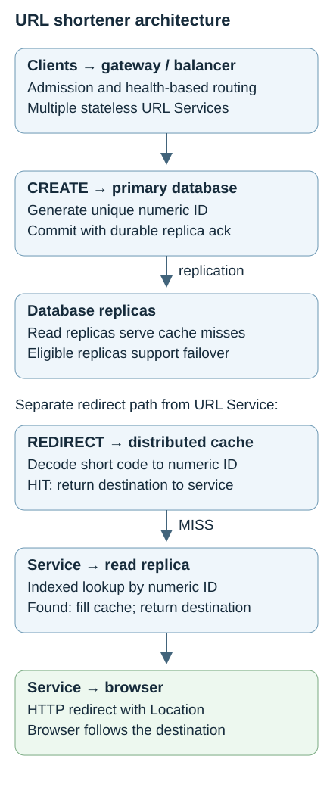
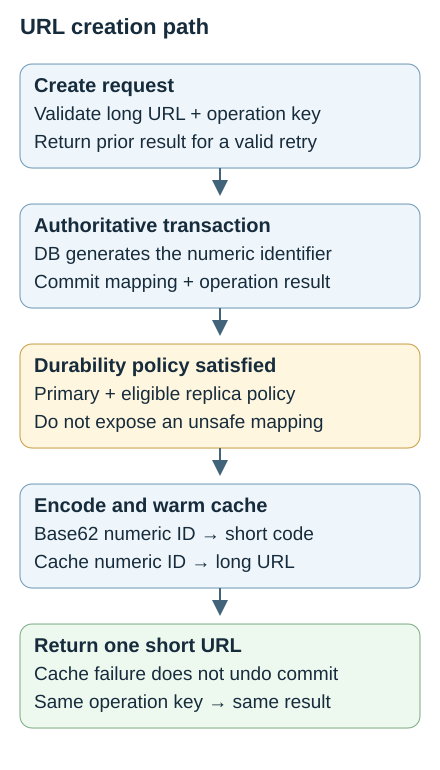
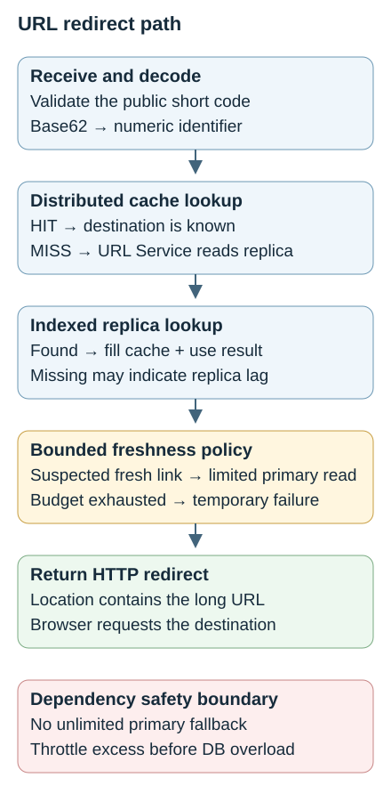
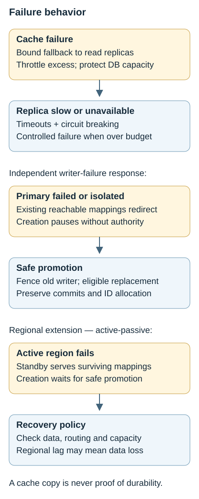

# Topic 2 — URL Shortener

[Back to Architecture Drills](../README.md)

**Status:** Complete

A bank launches a promotional campaign and shares a short link with customers. The link may receive a few thousand clicks at first, then millions if it spreads through social media. Every click must reach the intended page quickly, and the link must continue working through traffic spikes, cache failures, and database failover.

The system therefore has two different jobs. **Creation** must produce a unique, durable short URL exactly once for a logical request. **Redirection** must resolve that URL at much higher volume and return an HTTP redirect with very low latency. This split makes the design a useful study of identifier generation, caching, replication, retries, hot keys, and failure domains.

The baseline uses stateless URL Service instances, one logical relational database writer with high-availability replicas, a distributed cache, and read replicas for cache misses. The database generates a numeric ID; the service encodes it with Base62 to form the public short code. Distributed ID generation and database sharding remain deferred until measurements justify their complexity. Active-passive cross-region recovery is a failure extension rather than a V1 multi-writer design.

The chapter follows the mapping through its lifecycle: create it durably, serve it efficiently, protect the data tier when copies fail, and extend the topology only when the workload demands it. Decisions, useful corrections, and unresolved production choices are retained. Exact vendors, SLOs, cache policies, node counts, and regional recovery objectives remain implementation decisions.

## Contents

- [Problem & Requirements](#problem--requirements)
- [Final Architecture](#final-architecture)
- [End-to-End Flow](#end-to-end-flow)
- [Component Responsibilities](#component-responsibilities)
- [Key Architecture Decisions](#key-architecture-decisions)
- [Data & Consistency](#data--consistency)
- [Scaling](#scaling)
- [Reliability & Failure Modes](#reliability--failure-modes)
- [Security](#security)
- [Observability](#observability)
- [Constraint Mutations](#constraint-mutations)
- [Adversarial Architecture Review](#adversarial-architecture-review)
- [AI Intersection](#ai-intersection)
- [TPM Delivery](#tpm-delivery)
- [Program Risks](#program-risks)
- [TPM Constraint Mutations](#tpm-constraint-mutations)
- [Production Readiness](#production-readiness)
- [Rollout & Rollback](#rollout--rollback)
- [Concepts Learned](#concepts-learned)
- [Mental Models](#mental-models)

## Problem & Requirements

For the campaign example, the creation API accepts a destination such as `https://bank.example/offers/summer`, persists a durable mapping, and returns a compact address such as `https://go.bank/Wir`. Later, when a customer opens the short address, the service resolves the mapping and returns an HTTP redirect. The browser—not the URL Service—then requests the destination page.

This apparently small feature creates an asymmetric workload. Creating a link is a write that needs uniqueness, durability, and retry safety. Following a link is a read that happens roughly 100 times more often in the exercise, so latency, availability, caching, and traffic concentration dominate the architecture.

| Requirement | Decision and consequence |
|---|---|
| Creations | 10 million/day ≈ 116 writes/sec average **Consequence:** Start with a single logical writer and benchmark actual peaks. |
| Redirects | 1 billion/day ≈ 11,574 reads/sec average **Consequence:** The roughly 100:1 read/write ratio makes redirect optimization the priority. |
| Peak assumption | 5× average redirects ≈ 57,870 RPS **Consequence:** Size for bursts rather than only the daily average. |
| Latency and availability | Very low redirect latency and high availability **Consequence:** Use cache, healthy replicas, and bounded dependency calls. |
| Correctness and durability | Unique mappings; issued links should survive supported failover **Consequence:** Acknowledge only durable creation and promote eligible replicas. Cache is not authority. |
| Read consistency | Lag is acceptable for established, mostly immutable mappings **Consequence:** Replicas can serve reads, but newly created links need an explicit freshness policy. |
| Creation semantics | Each distinct create operation gets a new short URL **Consequence:** Do not require long-URL deduplication; use idempotency for retries. |
| Abuse resistance | Public creation attracts bots, phishing and malware **Consequence:** Rate-limit creation and add policy or reputation controls where justified. |

**Scope boundary.** Custom aliases, accounts, expiry, destination editing, billing, and click analytics are optional product extensions. A relational product, node counts, cache sizing, retention, bandwidth, measured capacities, exact SLOs, and regional recovery objectives were not selected. The later p99 < 200 ms versus 600 ms scenario was a delivery exercise, not a finalized production target.

**Capacity correction.** Five billion redirects/day is a valid *equivalent daily volume* for the assumed peak rate if sustained all day. It is not the forecast daily volume. Burst duration, timing, bots, and concentration on one link still require measurement.

These requirements lead directly to the baseline: keep the service fleet replaceable, let the database own durable mappings and identifiers, and add cache/read capacity specifically for the much larger redirect workload.

## Final Architecture

The diagrams separate the baseline topology, request flows, and failure behavior so each view remains readable on GitHub web and mobile.

### Baseline topology

[Open the scalable architecture diagram](assets/url-architecture.svg)

The gateway distributes traffic across replaceable URL Service instances. Creation writes to the authoritative primary; replication copies the committed mapping to database replicas. Redirection first checks the distributed cache and uses a read replica on a miss. Redis does not forward the request to the database—the URL Service observes the miss and performs that lookup. A database replica may serve reads, support failover, or do both when the database policy permits it.

### Creation path

[Open the scalable creation-flow diagram](assets/create-flow.svg)

Creation establishes a durable mapping before exposing the short URL. Only after the required database acknowledgement does the service encode the ID and attempt **cache warming**: proactively placing the new ID-to-URL mapping in cache. Warming helps an immediate click while read replicas catch up, but the cache remains a disposable copy rather than durable truth.

### Redirect path

[Open the scalable redirect-flow diagram](assets/redirect-flow.svg)

Redirects reverse the public encoding, use the cache first, and query a read replica on a miss. This is **cache-aside**: the application owns the lookup sequence and fills the cache after reading durable storage. The normal miss path ends at the read tier; narrowly bounded primary reads are reserved for suspected fresh-link lag under an explicit policy.

### Failure behavior

[Open the scalable failure-flow diagram](assets/failure-flow.svg)

Existing redirects and new creation have different failure envelopes. Established mappings can often continue from cache and replicas. Creation pauses whenever the database cannot establish one authoritative writer, because two writers allocating IDs independently could create conflicting mappings.

### Baseline and extensions

The baseline is one logical writer with HA replicas, multiple stateless service instances, distributed cache, and read replicas. Active-passive regional recovery is a failure extension. Database sharding, distributed ID generation, edge caching, and hot-key replication are scale extensions introduced only when measurements justify them.

## End-to-End Flow

1. **Create and identify the operation.** The client submits a long URL and, when retry protection is needed, an idempotency key. The service validates both and resolves an already-completed operation before attempting a new insert.
2. **Commit the authoritative mapping.** The service transactionally stores the long URL and operation result. The database generates the numeric primary key and satisfies the required durability policy.
3. **Encode and warm.** The service Base62-encodes the numeric ID, constructs the short URL, and attempts a bounded cache warm using **numeric ID → long URL**. Cache failure does not undo the committed mapping.
4. **Return one result.** The client receives the short URL. A retry with the same operation key returns that result instead of creating another mapping.
5. **Decode on redirect.** The service extracts and validates the short code, decodes it to the numeric ID, and checks the distributed cache.
6. **Resolve a miss safely.** A cache hit returns the destination. A miss triggers an indexed read from a healthy replica and a cache fill on success. A missing row on a lagging replica is not proof that the link never existed.
7. **Issue the redirect.** The service returns an HTTP redirect with the destination in `Location`; the **browser** requests the destination. The URL Service does not launch the destination itself.

### Worked creation and retry example

Suppose a client submits `https://bank.example/offers/summer` with idempotency key `campaign-2026-001`.

1. The service validates the URL and begins one transaction.
2. The database inserts the long URL and allocates numeric ID `125789`.
3. With the fixed alphabet `0-9A-Za-z`, Base62 represents `125789` as `Wir`; Base62 changes representation but does not create uniqueness.
4. The database satisfies the required durability acknowledgement, and the service records `campaign-2026-001 → 125789` in the same durable operation boundary.
5. The service warms cache entry `125789 → https://bank.example/offers/summer` and returns `https://go.bank/Wir`.

If the response is lost, the client may retry with the same idempotency key. **Idempotency** means repeating the same logical operation returns the original result instead of inserting another row. A separate intentional request without that key may still create a different short URL for the same destination; that is the selected product behavior, not a failure.

### Worked redirect example

A browser requests `https://go.bank/Wir`. The URL Service decodes `Wir` to `125789` and checks cache with that numeric key.

- **Cache hit:** Redis returns the long URL; the service immediately returns an HTTP redirect.
- **Cache miss:** The service performs an indexed lookup for `125789` on a healthy read replica, fills the cache, and returns the redirect.
- **Fresh-link miss:** If the replica has not applied the recent insert, the explicit freshness policy may allow a narrowly bounded authoritative read. It must not turn every miss into unlimited primary traffic.

In every successful case the response contains a `Location` header. The browser follows that header and makes a second request to the bank's campaign site.

### 301 versus 302

The drill accepted **301 (permanent redirect)** for a lean V1 without a hard requirement for mutable destinations or complete click analytics. A browser or intermediary may cache the result, so a customer who clicks `go.bank/Wir` again may reach the campaign page without calling the shortener. That lowers load, but it also reduces service-side click visibility and makes later destination changes or takedowns harder to enforce.

Use **302 (temporary redirect)** when the destination may change or the product needs more requests to pass through the service for analytics. That flexibility costs additional redirect traffic. Explicit HTTP cache headers still matter: 302 does not guarantee that every client calls the service again, while an aggressively cached 301 can outlive a server-side mapping change.

## Component Responsibilities

| Component | Responsibility / boundary |
|---|---|
| Gateway / load balancer | Apply admission controls and route to healthy services. **Boundary:** A single unprotected entry tier can stop both paths; routing need not inspect CPU on every request. |
| Stateless URL Service fleet | Validate requests, enforce operation semantics, encode/decode, manage cache/DB calls, and issue redirects. **Boundary:** Shared dependencies still limit a horizontally scaled fleet; V1 does not need a separate lookup service. |
| Primary DB | Own mappings, numeric ID allocation, and transactional idempotency. **Boundary:** Creation pauses whenever authoritative write ownership is unavailable. |
| Read / failover replicas | Offload redirect misses and hold eligible recovery copies. **Boundary:** Lag affects fresh links; lost read capacity increases saturation risk. |
| Distributed cache | Serve ID-to-URL lookups; partition ordinary keys and replicate for redundancy. **Boundary:** Outage shifts traffic to replicas, while one hot key can saturate one owner. |
| HA / recovery infrastructure | Fence old writers, promote safely, route to the valid writer, and support regional recovery. **Boundary:** Unsafe promotion risks lost mappings, reused IDs, or split brain. |
| SRE / operations | Observe dependencies, provision capacity, test failover, and operate runbooks. **Boundary:** Hidden degradation becomes a customer-facing incident. |
| Optional async analytics / AI | Analyze traffic and abuse outside redirects. **Boundary:** Analysis can lag or stop without blocking normal redirects. |

## Key Architecture Decisions

| Decision / disposition | Rationale and trade-off |
|---|---|
| **Accepted:** relational DB first | Simple schema, modest writes, indexed reads, and mature transactions. **Trade-off:** Distributed key-value stores also fit the lookup, but current capacity does not justify them; IDs alone do not imply SQL. |
| **Accepted:** DB numeric ID → Base62 | Database allocation provides uniqueness; encoding provides compactness. **Trade-off:** Sequential IDs remain predictable and enumerable. |
| **Deferred:** Snowflake-style IDs | Avoid worker-ID management, clock regression, and generator operations. **Alternative:** Timestamp + worker + sequence becomes useful if distributed creation is later required. |
| **Not selected:** random, hash, or UUID inputs | None is needed for the baseline. **Trade-off:** Random or truncated hashes need collision handling; UUID representations tend to be longer. Base62 fixes neither collisions nor truncation. |
| **Accepted:** new link per distinct operation | Avoid compulsory lookup-before-write and support separate campaign or ownership contexts. **Trade-off:** Reuse is a product choice; deduplication needs a data-layer uniqueness rule to close races. |
| **Accepted:** shared durable idempotency | A lost response must not create a second result on retry. **Trade-off:** Gateway checks, local memory, and redirect cache cannot be the operation's durable authority. |
| **Accepted:** numeric cache keys | Decode once so cache and DB use the same identifier. **Alternative:** Short-code keys work but couple storage to the public representation. |
| **Accepted:** cache-aside plus creation warming | Populate on demand while helping new links resolve before replicas catch up. **Trade-off:** Warming unvisited links consumes memory; LRU/LFU and TTL remain separate policies. |
| **Rejected as default:** wait for every read replica | One slow reader should not block creation. **Correction:** Acknowledgement by the primary plus an eligible replica addresses durability, not visibility on every reader. |
| **Accepted:** one writer with HA replicas | Redundancy does not require simultaneous writers. **Trade-off:** Sharding and active-active add routing, ID coordination, conflicts, and recovery complexity. |
| **Corrected:** spread a viral key's reads | Replicate hot data or add local/edge caching. **Rejected:** Pinning one key to one node, or merely adding hash shards, preserves the bottleneck. |
| **Rejected:** CORS as bot defense; synchronous LLM redirects | Direct clients bypass browser restrictions and redirects need deterministic low latency. **Alternative:** Rate-limit creation and run AI asynchronously. |

## Data & Consistency

The creation flow establishes durable truth; the redirect flow consumes copies of that truth. Keeping those roles separate makes the consistency rules easier to reason about.

### Minimum model and Base62

Persist the numeric ID and long URL. Creation time, owner, expiry, status, and policy metadata are later options. With a stable Base62 alphabet, the short code and full short URL are derivable, so neither needs its own stored field. The primary-key **value** identifies a row; the primary-key **index** is the searchable structure that locates it without scanning the table.

**Base62** represents a number using 62 URL-friendly symbols: digits, uppercase letters, and lowercase letters. It is encoding, not encryption and not a distributed ID generator. With alphabet `0123456789ABCDEFGHIJKLMNOPQRSTUVWXYZabcdefghijklmnopqrstuvwxyz`, the database makes `125789` unique and Base62 converts it to `Wir`. Changing the alphabet or its ordering later would change decoding, so the mapping contract must remain stable across deployments and failover.

**Correction retained from the drill.** The earlier `125789 ↔ X7d` example was illustrative rather than a verified conversion. The corrected pair is **125789 ↔ `Wir`** under the alphabet above.

### Cache-aside, warming and replica lag

**Cache-aside** means the URL Service checks cache, reads durable storage on a miss, and then populates cache. It avoids filling memory with every link before anyone uses it. **Cache warming** is the deliberate exception for a newly created link: after durable commit, the service proactively adds that one mapping so an immediate click can succeed quickly.

The reason is **replica lag**—the delay between a commit on the primary and its application on a read replica. If a customer clicks the new link during that delay, the replica may report “not found” even though creation succeeded. Warming narrows this visibility gap. It does not eliminate it: the cache write can fail, the entry can be evicted, or another region can have a cold cache. Redis therefore remains non-authoritative.

Freshness and durability expose different failure windows:

| Failure window | Response and limit |
|---|---|
| Primary commits; read replica is two seconds behind; user clicks immediately | Warm cache after the durable write. **Limit:** This helps only while the entry survives; cache failure, eviction, or another region's cold cache can still miss. |
| Primary acknowledges; crashes before any replica receives the row | Require primary + at least one eligible durable replica acknowledgement before success. **Limit:** Promotion rules must preserve committed history; an arbitrary lagging replica is not safe. |
| Cache contains a row lost during unsafe failover | Never treat cache presence as durable ownership. **Limit:** Cache can conceal data loss until expiry; recreating a different link does not repair the issued link. |

The drill considered temporary primary reads and bounded primary fallback on replica miss as alternatives to warming. **Production policy remains open:** if immediate resolution is promised, provide a capacity-limited authoritative check or a reader known to have applied the write when warming fails. During unresolved lag or dependency failure, return controlled temporary failure rather than presenting uncertainty as permanent absence. Do not send unlimited misses to the primary or create another link merely because cache lookup failed.

### Idempotency and unknown outcomes

Two intentional submissions of the same long URL may create two links. Repeating one operation with the same idempotency key should return its original link. Persist **operation key → numeric URL ID** in shared durable storage, transactionally with creation, and enforce uniqueness against concurrent service instances. The redirect cache cannot provide creation idempotency: it is keyed by URL ID, which a client with a lost creation response does not yet know.

A timeout means unknown outcome. If the first operation committed but its response was lost, its link remains valid; without idempotency the retry creates another valid link, not a replacement for a broken one. Request-key scope, payload mismatch handling, and retention are implementation contracts still to define. They must keep unrelated requests from reusing an operation result.

### Safe authority during failover

The DB/HA system owns promotion, not custom URL-service voting. Some deployments use consensus; “all relational replicas vote” is not universal. **Split brain** means two database nodes both accept themselves as the writer for the same mappings. Prevent it by fencing the old writer, choosing a sufficiently current replacement, preserving allocator state, and resuming only under the required commit policy. Local replica acknowledgement does not by itself promise zero data loss after an entire region fails.

## Scaling

The 100:1 read/write ratio means the first scaling question is usually how many redirects bypass the database. Only after measuring the writer's real limits should the design divide durable ownership.

| Area | Reasoning and trigger |
|---|---|
| Redirect load | Replica demand ≈ redirect RPS × (1 − cache hit ratio), excluding retries and special fallback. At 58,000 RPS and 95% hits, about 2,900 reads/sec reach replicas. |
| Cache deterioration | At 40% hits, misses reach about 34,800/sec: **12×** the prior replica load. With no cache, about 58,000/sec: **20×**, before amplification. |
| Application fleet | Add stateless instances for availability and measured compute demand, while bounding aggregate DB connections and downstream work. |
| Writer | Benchmark inserts with actual row size, indexes, replication acknowledgements, log throughput, CPU, IOPS, connections, latency and storage growth. “10k writes/sec” alone proves neither one-primary sufficiency nor a need for two active writers. |
| Storage and cache size | Retention × creations/day × measured record/index footprint determines storage; cache size depends on hot working set and eviction. These inputs were not established. |
| Future DB shards | Decode ID, route to its owning shard, then indexed lookup. Global ID uniqueness must survive multiple shard-local writers; independent auto-increments are insufficient. |
| Shard movement | ID modulo N is simple, but changing N remaps many keys. Consistent hashing limits movement to affected ranges; routing, migration and failover remain operational work. It does not universally guarantee better balance. |
| One viral key | A cached celebrity link at the exercise's 500,000 RPS can overwhelm one node even with a 100-node fleet. Spread reads using hot-key replicas or local/edge caches. |

The drill's example of a writer sustaining 25k writes/sec at p99 < 20 ms was hypothetical benchmark evidence, not a measured capacity claim. Likewise, neither a healthy 95% hit ratio nor low average CPU proves spare capacity at every dependency.

### Hot keys: one popular link is not ordinary growth

A **hot key** is one cache key receiving a disproportionate share of requests. Suppose a 100-node cache cluster has ample aggregate capacity, but `Wir → campaign URL` receives 500,000 RPS. Consistent hashing still sends `Wir` to its owning node, so that one node can saturate while 99 peers remain lightly used.

Adding more ordinary shards does not divide traffic for the same key. The targeted response is to replicate that hot mapping across multiple cache nodes, add application-local or edge caching, or otherwise fan out reads. Database sharding divides ownership of many mappings; hot-key replication creates more read-serving copies of one mapping. They solve different problems.

### When database sharding becomes justified

Sharding remains deferred while one logical writer meets measured write latency, log throughput, storage, connection, replication, and recovery requirements with headroom. A large redirect number alone does not justify it because cache and read replicas absorb most redirect traffic.

If the writer or mapping table reaches a demonstrated ownership limit, divide numeric-ID ranges among shards. After decoding `Wir → 125789`, a routing layer uses the ID or a shard map to find the one shard that owns that row. Each mapping still has one authoritative owner. Multiple shard-local auto-increment sequences would collide unless the ID strategy changes or allocates non-overlapping ranges.

Simple routing such as `ID % N` remaps many records when `N` changes. **Consistent hashing** places keys and shards on a logical ring so adding or removing a shard moves only affected ranges. It reduces remapping; it does not remove migration work, guarantee perfect balance, or solve a single hot key.

## Reliability & Failure Modes

Caching improves the normal read path but creates a failure-amplification risk. The fallback must be designed before cache loss occurs.

| Failure | Containment and recovery |
|---|---|
| URL Service instance dies | Route to healthy instances. **Protection:** Maintain a redundant fleet and enough survivor capacity; health checks alone do not create headroom. |
| Cache node or entire cache tier fails | Use healthy cache copies, then send admitted misses to read replicas. **Protection:** Bound replica fallback with throttling, timeouts, concurrency limits, and circuit breakers so an outage does not become a database stampede. |
| Read replica returns no fresh row | Apply the explicit freshness policy: a narrowly bounded authoritative read may confirm a suspected lag miss. **Protection:** Primary fallback is exceptional and capacity-limited; when its budget is exhausted, return a controlled temporary failure. |
| Read replicas become slow | Limit waiting and reject excess work. **Protection:** Bound concurrency, queues, timeouts, and connection budgets before slow calls exhaust the fleet. |
| Primary dies | Pause creation until safe promotion; continue established redirects from reachable cache and replicas. **Protection:** Preserve acknowledged mappings rather than promoting merely any healthy machine. |
| Network partition | Serve reachable established mappings; stop creation without valid write authority. **Protection:** Unreachable does not mean dead; fence the old writer and prevent split brain. |
| Whole region fails | In the regional extension, serve surviving mappings from the standby and wait for safe writer promotion. **Protection:** Provide replicated data, routing, survivor capacity, and tested recovery; lag bounds what survived. |
| Response lost after create | Return the committed result for the same operation key. **Protection:** Durable idempotency prevents duplicate creation across retries and restarts. |
| Edge / load balancer lacks redundancy | Both paths can fail despite healthy services. **Protection:** Inspect every shared dependency, including cache, read capacity, database authority, and regional placement. |

### Cache outage and stampede example

At the exercise peak of about 58,000 redirects/sec, a 95% hit ratio sends roughly 2,900 reads/sec to replicas. If the entire cache disappears, as many as 58,000 reads/sec can arrive at the read tier—about 20 times the previous load—before retries or reconnection bursts are counted.

The safe fallback is therefore not “send everything to the database.” Admit only the miss volume the replica tier has proven it can serve. Apply short timeouts, bounded concurrency, rate limits, backpressure, and circuit breakers. A **circuit breaker** temporarily stops calls to a dependency that is repeatedly failing or too slow, preserving service resources while limited probes test recovery. Requests beyond the safe budget receive a controlled temporary failure instead of causing a database-wide outage.

### Active-passive regional recovery

**Active-passive** means Region A normally owns creation while Region B keeps warm replicated state and recovery capacity. Region B may serve eligible reads if the design permits, but it does not accept independent creation writes. If Region A fails, establish one authoritative writer in Region B before resuming creation; established redirects can continue from surviving cache and replicated mappings.

Active-active was rejected for this requirement because concurrent writers complicate ID allocation, conflicts, replication, ordering, partition behavior, and reconciliation. Recovery-time and data-loss objectives, promotion eligibility, and failback remain production decisions. Replication is not a substitute for tested backups and restoration.

## Security

The redirect path is intentionally simple, but the public creation endpoint introduces abuse and privacy risks that caching and database correctness do not address.

Rate limiting was the first accepted abuse control for creation. Combine IP, API-key/account, tenant or device dimensions as appropriate; add quotas, CAPTCHA/challenges, suspicious-domain blocking and URL reputation/malware checks where justified. Accounts and private links are extensions, not mandatory V1 features.

**CORS correction.** Browser cross-origin response restrictions do not stop direct API clients and bots from submitting requests. CORS alone cannot prevent mass link creation.

**Enumeration trade-off.** Sequential DB IDs remain guessable after Base62 encoding. The drill considered permutation/obfuscation, non-sequential unique IDs and enumeration limits. None turns a public short code into authorization: private destinations need access controls. If destinations become mutable, expired or blocked, revisit cache invalidation and client redirect caching; the stale-but-correct immutable mapping assumption no longer covers those changes.

## Observability

The architecture depends on several protective layers, so monitoring must show where load moved rather than merely report that overall latency increased.

| Signals | What they distinguish |
|---|---|
| Create/redirect RPS; p50/p95/p99 latency; errors | Separate path health; averages hide slow-tail customer impact. |
| Service CPU, memory, concurrency and waiting | Compute saturation versus dependency or connection pressure. |
| Cache hit ratio, latency, evictions, memory | Working-set changes and impending replica load. |
| DB CPU, memory, IOPS, connections, log throughput | Capacity limits that more service instances cannot fix. |
| Replica lag and apply health | Fresh-link visibility and failover readiness. |
| Key concentration; shard distribution if sharded | One hot key versus a broadly overloaded fleet. |
| Promotion/recovery duration and replication health | Degraded redundancy before the next outage. |

The key diagnostic chain is **hit ratio drops → replica QPS rises → connections/CPU rise → redirect latency grows**. Conversely, healthy cache and replicas with high service CPU point toward the application tier. No fixed “first bottleneck” is correct for every workload.

## Constraint Mutations

| Mutation actually exercised | First pressure / minimal change |
|---|---|
| Creation grows 10× | Re-benchmark the writer under durability and latency requirements; do not shard automatically. |
| Redirects grow 100× and one link dominates | Inspect cache throughput and hot-key ownership first; replicate the hot key or add local/edge caching, then size miss and network capacity. |
| Cache disappears / hit ratio collapses | Replica load rises first; bound admission and fallback instead of cascading to the writer. |
| Read DB becomes slow | Stop accumulating work with timeouts, circuit breaking and backpressure. |
| Primary isolated / fails | Preserve established reads; pause creation until authoritative failover is safe. |
| Region fails | Add active-passive regional recovery, adequate replicated state and capacity. |

**Proposed but not completed as separate drills:** collision-rate growth under alternative IDs, global expansion beyond regional failover, data residency, tighter latency targets and budget cuts. They are future exercises, not accepted architectures. With correct unique DB IDs and lossless Base62, probabilistic short-code collision handling is not part of the baseline.

## Adversarial Architecture Review

| Challenge / earlier proposal | Resolution |
|---|---|
| Why not remove cache and just add read replicas? | Cache offloads most reads and absorbs popular-link traffic cheaply; replicas still handle misses. Cache capacity and failure remain real dependencies. |
| Is the URL Service always the first bottleneck? | No. Normal growth depends on cache efficiency and replica headroom; a viral hit stresses cache, while high service CPU can independently become limiting. |
| Are multiple API instances over-engineering? | They remove an application SPOF. Premature DB sharding is the stronger over-engineering example. |
| Why is one primary enough? | It is a starting hypothesis supported by modest average writes, not a universal guarantee. Test the actual workload with headroom. |
| Would two primaries improve HA? | Multiple physical DB nodes help HA; multiple concurrent writers solve a different problem and require coordination. |
| Does Base62 guarantee uniqueness or hide the sequence? | Neither. The allocator supplies uniqueness; encoding remains enumerable. |
| Can cache or gateway identify a retried create? | Redirect cache cannot infer the lost operation; gateway validation is not durable transactional idempotency. |
| Can one isolated cache node protect a celebrity URL? | Isolation concentrates the load. Fan out reads for the same key. |
| Does waiting for replication settle all correctness? | Durability, reader apply state and safe promotion are separate requirements. |

## AI Intersection

**Accepted placement: asynchronous, outside the redirect critical path.** AI may analyze hot URLs/customers, cache-hit anomalies, unusual traffic and capacity trends. Malicious-URL classification was considered as an optional extension with deterministic fallback and human review for ambiguity. An LLM on every redirect adds latency, cost, nondeterminism and a failure dependency without improving deterministic lookup.

Privacy, retention, model quality and inference budget were requested discussion dimensions but were not specified in detail. Before implementation, minimize sensitive URL/customer data in analytics, evaluate false positives/negatives, define human ownership, and keep model failure from stopping ordinary redirects. These are implementation follow-ups, not completed design decisions. Background workers, analytics storage, pre-aggregation and a transactional outbox appeared as prior knowledge; no concrete event-delivery architecture was selected here.

## TPM Delivery

| Workstream | Deliverable / dependency |
|---|---|
| Architecture / business analysis | Confirm scope, link/retry behavior, SLOs and acceptance criteria. |
| API / application | Creation and redirect capability, encoding, bounded calls and idempotency integration. |
| DB / data | Schema, indexed access, shared operation state, endpoints, replication and safe promotion. |
| Cache / platform | Cache integration, eviction, redundancy and failure behavior. |
| Infrastructure | Environments, networking, load balancing and deployment capacity. |
| InfoSec | Early abuse/security requirements, validation and residual-risk decisions. |
| SRE / observability | Early telemetry and availability standards; dashboards, alerts and support model. |
| QA / integration | Start test strategy with development; validate integrated correctness, load and failure behavior. |
| Analytics, if scoped | Async analysis with separate acceptance criteria and dependencies. |
| Release / operations / mandatory operational requirements | Runbooks, DR readiness, access, change approvals, rollout/rollback and handoff. |

**Sequencing correction.** API, DB, cache, infrastructure, architecture, QA planning, InfoSec requirements and SRE design start in parallel. Security and SRE must not wait until mid-development; their implementation and detailed validation can ramp later. Mid-stage work adds dashboards, analytics if selected and runbook preparation.

**Integration gate.** API + DB + cache + infrastructure need usable contracts and capabilities for end-to-end testing. Component completion alone does not prove the system. Late gates cover performance, resilience, security, DR/failover, operational acceptance and rollout/rollback validation. Specific dates, staffing and named owners were not assigned.

**Readiness evidence.** Validate create-to-immediate-redirect, hit/miss paths, concurrent retries and lost responses, cache outage, slow/lagging replicas and primary promotion. For the regional extension, verify surviving mappings, routing and capacity. Agree launch thresholds, decision owners, monitoring and rollback triggers; these operationalize the drill rather than claim tests already passed.

## Program Risks

| Risk surfaced | Mitigation / accountable function |
|---|---|
| DB dependency delays integration | TPM + DB lead isolate the true critical-path deliverable and release usable capabilities incrementally. |
| Cache protection hides insufficient replica capacity | Platform + SRE + performance QA exercise cache loss and bounded fallback. |
| Freshness or durability assumptions exceed actual HA policy | DB + API owners validate acknowledgement, read routing and promotion together. |
| Viral traffic defeats aggregate sizing | Platform + SRE test skew and hot-key mitigation, not only uniform load. |
| Late security / operational engagement | Engage requirements owners at inception; make acceptance visible before release. |
| Fixed deadline despite performance failure | Engineering + performance team tune and retest; Product/leadership decide reduced scope or explicit residual risk. |
| Serious abuse vulnerability near launch | Security validates compensating controls; accountable business leadership owns the launch decision. |
| Unproven regional recovery | Infrastructure + DB + SRE demonstrate DR readiness before claiming regional resilience. |

These risks consolidate the architecture and delivery discussion; they are not a claim that a formally scored or staffed risk register was produced.

## TPM Constraint Mutations

| Disruption | Response and decision boundary |
|---|---|
| **DB platform slips three weeks** | Keep API work moving with mocks/stubs, contracts and unit tests. Identify whether schema, endpoint, writes or replication actually gates integration; negotiate partial DB deliveries for phased integration and escalate that critical subset. Mocks do not replace integrated evidence. |
| **High redirect p99; healthy cache/replicas; high service CPU; fixed launch date** | Investigate code, concurrency, runtime/GC and capacity; tune and retest first. Define acceptable thresholds and owners. For a controlled residual miss, reduce initial scope/traffic via canary or parallel run; retain the old system as driver/fallback only if one exists. Monitor p99, CPU, errors and saturation against rollback triggers. |
| **Serious abuse vulnerability two days before launch** | Convene Security, Engineering, Product/Business, Operations and accountable leadership. Establish severity, exploitability, blast radius and fix feasibility. Evaluate rate limits, CAPTCHA, account-only creation, domain blocks, reduced scope or disabling anonymous creation. Security assesses residual risk; record the decision, owner, remediation deadline and rollback trigger. If no acceptable control exists, escalate for launch delay. |

A canary does not waive an unmet critical performance requirement. A fixed date does not make unacceptable security risk acceptable, and the TPM does not personally accept that risk. Executive communication should present impact, recovery choices and the decision needed. Cache-platform delay, staffing loss and regional-deployment delay were suggested scenarios, not completed delivery drills.

## Production Readiness

These are **release requirements, not completed tests or signoffs**. Evidence, thresholds, and accountable owners must be assigned before Go/No-Go.

| Gate | Evidence required before Go |
|---|---|
| Development / unit validation | Base62 encode/decode compatibility, URL validation, idempotency behavior, cache-key rules, and bounded dependency handling. |
| E2E integration | Creation, immediate redirect, cache hit/miss, replica lookup, idempotent retry, and HTTP redirect behavior work across the real dependencies. |
| Performance / resilience | Representative peak and concurrent traffic, viral-key skew, cache loss, hit-ratio collapse, slow replicas, primary promotion, and regional degradation. |
| Data / HA readiness | Acknowledgement policy, replica eligibility, fencing, allocator continuity, backups, restore, failover, and failback are demonstrated. |
| Security / InfoSec | Creation abuse, enumeration, malicious destinations, tenant or private-link access if scoped, and explicit residual-risk approval. |
| Operational readiness | Dashboards, alert thresholds, capacity assumptions, on-call ownership, incident procedures, and executable runbooks. |
| Final Go / No-Go | Gate evidence, accepted residual risk, named decision owner, customer-impact limits, and rollback readiness. |

Exact latency, error-rate, cache-hit, replica-lag, data-loss, recovery-time, and rollback thresholds remain to be defined. The drill values are scenarios, not production acceptance criteria.

## Rollout & Rollback

Use **internal validation → shadow or mirrored observation where safe → small canary → selected traffic or tenants → progressive expansion → full rollout**. Mirroring must never duplicate creation writes; shadowing is suitable only for side-effect-free validation or decision comparison.

| Trigger | Action and recovery check |
|---|---|
| Invalid URL, encoding, or idempotency behavior | Block expansion and restore the last-known-good service version. **Recovery check:** Re-run compatibility and retry tests before exposure resumes. |
| Redirect latency, errors, or service CPU breach agreed limits | Freeze expansion, compare canary with baseline, and tune code, runtime, concurrency, or capacity. **Recovery check:** Resume only after thresholds hold under representative traffic. |
| Cache hit ratio collapses or replica saturation rises | Reduce exposure and protect the read tier with admission limits. **Recovery check:** Verify cache health, miss capacity, and bounded fallback before expanding. |
| Creation durability or failover evidence fails | Stop creation exposure; continue only safe established redirects where possible. **Recovery check:** Demonstrate committed mapping survival, eligible promotion, and allocator continuity. |
| Abuse controls weaken or malicious-link volume rises | Reduce or disable anonymous creation and invoke security controls. **Recovery check:** Restore effective controls and obtain Security approval before resuming. |
| Rollout remains healthy | Expand gradually while monitoring creation, redirects, cache, database, security, and customer outcomes. **Recovery check:** Preserve a deployable last-known-good version and tested rollback path. |

**Production clarification.** Rolling back application code does not remove an already cached permanent redirect, reconstruct lost idempotency state, or restore a missing database mapping. Code rollback, data recovery, cache invalidation, and traffic exposure are separate operations with separate safety checks.

## Concepts Learned

| Concept | Working meaning / correction |
|---|---|
| Rate versus volume | Daily counts become RPS by dividing by 86,400; peak duration remains a separate input. |
| Base62 / allocator | Representation versus source of uniqueness; a fixed alphabet makes decoding deterministic. |
| Primary key / index | Identifier value versus the structure that finds its row. |
| Deduplication / idempotency | Reuse across distinct requests versus one result across retries of the same operation. |
| Cache-aside / warming / eviction | Fill on read miss / seed known new mappings / choose what stays; none alone proves freshness. |
| Replica / shard / hot key | Copy of state / subset of ownership / concentrated demand for one key. |
| Consistent hashing | Reduce remapping on membership change; not a single-hot-key remedy. |
| Durability / read visibility | Surviving acknowledged state versus whether a particular reader can see it yet. |
| HA / active-active / split brain | Redundant recovery / concurrent writers / conflicting authority during failure. |
| Timeout / backpressure / circuit breaker | Bound waiting / limit incoming work / stop repeated calls to an unhealthy dependency. |
| 301 / 302 | Permanent versus temporary redirection, with caching, analytics and mutability trade-offs. |
| Critical path / canary / compensating control | Gating dependencies / limited exposure / a verified alternative control for a specific risk. |

## Mental Models

- The database creates the unique number; Base62 changes its representation.
- Correct mapping does not require the freshest read everywhere when mappings are immutable.
- Warm cache bridges a lag window; it does not establish durable truth.
- A timeout means uncertainty, not proof that creation failed.
- Deduplication is a product choice; idempotency protects one operation's retries.
- The service returns a redirect; the browser follows it.
- Cache hit ratio is a database capacity signal, not just a cache statistic.
- Sharding distributes many keys; replication can distribute reads for one hot key.
- More machines do not necessarily mean more active writers.
- Scale the writer from evidence, not the emotional size of an RPS number.
- Existing reads can survive failures that stop safe creation.
- Bound fallback before a partial outage becomes a full outage.
- AI can advise asynchronously; deterministic lookup needs no model.
- Start security and operations early; integration proves the pieces work together.
- A deadline can change scope and exposure; it cannot replace readiness evidence.

---

**Chapter provenance:** Completed Topic 2 URL Shortener drill, including its accepted choices, rejected proposals and corrections. Numerical scenarios are teaching assumptions, not benchmarks. Production clarifications and uncompleted proposed exercises are identified explicitly. Previous: [Topic 1 — Architecture Foundations](../01-architecture-foundations/README.md). Next: [Topic 3 — Rate Limiter](../03-rate-limiter/README.md).
