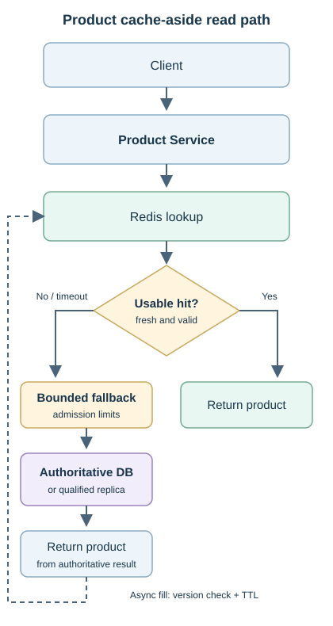
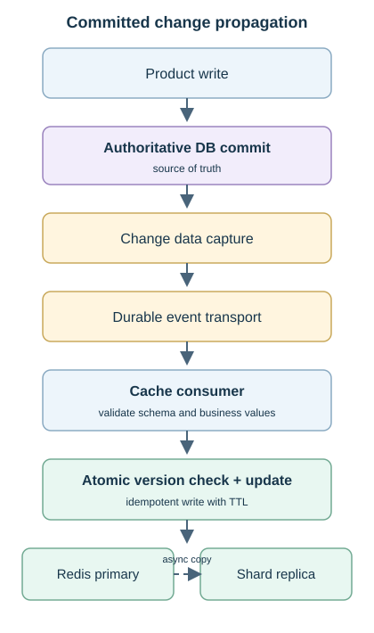
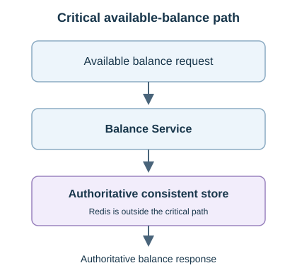
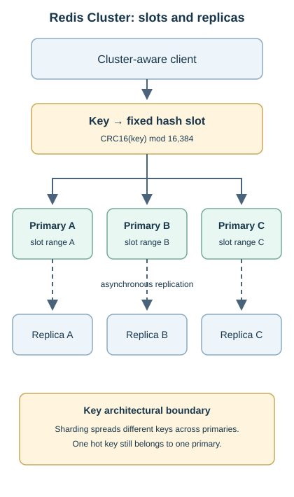
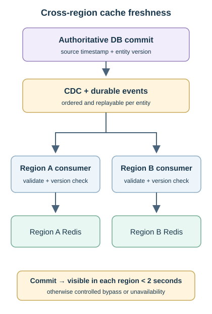

# Topic 6 — Distributed Cache

[Back to Architecture Drills](../README.md)

**Status:** Complete

A multinational bank serves millions of customers through mobile and web banking. Customers repeatedly request the same product catalogue, branch details, interest-rate descriptions and reference data. If every request reaches the database, the bank spends database connections, CPU and I/O reading information that often has not changed. At peak traffic, those repeated reads increase latency and compete with more important database work.

A cache keeps a temporary copy of selected data closer to the application. A cache hit can return a product in milliseconds without repeating the database lookup. That speed comes with a new risk: the copy can be missing, expired or older than the authoritative record. Caching therefore begins with a business question, not a Redis decision: **what happens if this value is stale?**

The accepted design uses Redis for approved product and reference data. Reads use **cache-aside with asynchronous miss population**. Committed product changes follow **database commit → change data capture (CDC) → durable event → cache consumer → version-aware Redis update**. Redis Cluster distributes keys across primary nodes, and replicas support failover. The database remains authoritative throughout.

Redis stays outside the critical available-balance path. If a customer has **$2,000**, spends **$500**, and immediately checks the balance, the service must not return a stale cached $2,000 or use it to authorize more spending. Product data can tolerate an explicitly approved stale window; available balance cannot make that same trade-off.

This chapter records architecture decisions from the completed drill, not evidence of a production implementation. Except for the less-than-two-second cross-region freshness requirement introduced as a constraint mutation, numerical values are teaching exercises. Exact thresholds, owners, recovery objectives and production sign-offs remain implementation decisions.

## Contents

- [Problem & Requirements](#problem--requirements)
- [Cache Fundamentals](#cache-fundamentals)
- [Cache Patterns](#cache-patterns)
- [Final Architecture](#final-architecture)
- [End-to-End Flow](#end-to-end-flow)
- [Component Responsibilities](#component-responsibilities)
- [Data & Consistency](#data--consistency)
- [Scaling](#scaling)
- [Reliability & Failure Modes](#reliability--failure-modes)
- [Security](#security)
- [Observability](#observability)
- [Multi-Region Architecture](#multi-region-architecture)
- [Key Architecture Decisions](#key-architecture-decisions)
- [Constraint Mutations](#constraint-mutations)
- [Adversarial Architecture Review](#adversarial-architecture-review)
- [AI Intersection](#ai-intersection)
- [TPM Delivery](#tpm-delivery)
- [Program Risks](#program-risks)
- [TPM Constraint Mutations](#tpm-constraint-mutations)
- [Production Readiness](#production-readiness)
- [Rollout & Rollback](#rollout--rollback)
- [Concepts Learned](#concepts-learned)
- [Mental Models](#mental-models)

## Problem & Requirements

The representative use case is a Product Service that returns a banking product such as `product:premium-savings`. The product is requested often but changes infrequently. Redis can reduce repeated database work, provided the bank defines how old the cached copy may be and what the service does when Redis or the update pipeline fails.

Cacheability is determined by the consequence of staleness, not by read volume alone.

| Data / requirement | Decision and consequence |
|---|---|
| Product catalogue and branch/reference data | Good cache candidates when the business accepts a defined stale window. |
| Customer profile and transaction history | Conditional. Field sensitivity, authorization, new postings, reversals and freshness must be evaluated separately. |
| Fraud and authorization configuration | Strict freshness and failure policy. A stale rule can change a security or financial decision. |
| Available balance | Read from the authoritative strongly consistent path. Redis is excluded from critical balance reads and decisions. |
| Latency and throughput | Reduce database reads and tail latency without hiding an unsafe database capacity gap. |
| Freshness | Define a limit for each data class. The two-region mutation requires product changes to become visible in less than two seconds. |
| Resilience | Bound cache waiting, database fallback, retries and recovery load so one failure does not cause another. |
| Operability | Measure each shard, replication, CDC/consumer lag, source-to-cache freshness and database impact. |

The goal is not to maximize the hit ratio. It is to improve read performance while preserving a clear authority model, bounded staleness, controlled failure behavior and an operable recovery path.

## Cache Fundamentals

### Cache and authoritative database

A **cache** is a fast, temporary copy of data. The **authoritative database** owns the durable record and resolves disagreement. If Redis says a product rate is 3.0% and the committed database record says 3.2%, the database value is authoritative even if Redis answered faster.

Redis can lose entries through expiration, eviction, restart or failover without losing the product itself. The Product Service can rebuild the cache from the database. This is why Redis is an optimization layer rather than the system of record.

### Hit, miss and hit ratio

- A **cache hit** means Redis returned an entry that the service can use.
- A **cache miss** means the entry was absent, expired, evicted or deliberately invalidated. The service must use a permitted fallback.
- The **hit ratio** is the percentage of lookups served from cache. The **miss ratio** is the remaining percentage.
- **Cache latency** is the time spent obtaining the cached value. A high hit ratio does not compensate for a slow or overloaded cache.

At 20,000 requests per second (RPS) with a 95% hit ratio:

```text
Cache hits = 20,000 × 95% = 19,000 RPS
Cache misses = 20,000 × 5% = 1,000 RPS
```

Those 1,000 misses can still overload a database whose safe spare capacity is lower. At one million RPS, a 99% hit ratio still leaves 10,000 misses per second. Percentages must therefore be translated into absolute database demand.

A hit can also be wrong. Redis may return a value that has not yet received the latest committed update. **Hit ratio measures where a response came from; it does not measure freshness or correctness.**

### TTL, expiration, eviction and invalidation

- **Time to live (TTL)** is the configured lifetime of an entry. When it ends, the entry expires.
- **Eviction** removes data under memory pressure according to a policy, even if its TTL has not ended.
- **Invalidation** deliberately removes an entry because it may no longer be safe to use.
- **Update** replaces the cached value with a newer projection.
- **Stale data** is older than the authoritative state or older than the approved business freshness window.

TTL limits how long an entry resides in cache; it does not automatically prove how recently it matched the database. Delayed events, lagging replicas or duplicate events that reset TTL can all extend the life of an old value. TTL is a safety net, not the primary freshness mechanism in this design.

### Warming, stampedes and negative caching

**Cache warming** loads selected entries before ordinary traffic needs them. It can reduce cold-start misses, but warming must stay within database and cache budgets.

A **cache stampede** occurs when many requests miss the same popular key at once and all query the database. **Request coalescing**, also called single-flight, allows one request or a small bounded group to load the value while the others wait briefly or follow a controlled response path.

**Negative caching** stores a short-lived `NOT_FOUND` result for a key that genuinely does not exist. It prevents repeated invalid requests from reaching the database. It must use a short TTL and must never turn a database error into a false `NOT_FOUND`. If the product is later created, the negative entry should be removed or replaced.

## Cache Patterns

Caching patterns describe which component owns a lookup or write and when the database changes. Several patterns were evaluated; only some are selected.

### Cache-aside — selected for reads

The application checks Redis first. On a miss, the Product Service reads the database and populates Redis.

```text
Product Service → Redis
    HIT  → return product
    MISS → database → return product → populate Redis
```

The service owns miss handling and fallback policy. This keeps the database visible to the application and works with ordinary Redis, but it adds application logic. Concurrent misses can produce duplicate database reads, and a delayed fill can overwrite a newer event-driven update unless both paths use version checks.

The accepted refinement returns the authoritative result to the client and populates Redis **asynchronously**. That avoids adding the cache write to response latency. The trade-off is a short window in which another request may miss, so hot keys need request coalescing and bounded database concurrency.

### Read-through — comparison only

The application asks a cache abstraction for the product. On a miss, that abstraction loads the database and returns the value. The application sees less cache-specific code, but the loader, database credentials, failure policy and observability move into the abstraction. Redis by itself is not a read-through database integration.

This pattern was discussed but not selected for the documented Product Service.

### Write-through — comparison only

A write-through layer updates the cache and backing database synchronously before success is returned. It can make subsequent reads warm, but it places both systems in the write path and still needs a clear answer when one succeeds and the other fails. It does not automatically create an atomic transaction across the database and Redis.

### Write-behind / write-back — rejected for financial authority

The cache accepts a write, returns success, and persists to the database later. This can absorb bursts and reduce write latency, but a cache failure can lose an acknowledged change before the authoritative store receives it.

That risk is unacceptable for balances, ledger entries and other authoritative financial state. The selected product architecture commits to the database first; the later Redis update is a derived projection. **Database-first asynchronous propagation is not write-behind.**

### Event update, invalidation and refresh-ahead

After a committed database change, a consumer can either:

- **Update** Redis when the event contains a complete, trusted projection.
- **Invalidate** Redis when the cached object is derived or the event cannot safely reconstruct it. The next read then reloads it.
- **Refresh ahead** shortly before expected expiry for a proven hot key, within source-load limits.

For the product-rate example, direct version-aware update is selected because the event can carry the complete projection. Invalidation remains a valid fallback for complex or uncertain representations.

### Selected combination

The final design combines two independent mechanisms:

1. **Cache-aside with asynchronous population** handles misses, evictions, expirations and cold starts.
2. **CDC-driven event updates** propagate committed product changes without requiring the Product Service process to survive after the database commit.

TTL provides a final bound on entry residence if the event path fails. It does not replace either mechanism.

## Final Architecture

The concepts above lead to three clear boundaries: an approved product read path, an asynchronous committed-change path and a separate authoritative balance path.

### Product read path



[Open the scalable product read-path diagram](assets/product-read-path.svg)

The Product Service uses a cluster-aware Redis client. A value is a usable hit only if its schema and freshness evidence are acceptable. A miss or cache timeout enters a controlled database fallback. The database result can be returned before the asynchronous Redis population completes.

### Committed change propagation



[Open the scalable change-propagation diagram](assets/committed-change-propagation.svg)

The cache consumer, not Redis Cluster, subscribes to change events. It validates the event, rejects an older version, and updates the Redis primary with a TTL. Redis then copies the shard state asynchronously to its replica.

### Critical balance boundary



[Open the scalable balance-boundary diagram](assets/critical-balance-boundary.svg)

The available-balance request continues to the authoritative consistent store. If a $500 debit commits against a $2,000 balance, the next qualifying read must return $1,500. A stale Redis value is not used to authorize spending. A prior balance read is also not a reservation of funds; the transactional decision still belongs to the authoritative financial system.

## End-to-End Flow

### Product read: cache hit

1. The client requests `product:premium-savings`.
2. Product Service derives a stable cache key and asks its cluster-aware Redis client.
3. The key maps to a fixed hash slot and then to the primary that owns that slot.
4. Redis returns the cached product and source version.
5. Product Service accepts it only if the schema and freshness policy permit its use, then returns it to the client.

### Product read: cache miss

1. Redis returns no entry, or the service treats the entry as unusable.
2. Product Service enters a bounded fallback path. Concurrency and database admission limits apply before the query begins.
3. The database or a freshness-qualified database read replica returns the authoritative product and its version.
4. Product Service returns the result to the client.
5. A background task conditionally writes the value to Redis with a TTL. If a newer version is already present, the older fill is rejected.
6. If the background write fails, the product remains safe in the database. A later request may miss again.

### Product change: interest rate update

Assume the interest rate for the same product changes from 3.0% at version 41 to 3.2% at version 42.

1. Product Service validates the business change and commits version 42 to the authoritative database.
2. CDC reads the committed database log position. It does not depend on the application completing a separate best-effort Redis call.
3. Durable event transport publishes the change to the cache-consumer stream.
4. The cache consumer validates the producer, schema, product ID, rate value and source version.
5. The consumer atomically checks the cached version and replaces version 41 with version 42.
6. Redis asynchronously copies the shard to its replica. Regional consumers perform the equivalent update in their own regions when multi-region operation is enabled.
7. Monitoring measures database-commit time to cache-visible time. The consumer advances its durable checkpoint only after successful processing.

If the consumer crashes after writing but before acknowledging, the event may be delivered again. The version-aware update is idempotent, so applying version 42 twice has no additional effect. If version 43 arrives before delayed version 42, the consumer rejects version 42 rather than overwriting newer state.

## Component Responsibilities

| Component | Responsibility / boundary |
|---|---|
| Product Service | Own business writes, cache reads, miss handling, controlled fallback and asynchronous fills. It must not treat Redis as authoritative. |
| Authoritative database | Store durable committed product state and source versions. Resolve disagreement and support cache reconstruction. |
| Database read replica | Offload eligible reads only when measured lag fits the product freshness budget. It is a copy of database state, not a Redis replica. |
| Change data capture | Capture committed changes from a recoverable source position within log retention. |
| Event transport | Provide durable delivery, replay, ordering scope, retention and backpressure. |
| Cache consumer | Validate events; apply idempotent, version-guarded cache updates, invalidations and tombstones; own retry and DLQ handling. |
| Cluster-aware Redis client | Map key → hash slot → current owner; refresh topology and handle redirects. |
| Redis primary | Own one part of the cache keyspace and accept writes for its slots. It is not the product system of record. |
| Redis replica | Asynchronously copy one Redis primary's shard for failover and permitted read offload. It is distinct from a database read replica. |
| SRE / operations | Detect degradation, enforce fallback limits, reconcile state, execute recovery and maintain runbooks and ownership. |

## Data & Consistency

### Why cached data becomes stale

The database and Redis are separate systems. A database commit and a Redis update are not one atomic transaction. After version 42 commits, Redis can still hold version 41 while CDC captures the change, the event waits, or the consumer recovers. That interval is bounded eventual consistency only when the complete path is measured and controlled.

### TTL versus event-driven update

Waiting only for TTL means a product can remain stale until its entry expires. Event-driven update normally propagates the change sooner. TTL remains useful when an event is missed, a consumer is unavailable or an entry escapes ordinary repair.

The two mechanisms answer different questions:

- **Event update:** how does a known committed change reach Redis quickly?
- **TTL:** how long may an entry remain resident if ordinary propagation fails?

Neither proves freshness by itself. A consumer that repeatedly writes an old value and resets its TTL can keep the value stale.

### Ordering, duplication, replay and recovery

The event contract carries a stable product ID, source version or sequence, operation, schema version and either a complete projection or a reload instruction.

- **Duplicate event:** version 42 is applied twice; the second application changes nothing.
- **Out-of-order event:** version 43 is already cached; delayed version 42 is rejected.
- **Consumer crash:** durable delivery retries from the last safely processed checkpoint.
- **Missed or poison event:** retry is bounded; invalid events enter an owned dead-letter queue (DLQ); operators investigate and replay or reconstruct from the database.
- **Deletion:** a versioned tombstone or equivalent fence prevents a delayed fill from resurrecting a deleted product.

### The stale-fill race

A read miss can obtain version 41 just before CDC installs version 42. The asynchronous miss population must use the same version guard as the event consumer; otherwise, its delayed write could replace version 42 with version 41.

Eviction, expiry and failover can remove the cached version fence. Comparison alone is then insufficient. The implementation must bound fill and replay age and re-read the source or preserve an appropriate durable fence before accepting uncertain state. These are design requirements, not guarantees supplied automatically by a plain Redis `SET`.

### Authority and business consequence

Product display can accept a documented stale window when the business consequence is understood. A price or rate used to execute a transaction may require authoritative validation at commit time even if the catalogue display was cached. Available balance remains on its strongly consistent path because a stale value can affect another spending decision.

## Scaling

### Why one cache node is not enough

A single Redis node has finite memory, CPU, network bandwidth and connection capacity. Adding replicas can improve read capacity and availability, but one primary still owns the entire writable keyspace. When the total product catalogue or aggregate traffic exceeds one primary's measured capacity, the keyspace must be partitioned.

### Sharding versus replication

- **Sharding** divides different keys across primary nodes. It increases aggregate memory and throughput.
- **Replication** copies one primary's keys to another node. It supports failover and optional read offload but does not divide primary writes.

For example, `product:checking`, `product:savings` and `product:mortgage` may map to different primaries. One individual key normally belongs to one primary, so a single extremely popular product can still create a hot key and hot shard.

### Redis Cluster and hash slots

Redis Cluster uses **16,384 fixed hash slots**. Conceptually:

```text
slot = CRC16(key) mod 16,384
key → slot → primary that currently owns the slot
```

The key-to-slot result remains stable while slot ownership can move during rebalancing. This differs from classic consistent hashing and from `hash(key) % node_count`, where changing the node count remaps many keys.



[Open the scalable Redis Cluster diagram](assets/redis-cluster-slots.svg)

Each primary owns a set of slots and normally has at least one replica. A cluster-aware client learns the slot map and follows topology changes. Multi-key operations cannot be assumed atomic across slots. Hash tags can colocate carefully chosen related keys, but excessive colocation creates a hot slot.

### Primary failure and replica lag

If Primary B fails, the cluster detects the failure and can promote an eligible Replica B. Clients refresh topology and route B's slots to the new primary. Redis replication is asynchronous, so the promoted replica may be behind. A recent cache update can be absent after promotion.

That is recoverable for product cache data because the database remains authoritative and CDC replay, invalidation or a later miss can rebuild the entry. It would be dangerous if Redis were treated as the financial system of record. Restored availability does not prove restored freshness.

### Rebalancing, hot keys and memory pressure

Rebalancing moves slots between primaries when load is uneven or nodes change. It can relieve an overloaded shard only when other nodes have spare capacity and the load comes from multiple movable keys. It cannot split one hot key or create aggregate capacity.

For a proven hot key, use a measured combination of request coalescing, refresh-ahead, safe local caching, eligible replica reads, admission control or deliberate duplication with explicit update semantics. Each option adds a freshness or operational trade-off.

When Redis reaches its configured memory limit, the eviction policy determines which keys can be removed:

- **allkeys-LRU** favors recently used keys.
- **allkeys-LFU** favors frequently used keys and can suit skewed demand.
- **volatile** variants consider only keys with TTLs.
- **volatile-TTL** prefers entries nearer expiry; it is a separate policy, not LRU plus TTL.
- **noeviction** rejects writes at the limit and may be appropriate only when that behavior is explicitly designed.

Redis uses approximate LRU/LFU algorithms. Choose the policy from workload evidence, reserve headroom for replication and overhead, and alert before exhaustion. [Redis eviction policies](https://redis.io/docs/latest/develop/reference/eviction/).

## Reliability & Failure Modes

### Cache stampede and database protection

Assume a popular product receives thousands of requests per second and its entry expires:

1. The first requests find no cached value.
2. Without coordination, every Product Service instance queries the database for the same row.
3. Database connections fill, latency rises and requests time out.
4. Independent retries add more load.
5. A cache expiry becomes a database incident.

The selected protection is request coalescing or a short leased refresh lock, bounded waiting and a global database concurrency budget. TTL jitter spreads expirations so many keys do not expire at the same moment. Refresh-ahead is an additional option for proven hot keys. Retry ownership, attempts and total time remain bounded.

**Backpressure** slows, limits or rejects work when downstream capacity is exhausted. A **circuit breaker** stops repeated calls to a dependency that is failing or too slow and allows limited recovery probes. These controls prevent an unavailable cache from redirecting unlimited traffic to the database.

### Failure scenarios

| Failure sequence | Customer impact, detection, containment and recovery |
|---|---|
| Redis node or one primary fails | Requests for affected slots may time out or fail during detection and promotion. Monitor node health, slot coverage, redirects and failover duration. Refresh client topology, contain affected traffic, then verify replica lag and rebuild uncertain entries. Do not claim freshness merely because traffic resumes. |
| Redis is unavailable | Product reads miss their fast path. Use a short cache timeout and breaker, then admit only the database traffic proven safe. Prioritize or shed lower-value reads when the fallback budget is full. Recover Redis gradually to avoid a warming storm. |
| Cache miss storm / avalanche | Many requests or many expired keys reach the database together. Detect miss rate, fallback concurrency, DB latency and pool saturation. Use coalescing, TTL jitter, bounded concurrency and gradual warming. |
| Cache penetration | Repeated nonexistent keys bypass Redis. Validate input, rate-limit abusive traffic and use short negative caching for confirmed `NOT_FOUND`; invalidate or replace when the product is created. |
| Hot key or hot shard | One node shows high CPU, network or latency despite a healthy cluster-wide average. Identify per-key/slot demand, reduce or fan out safe reads and rebalance movable slots. One hot key is not solved by ordinary sharding. |
| Memory exhaustion | Evictions rise or writes fail according to policy. Monitor headroom, key sizes, fragmentation, evictions and expirations. Correct capacity, TTL or key-shape problems; warm recovered capacity under a budget. |
| CDC interruption or consumer lag | Database changes commit while Redis continues serving older products. Detect capture position, backlog, oldest unprocessed event and commit-to-visible age. Bypass affected data when freshness breaches policy, repair capture/consumer state, replay in order and verify before normal service resumes. |
| Duplicate or out-of-order event | A naive consumer may repeat work or overwrite a newer value. Detect version regressions and processing anomalies. Idempotent conditional updates reject duplicates and older versions; DLQ/replay handles invalid events. |
| Database unavailable | Cache may still contain products, but only entries inside the approved freshness and failure policy may be served. Otherwise return controlled unavailability. Redis does not become authoritative because the database is down. |
| Network partition / competing ownership | Topology may lose coverage or quorum and clients may see redirects or failure. Use Redis Cluster's failover rules; do not manually admit competing primaries. Reconcile cache state from database/events after recovery. |
| Region failure or cross-region delay | One region may stop updating or serving its cache. Route only according to approved regional capacity and data policy, monitor source-to-visible age independently, and rebuild from durable positions or the authoritative source. Asynchronous propagation does not provide strong consistency. |

Redis can stop serving more broadly when slot coverage or quorum is lost. Degrading only affected slots is desirable where the selected configuration and client behavior permit it, but it is not automatic. The exact behavior must be proven through failure testing. [Redis Cluster availability](https://redis.io/docs/latest/operate/oss_and_stack/management/scaling/).

Fallback limits apply across the **whole database fleet**, not independently per application instance. Database read replicas need their own lag and capacity limits. Recovery traffic, cache warming and replay are also production load and require budgets.

## Security

Redis is an internal dependency, not a trusted open store.

- Use TLS in transit, authenticated workload identity, network isolation and managed secret rotation.
- Grant least-privilege ACLs by workload and key namespace. Only approved service fill paths and cache consumers may write product entries.
- Separate administrative access from runtime access and audit privileged changes.
- Validate event origin, schema, key construction, tenant boundary and business values before updating Redis.
- Minimize sensitive data. Apply field-level eligibility to customer information and avoid caching secrets or data without a justified retention and access model.
- Secure persistence, snapshots and backups when enabled; redact logs and enforce regional residency requirements.
- Treat malformed events and unauthorized writes as possible cache poisoning, contain the writer and rebuild affected data from the authoritative source.

Security-sensitive or fraud configuration also needs an explicit fail-open/fail-closed decision. A valid Redis connection does not make a stale authorization rule safe.

## Observability

| Signal | What it reveals |
|---|---|
| Hit/miss ratio by tier, shard and key class; absolute request rate | Cache effectiveness and actual database demand. |
| Redis p50/p95/p99, errors, timeouts and connection utilization | Whether the fast path is actually fast and reachable. |
| CPU, network and operations per node, slot and hot key | Load concentration hidden by cluster-wide averages. |
| Memory/headroom, fragmentation, key size, evictions and expirations | Capacity pressure versus normal TTL behavior. |
| Replication lag, slot coverage, failover duration and redirects | Recovery gaps, stale-replica risk and routing instability. |
| CDC source position, backlog, oldest unprocessed event, failures and DLQ | Whether committed changes are moving through the pipeline. |
| Database commit-to-cache-visible time by region | Business freshness, independent of hit ratio. |
| Database/read-replica latency, lag, pools, saturation and fallback rejections | Whether cache degradation is becoming a database incident. |
| Sampled database-versus-cache version comparison | Evidence of divergence that ordinary infrastructure metrics may miss. |

Use CDC heartbeats or source watermarks to distinguish an idle product stream from a broken pipeline. “No product changes recently” is not the same as “the consumer is healthy.” Alerts need owners, thresholds and runbooks. A 99% hit ratio can coexist with stale values, a hot shard or an unsafe fallback path.

## Multi-Region Architecture

The two-region mutation keeps one clear authority model: the database owns committed product state; CDC and durable events distribute changes; each region has a consumer that applies version-aware updates to its regional Redis cluster.



[Open the scalable cross-region freshness diagram](assets/cross-region-freshness.svg)

The requirement is for a committed product change to become visible in each region in **less than two seconds**. That budget includes capture, transport, queueing, consumer processing, Redis apply time and any replica or local-cache delay. Each region measures the path independently.

This is a requirement to validate, not a claim that the design has already achieved it. TTL alone cannot satisfy it. If a region's freshness is unknown or outside the bound, the service may use a freshness-qualified source under admission limits. If no source can meet the requirement, the safe result is controlled unavailability.

Regional recovery begins from a durable event position or authoritative reload. Per-entity versions prevent an older regional event from replacing a newer value. Rebuilding is gradual so the source database and recovered cache are not overwhelmed. A network partition cannot guarantee both fresh reads and uninterrupted regional availability; the business and data-residency policy determines which operations continue.

## Key Architecture Decisions

| Decision / disposition | Why and trade-off |
|---|---|
| **Accepted:** cache only approved data classes | Product/reference data can have bounded staleness; available balance remains authoritative. Eligibility needs field-level review for customer and security data. |
| **Accepted:** cache-aside reads | Product Service controls source access and fallback. The cost is explicit miss and race handling. |
| **Accepted:** asynchronous miss population | The client need not wait for a Redis write. Concurrent misses and stale-fill races require coalescing and version guards. |
| **Accepted:** CDC-driven cache updates | Propagation follows the committed database log and survives an application crash after commit, provided capture/replay remains recoverable. |
| **Refined:** update instead of invalidation-only | A complete validated product event can replace the value directly. Complex or uncertain projections should be invalidated and reloaded. |
| **Accepted:** bounded eventual consistency | Suitable for approved product/reference views, not for critical available-balance decisions. |
| **Accepted:** versions, idempotency and TTL | Handle reordering, duplicates and missed propagation. They do not make database and Redis one transaction. |
| **Accepted:** Redis Cluster primaries plus replicas | Sharding adds aggregate capacity; replication adds resilience and optional read offload, with lag risk. |
| **Rejected:** arbitrary database/cache dual writes | Database success plus cache failure leaves stale state; cache success plus database failure can expose uncommitted state. |
| **Rejected:** write-behind financial authority | Acknowledging before database persistence can lose an accepted financial change. |
| **Rejected:** TTL removal | A lost or delayed event could leave an entry stale indefinitely. |
| **Rejected:** unlimited database bypass | A cache outage could become a database outage. Fallback must be admitted and bounded. |
| **Rejected:** AI routing or consistency authority | Key placement and correctness decisions remain deterministic and auditable. |

## Constraint Mutations

| Changed constraint | Accepted response / correction |
|---|---|
| **10× traffic; no new Redis nodes for 30 days** | Diagnose and rebalance uneven slots, then reduce demand through safe local caching, coalescing, refresh-ahead, bounded replica reads, rate limits and degradation. Rebalancing cannot create aggregate capacity or split one hot key. |
| Primary fails with its replica behind | Promote according to cluster rules, refresh topology, contain stale reads and replay/reload. Availability is not freshness. |
| Entire cache fails while DB is already busy | Enforce shared DB budgets, prioritize work and shed excess. Never redirect the whole cache load blindly. |
| Business demands zero stale data | Revisit the authoritative read architecture. Shorter TTL or faster CDC does not prove strong consistency. |
| **Two regions; freshness under two seconds** | Use regional consumers and caches, measure complete source-to-visible latency, and bypass or return controlled unavailability when freshness cannot be established. |

## Adversarial Architecture Review

| Challenge | Outcome retained |
|---|---|
| Why use Redis at all? | Keep it only where measured latency or database-load reduction justifies its operational cost. Small, stable data may need only local caching. |
| Why not use highly available Redis for balances? | Speed and replication do not eliminate stale-state risk. The authoritative balance path is retained. |
| Why not update Redis directly from Product Service after the DB commit? | A process can crash after commit and before its best-effort task runs. Recoverable CDC follows what actually committed. |
| Why not invalidate every changed product? | Invalidation is safe for uncertain projections, but a complete validated event can update directly and avoid the next database miss. |
| Can TTL be removed after CDC is introduced? | No. Capture, transport and consumers can fail; TTL remains a safety net. |
| Does Redis Cluster solve a hot key or 10× aggregate traffic? | It spreads different keys. One hot key remains on one primary, and fixed nodes still have a capacity ceiling. |
| What if the cache is empty or wrong? | Admit source reload under a budget, reject unsafe state and reconstruct from the database. Test both cases. |
| Are we hiding an under-scaled database? | Prove database capacity for expected misses, outage fallback and recovery. Cache success does not excuse an untested source path. |

## AI Intersection

The accepted use is asynchronous demand prediction:

```text
Traffic and cache telemetry
    → asynchronous prediction of likely hot products
    → deterministic validation and capacity checks
    → bounded prewarming or refresh-ahead
```

Prediction can reduce avoidable misses before a known traffic spike; it does not create Redis or database capacity. Measure useful warmed hits against wasted work and stop if prewarming increases pressure.

AI does not select Redis shards, assign hash slots, decide whether stale data is safe or participate in synchronous balance/payment decisions. Redis retains deterministic key → slot → owner routing. Human-approved policies and deterministic controls own correctness, budgets and stop conditions.

## TPM Delivery

The Staff TPM converts the architecture into outcome-based workstreams, dependencies, evidence and named decisions.

| Workstream | Teams / dependencies | Completion evidence |
|---|---|---|
| Application and API integration | Product/API teams; eligibility and data contracts | Cache hit/miss, authorization, controlled fallback and client behavior demonstrated. |
| Caching platform | Redis/platform engineering; networking and capacity | Topology, slots, replicas, client routing, memory policy, failover and scaling evidence. |
| Data and events | Database engineering, CDC and event teams | Schema/version contract, recoverable capture, idempotent consumers, replay and freshness measurement. |
| Security and privacy | Security, IAM, platform and data owners | TLS, workload identity, ACLs, network isolation, data eligibility and InfoSec approval. |
| Reliability and observability | SRE, database and platform teams | Dashboards, alerts, shared fallback budgets, runbooks, failure exercises and operational ownership. |
| Performance and resilience testing | Application, platform, database, QA | Peak load, hot key, stampede, eviction, cache outage, DB protection and regional-delay evidence. |
| Release and handover | Release management, SRE, support, TPM | Phased rollout, rollback rehearsal, L1/L2/L3 walkthrough, MOR and Go/No-Go evidence. |

### Dependencies and critical path

1. Agree which fields are cacheable and define freshness/failure contracts.
2. Establish Redis platform, client and security foundations.
3. Integrate cache-aside behavior and the versioned CDC/event consumer.
4. Instrument source-to-visible freshness and shared database fallback limits.
5. Complete performance, failure, security and operational-readiness gates.
6. Pilot one representative product cohort before progressive adoption.

Contracts, test design, security review, telemetry and runbooks can begin in parallel. Production integration, certification and cutover remain gated by platform and CDC readiness. Mandatory security, correctness, resilience and rollback evidence does not move after launch because the schedule is compressed.

## Program Risks

| Risk / owner function | Mitigation → trigger → contingency |
|---|---|
| Operational readiness gap / SRE + TPM | Complete alerts, runbooks, RACI and rehearsal → support cannot diagnose or recover → delay the pilot. |
| Security readiness gap / Security + Platform | Validate ACLs, identity, isolation and approvals early → controls incomplete → block the affected cohort. |
| Recovery target missed / Platform + SRE | Test failover, freshness, replay and fallback capacity → agreed recovery or SLO breached → postpone cutover, repair and retest. |
| Cache outage overwhelms database / Database + Application | Establish shared admission budgets and outage tests → fallback saturation or rejection exceeds policy → shed non-critical reads and pause rollout. |
| CDC lag violates product freshness / Data + Events | Measure commit-to-visible age and rehearse replay → age breaches the contract → bypass affected data under limits and recover the pipeline. |
| Hot key or memory pressure / Cache Platform | Load-test skew, headroom and eviction policy → node-level saturation or sustained eviction → reduce demand, rebalance movable slots and add capacity when permitted. |

Probability was not scored in the drill. Record named owners, due dates, triggers, evidence and residual-risk decisions rather than inventing ratings or treating “monitor closely” as mitigation.

## TPM Constraint Mutations

These are delivery consequences of the architecture, not claims that the scenarios have been implemented.

| Constraint | Delivery response |
|---|---|
| Shorter schedule or platform delay | Prioritize one product cohort and parallelize contracts, consumer preparation, testing and operations. Preserve security, correctness, resilience and rollback gates. |
| Cache-outage test overwhelms DB | No-Go until shared admission, degradation and fallback behavior are repaired and retested. |
| Two-second regional requirement arrives late | Add regional consumers, source-to-visible measurement, partition and rebuild tests; rebaseline scope and dependencies. |
| Business requires all services to use Redis | Reject blanket adoption. Each data class must pass cacheability, correctness, security and failure analysis. |

## Production Readiness

These are required gates, **not claims of passed tests or completed sign-offs**. Each gate needs objective criteria, a named owner, evidence and approval.

| Gate | Evidence before Go |
|---|---|
| Contracts and correctness | Unit/component and end-to-end tests for cache eligibility, hit/miss behavior, async fill races, duplicates, ordering, deletion, negative caching and malformed events. |
| Freshness | Measured CDC/consumer/replica lag, source-to-cache visibility and two-region propagation under the required bound; stalled-pipeline containment. |
| Performance and capacity | Redis and DB p95/p99, headroom, connections, eviction behavior, hot keys, cold starts, peak load and the fixed-node 10× demand strategy. |
| Resilience and DB protection | Node/cluster/network failure, replica promotion, stampede/avalanche, circuit breaker, shared fallback budgets, replay and gradual recovery. |
| Security and privacy | Workload identity, ACLs, TLS, network isolation, data eligibility, sensitive-data handling and InfoSec approval. |
| Multi-region | Independent freshness measurement, partition behavior, regional capacity, durable replay/rebuild and residency decisions. |
| Operations and release | Dashboards, actionable alerts, L1/L2/L3 walkthrough, SRE ownership, runbooks, rollback rehearsal, mandatory operational requirements (MOR) and final Go/No-Go. |

Expected lag or occasional eviction is not automatically a blocker; exceeding an agreed freshness, capacity or recovery limit is. Unobservable propagation, uncontrolled database fallback, incomplete security, failed resilience tests or missing operational ownership block launch.

## Rollout & Rollback

Use **lower environment → representative product pilot → canary → limited cohort → progressive adoption**. At every step compare cache latency and freshness with database load, customer errors, shard health and fallback demand.

Rollback is more than reverting application code:

- Pause expansion and disable the affected cache-read path when latency, errors or freshness breach the gate.
- Keep database admission limits active; bypass does not create database capacity.
- Stop a bad cache writer before invalidating poisoned entries.
- Revert compatible consumer/configuration changes while preserving durable replay positions.
- Rebuild gradually from authoritative data and verify versions and freshness before normal reads resume.
- Never roll back database truth to match stale Redis.

The former application path and data contracts must remain compatible for the rollback window. If database fallback cannot safely carry the cohort, reduce or reject non-critical product traffic rather than causing a wider outage.

## Concepts Learned

| Concept | Working meaning / correction |
|---|---|
| Cache / authoritative store | Temporary fast copy / durable owner that resolves disagreement. |
| Hit / miss | Usable cached entry found / entry absent or unusable. A hit can still be stale. |
| Hit ratio / miss ratio | Share served from cache / share requiring another path; translate both into absolute RPS. |
| Expiration / eviction / invalidation | TTL elapsed / memory policy removed data / explicit removal after change or uncertainty. |
| Cache warming | Load selected data before ordinary demand; source load still needs a budget. |
| Cache-aside / read-through | Application handles misses / cache abstraction owns the loader. |
| Write-through / write-behind | Synchronous cache-and-store path / cache accepts before later persistence. Neither is the selected product-write design. |
| Source of truth / eventual consistency | Authority over state / permitted temporary disagreement with derived copies. |
| Node / primary / replica / shard | Redis process / writable slot owner / copy of one shard / partition of the keyspace. |
| Database replica / Redis replica | Copy of authoritative database state / copy of disposable cache state. Their risks and read policies differ. |
| Consistent hashing / Redis slots | Ring-based key placement / fixed key-to-slot mapping with movable slot ownership. |
| Stampede / avalanche / penetration | Many requests miss one key / many keys miss together / nonexistent keys repeatedly reach the source. |
| Coalescing / backpressure | Share one in-flight load / limit work before downstream capacity collapses. |
| Idempotency / versioning | Duplicate application has no extra effect / older state cannot replace newer state while the guard exists. |
| Failover / freshness | Restored serving / sufficiently current data; one does not prove the other. |

## Mental Models

- Cacheability follows the **consequence of staleness**, not read volume alone.
- **The database owns truth; Redis accelerates approved reads.**
- A hit ratio is a traffic measure, not a freshness or fallback-capacity guarantee.
- Cache-aside handles misses; CDC propagates committed changes; TTL is a safety net.
- Async population reduces response waiting but needs coalescing, bounded concurrency and stale-fill protection.
- Redis atomicity does not create database-to-cache atomicity.
- Sharding divides keys; replication copies a shard; one hot key is not automatically divided.
- Redis and database replicas solve different problems and can both lag.
- Cache outage must not become database outage; fallback, warming and replay all consume capacity.
- Cross-region asynchronous updates require measured freshness and explicit partition behavior.
- AI predicts demand asynchronously; deterministic controls own placement, correctness and runtime budgets.
- Production readiness requires evidence that people can detect, contain, repair and roll back failures.

---

**Design basis:** completed Topic 6 Distributed Cache drill, including accepted, refined and rejected proposals; failure analysis; constraint mutations; AI boundary; and TPM delivery. The database remains authoritative, Redis remains outside the critical available-balance path, and implementation safeguards are requirements rather than claims of production certification. Previous: [Topic 5 — Service Mesh + Service Discovery](../05-service-mesh-service-discovery/README.md). Next: [Topic 7 — Kafka + Event-Driven Architecture](../07-kafka-event-driven-architecture/README.md).
