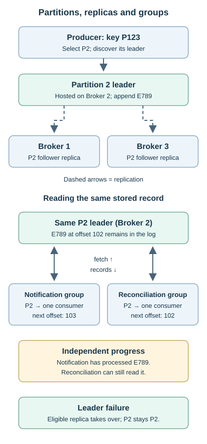
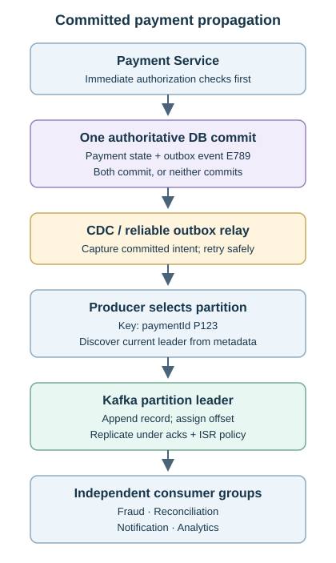
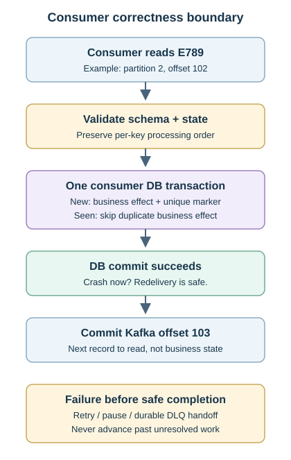
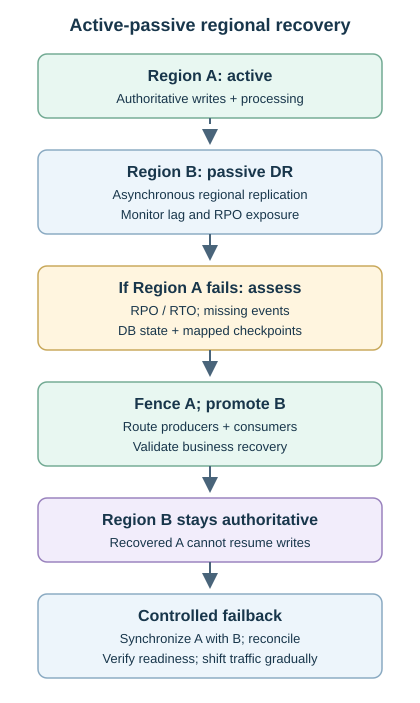

# Topic 7 — Kafka + Event-Driven Architecture

[Back to Architecture Drills](../README.md)

**Status:** Complete

A customer has completed a **CAD $500 payment**, identified as `P123`. The bank must now notify the customer, update reconciliation records, make the payment available to fraud monitoring and feed analytics. If Payment Service calls all four services synchronously, a Notification outage can cause a timeout after the money has already moved. Analytics taking several seconds can delay the response even though the payment itself succeeded.

A completed payment should not be reversed merely because its notification could not be delivered. The bank needs a way to preserve the completion fact and let each downstream service act independently. This is the problem that asynchronous event-driven architecture addresses. Kafka provides the durable event log used in this chapter; the payment database remains the authoritative owner of payment state.

The chapter follows that payment from publication through consumption, failure and recovery. It preserves the completed 17-stage drill's decisions. Numerical exercises illustrate constraints rather than validated production capacity; service-level objectives (SLOs), recovery targets, owners and sign-offs still require implementation evidence.

## Contents

- [Problem & Requirements](#problem--requirements)
- [Why Event-Driven Architecture](#why-event-driven-architecture)
- [Event-Driven Patterns](#event-driven-patterns)
- [Kafka Fundamentals](#kafka-fundamentals)
- [Final Architecture](#final-architecture)
- [End-to-End Flow](#end-to-end-flow)
- [Component Responsibilities](#component-responsibilities)
- [Transactional Outbox and CDC](#transactional-outbox-and-cdc)
- [Delivery Semantics and Consumer Idempotency](#delivery-semantics-and-consumer-idempotency)
- [Data & Consistency](#data--consistency)
- [Partitioning and Ordering](#partitioning-and-ordering)
- [Retries, DLQ and Replay](#retries-dlq-and-replay)
- [Scaling](#scaling)
- [Reliability & Failure Modes](#reliability--failure-modes)
- [Multi-Region Disaster Recovery](#multi-region-disaster-recovery)
- [Security](#security)
- [Observability](#observability)
- [Key Architecture Decisions](#key-architecture-decisions)
- [Constraint Mutations](#constraint-mutations)
- [Adversarial Architecture Review](#adversarial-architecture-review)
- [AI Intersection](#ai-intersection)
- [TPM Delivery](#tpm-delivery)
- [Program Risks](#program-risks)
- [TPM Constraint Mutations](#tpm-constraint-mutations)
- [Production Readiness](#production-readiness)
- [Rollout & Rollback](#rollout--rollback)
- [Concepts Learned](#concepts-learned)
- [Mental Models](#mental-models)

## Problem & Requirements

The first decision is which work must finish before a payment can be accepted. Authorization, required fraud decisions, current foreign-exchange (FX) rates and authoritative balance checks belong before completion. Customer notification, reconciliation, analytics and appropriate post-transaction monitoring can react afterward.

This boundary prevents downstream slowness from becoming payment-request slowness. It does not make downstream work optional: reconciliation still needs a deadline, a recovery path and an accountable owner.

| Requirement | Decision and consequence |
|---|---|
| Immediate payment decisions | Keep required authorization, Fraud, FX and balance checks synchronous, with explicit timeout and failure policies. |
| Completed-payment fan-out | Publish one business fact; independent consumer groups perform their own work. |
| Ordering | Preserve one payment's lifecycle using `paymentId`; do not promise global ordering. |
| Financial effects | Accept redelivery but prevent duplicate business effects with durable consumer idempotency. |
| Consumer outages | Buffer retained events and recover within retention and business lag limits. |
| Contracts and ownership | Payment owns the integration contract; each consumer owns its local state. |
| Regional recovery | Use active-passive disaster recovery (DR), explicit loss/time objectives and controlled failback. |
| Operability | Observe infrastructure, consumer progress and business completion separately. |

Kafka does not replace the payment database or make an uncertain payment successful. A delayed consumer is a downstream processing problem; a later settlement rejection is a new business outcome handled through an authorized compensating workflow.

## Why Event-Driven Architecture

An **event** records a fact that has happened: `PaymentCompleted` says that payment `P123` completed for CAD $500. In an **event-driven architecture**, interested services react to that fact without the originating service calling each of them and waiting for a response.

Payment publishes the fact once. Notification uses it to send a message; Reconciliation updates its records; Fraud monitoring evaluates it; Analytics incorporates it into reports. Each service can recover independently if it is temporarily unavailable. This is **fan-out**, and it also provides temporal decoupling: producer and consumer need not be available at the same moment.

The cost is temporary disagreement between systems, more complex tracing, and explicit handling of duplicates, ordering and backlog. Kafka is useful when durable fan-out and replay justify that cost. A request for the current FX rate or available balance normally needs an immediate authoritative answer, so inserting an event round trip adds unnecessary coordination.

### Event-Driven Patterns

| Pattern | Meaning in the payment example |
|---|---|
| Command / event | `AuthorizePayment` requests an action and may be rejected; `PaymentAuthorized` records a completed fact. |
| Domain / integration event | An internal Payment fact is mapped to a stable external contract; consumers should not depend on Payment's entire internal model. |
| Publish-subscribe / competing consumers | Different groups independently read the same events; workers inside one group divide that group's work. |
| Local transactions + compensation | Each service owns its database. Later failure produces a new correcting action rather than one transaction spanning every service. |
| Outbox + CDC / replay | Durably capture publication intent / reread original retained facts. Their failure boundaries are explained below. |

Payment owns the meaning and evolution of its integration event. An internal field rename can be hidden by the boundary mapper; a change in business meaning requires contract evolution. Fraud-specific `riskScore` belongs in a Fraud-owned event such as `FraudAssessmentCompleted`, rather than automatically expanding `PaymentCompleted`.

## Kafka Fundamentals

Kafka stores records in a durable, partitioned log. A **producer** is the application or connector that writes records; a **consumer** is an application that fetches them and performs business work. In the accepted design, Payment creates the event intent and a separate publication component sends it to Kafka.

### Producers, topics, brokers and partitions

A **topic** is a named stream in Kafka. The drill uses `PaymentCompleted` for the completion stream. A **partition** is one ordered log within a topic. A **broker** is a Kafka server that stores and serves partition replicas; a cluster contains multiple brokers.

For example, the producer uses key `P123`, chooses partition 2 and discovers that Broker 2 hosts its leader. It sends the record to Broker 2, which appends it at offset 102. An **offset** is the record's position within that partition; another partition can also contain offset 102 without conflict.

| Record element | Example and purpose |
|---|---|
| Key | `P123`: used by the partitioner to select a partition. |
| Value | `PaymentCompleted`, payment ID, amount 500, currency CAD and other contract fields: tells the consumer what happened. |
| Timestamp | Event creation or broker append time, depending on configuration; define business occurrence time explicitly. |
| Topic, partition, offset | The record's transport position; not its business identity. |
| Event ID | `E789`: stable identity of this completion event across retries and replay. |

A payment's different lifecycle events share `paymentId`, but each distinct event has its own `eventId`. The key preserves the intended ordering scope; the event ID lets consumers recognize a repeat.

### Leaders, followers and acknowledgements

A partition has a **leader replica**, which accepts its writes, and **follower replicas**, which copy its log. Replication factor 3 means three copies of that partition, normally on different brokers. Broker 2 can host the leader of partition 2 and a follower of another partition: a broker is not globally a leader or follower.

Partition selection happens first; the producer then routes to that partition's current leader. Kafka does not assign the published record to an arbitrary leader or follower afterward. On leader failure, an eligible replica can take over and clients refresh metadata; the partition's identity remains unchanged.

A producer **acknowledgement** confirms storage under a configured policy, not downstream business completion. **In-sync replicas (ISR)** are replicas sufficiently caught up with the leader under Kafka's synchronization rules; the leader is included. A replica can exist while being too far behind to belong to ISR.

| Setting / example | Meaning and trade-off |
|---|---|
| `acks=0` | Do not wait for a broker acknowledgement; the producer lacks confirmation. |
| `acks=1` | Wait for the leader; failure before replication can lose an acknowledged record. |
| `acks=all` | Wait for the current ISR; this is the selected durability posture. |
| Replication factor 3; `min.insync.replicas=2` | With leader and one follower in ISR, writes can succeed. With only one ISR member, `acks=all` writes fail. |

The minimum is a floor, not a request to ignore other ISR members: `acks=all` waits for the current ISR, not any two arbitrary replicas or every configured follower. Stronger durability costs waiting and can reduce write availability. Pair it with producer idempotence and compatible retry/in-flight settings; never silently weaken durability during an incident. [Kafka producer configuration](https://kafka.apache.org/40/configuration/producer-configs/).

### Consumer groups and offsets

A **consumer group** represents one logical workload. Notification, Reconciliation, Fraud and Analytics use different group IDs. Each group has its own progress, so all four can read offset 102 and perform different actions. Notification completing its work neither deletes the record nor advances Reconciliation's offset.

Within an ordinary partition-assigned group, workers divide partitions. With six partitions and three Reconciliation instances, each typically owns two; each partition is assigned to one member at a time. Eight instances cannot all receive a partition: two remain idle. They are unassigned members, not dedicated standbys.

Consumers fetch records from their assigned partitions; Kafka does not call their business functions. The **committed offset** is the next position to read on recovery. After successfully processing offset 102, commit 103. That progress is separate from the event's business value and from the consumer database; Kafka cannot inspect that database to infer success.

[Open the scalable partition-replica diagram](assets/partition-replicas.svg)

The diagram separates record replication from consumer fetching. Followers copy the partition; consumers read for their own workloads. Those are different relationships even when the same event travels through both.

### Retention, lag and rebalancing

**Retention** controls how long or how much log data remains available under topic policy. Reading a record does not remove it. **Replay** means reading retained records again, using an earlier position or a separate group. Neither offsets nor retention promise unlimited recovery: an event can expire while a consumer is still behind.

**Consumer lag** measures how far a group is behind the available log. Record counts show outstanding volume; the oldest unprocessed event's age shows whether a business deadline is being missed. A million cheap records and a thousand slow API calls can have very different catch-up times.

A **rebalance** redistributes partitions when group membership or assignments change. If a consumer crashes, another member takes its partitions and resumes from committed progress. Work completed before the crash may be delivered again. Repeated crashes or joins/leaves create churn, processing interruptions and increasing lag; revoked workers must stop work and coordinate in-flight commits.

A **dead-letter topic (DLT)**, often called a **dead-letter queue (DLQ)**, holds records that normal processing cannot resolve. It preserves failed work for investigation and controlled recovery. It is an application failure-handling path, not proof that the original payment failed.

## Final Architecture

The baseline is **payment state + outbox committed atomically → CDC → Kafka → independent consumer groups**. An outbox is a durable table of events to publish, written in the same database transaction as the payment. Change data capture (CDC) observes committed changes and delivers that intent to Kafka through a relay or connector.

Each consumer commits its business update and a durable record of the processed event together, then advances its Kafka offset. This accepts at-least-once delivery while preventing repeat business effects. Active-passive DR extends recovery across regions without making both regions authoritative at once.

[Open the scalable payment-propagation diagram](assets/payment-event-propagation.svg)

The normal path is shown here before its two important crash windows are examined: publication after the payment DB commit, and offset advancement after the consumer DB commit.

## End-to-End Flow

1. **Decide:** Payment validates the command and any immediate authoritative dependencies before declaring completion.
2. **Commit:** update payment state and insert `PaymentCompleted`, with stable `eventId = E789` and `paymentId = P123`, in one local DB transaction.
3. **Publish:** CDC/relay reads committed intent, uses `P123` as the key, discovers the selected partition's leader and retries within policy without changing event identity.
4. **Replicate:** leader appends the record and assigns an offset; follower replicas copy the partition. Acknowledgement follows the configured durability policy.
5. **Consume:** Fraud, Reconciliation, Notification and Analytics independently read through their groups. Each partition has one assigned consumer per group; payload/type determines the business action.
6. **Apply:** validate, enforce version/state-transition rules, and commit business work plus a unique processed-event marker atomically. Then commit the next offset to read.
7. **Recover:** transient failure uses bounded retry/backoff or pause; terminal failure uses an owned DLQ. Govern replay, preserve ordering where required and throttle catch-up.
8. **Fail over:** assess regional data and checkpoints against RPO/RTO, fence old authority, promote DR and route clients. Keep the promoted region authoritative until controlled failback.

## Component Responsibilities

| Component | Responsibility / boundary |
|---|---|
| Payment Service / DB | Own payment invariants, authoritative state and transactional event intent. |
| Outbox / CDC relay | Durable intent / recoverable publication; monitor backlog, capture positions and source-log retention. |
| Producer / partitioner | Serialize the contract, select key/partition, discover leader, handle acknowledgements and retries. |
| Topic / partition | Logical stream / ordered log and unit of parallelism. |
| Broker / replicas | Host logs, append, serve fetches and replicate; do not execute consumer business logic. |
| Consumer-group coordination | Assign partitions and reassign after membership changes; group offsets track recovery positions. |
| Consumer / service DB | Validate, deduplicate, apply owned business state and commit progress safely. |
| Contract governance / registry | Own schema versions, compatibility checks, migration and consumer impact. |
| SRE / DR operations | Capacity, lag, alerts, failure recovery, regional authority and runbooks. |

## Transactional Outbox and CDC

### The dual-write failure window

Suppose Payment Service first commits `P123 = COMPLETED` to its database, then publishes `PaymentCompleted(E789)` to Kafka. The database commit succeeds, but publication fails or the process crashes before sending. The CAD $500 payment is real, yet downstream services have no event to process. An in-memory retry task disappears with the process.

Reversing the calls is equally unsafe: Kafka may receive the event, consumers may act on it, and the payment DB commit may fail. Starting both operations simultaneously does not make them atomic. This is the **dual-write problem**: one business action depends on two independent commits that can disagree.

### Put payment state and event intent in one transaction

The transactional outbox moves the atomic boundary entirely inside the payment database:

1. Begin a local DB transaction.
2. Update payment `P123` to `COMPLETED`.
3. Insert outbox event `E789`, including its stable identity and integration payload.
4. Commit both changes together.
5. Let CDC capture the committed outbox change and the relay/connector publish it to Kafka.

**Atomicity means both local writes commit, or neither does.** It does not mean Kafka and every downstream database have committed at the same instant. The payment can be durable while publication is delayed. The advantage is that a crash no longer erases the intent to publish.

CDC is the mechanism for observing committed changes, commonly from the database log; the outbox is the application's explicit event intent. CDC can also capture ordinary business tables. A reliable polling relay can replace CDC, but must retain recoverable progress and publication guarantees. Monitor outbox age, capture positions and source-log retention so an extended outage does not make recovery impossible.

### Why duplicate publication remains possible

If the relay crashes before publication, it resumes from durable progress and tries again. If it publishes `E789` successfully but crashes before recording progress, it may publish `E789` again after restart. The second record must keep the same event ID.

Producer idempotence suppresses duplicate appends from supported producer retries using producer identity and per-partition sequence numbers. It does not deduplicate every application republish or relay restart by business ID. **The outbox protects event intent; consumer idempotency protects repeated business effects.** Both are required.

## Delivery Semantics and Consumer Idempotency

The critical question is what survives a crash between performing work and recording progress.

| Processing model | Failure consequence |
|---|---|
| At-most-once | Advance progress before work; a crash may leave the event unprocessed. |
| At-least-once | Perform work before advancing; a crash may cause another delivery. This is the accepted model. |
| Kafka exactly-once processing | Kafka transactions can atomically publish output records and commit consumed offsets, with appropriate transactional readers. External DB/API effects need additional safeguards. |

Kafka's transactional scope does not automatically include a reconciliation database or a payment provider. [Kafka delivery-semantics design](https://kafka.apache.org/40/design/design/).

### Reconciliation crashes after writing the result

Follow `E789` at partition 2, offset 102:

1. Reconciliation reads the CAD $500 completion and starts a local DB transaction.
2. It checks a durable processed-event record. If `E789` is new, it writes the reconciliation effect and inserts the event marker in that same transaction.
3. The DB commits both writes. The consumer crashes before committing Kafka offset 103.
4. A replacement consumer resumes from the last committed Kafka position and reads `E789` again.
5. The application finds the existing marker and skips the duplicate effect. It can now commit offset 103 safely.

If the crash occurred before the DB commit, neither local write would survive and the next attempt would perform the work. If the effect and marker were separate commits, a crash could leave a posting with no marker, allowing it to be applied twice.

[Open the scalable consumer-correctness diagram](assets/consumer-correctness.svg)

### Make the duplicate check durable and race-safe

Use a uniqueness constraint on the stable event ID or appropriate business-effect key, enforced in the business transaction. A check-then-insert without concurrency protection can race. Never generate a new ID for each transport retry. Retain deduplication records for the supported replay/recovery horizon.

Commit only contiguous completed work within a partition. If offset 102 is unresolved, completing 103 must not cause a commit that skips 102 on recovery. A deliberate failure-path handoff must itself be durable before source progress advances.

**Producer idempotence prevents retry appends; consumer idempotency prevents repeated business effects.** They protect different boundaries. A local marker alone cannot atomically cover a remote notification or posting API: use receiver-side idempotency or a durable dispatch/outbox boundary with an appropriate recovery protocol.

## Data & Consistency

### Event contract and schema evolution

The integration envelope carries event ID/type, schema version, payment ID, relevant account/merchant identifiers, amount/currency, status and business time. Include a source sequence/version for ordering guards. Define monetary representation and field semantics explicitly. A schema registry stores contract versions and checks configured compatibility rules. JSON, Avro or Protobuf still require governed contracts; registry checks and real consumer tests must agree.

| Change / compatibility | Required control |
|---|---|
| Backward / forward / full | New reader reads old data / old reader reads new data / both directions; verify the chosen format and registry policy. |
| Add optional `merchantCategory` | Often compatible with appropriate defaults and tolerant readers; strict unknown-field rejection can still fail the whole event. |
| Change `amount` number → string | Breaking for existing numeric logic; migrate through a new field/version. |
| Rename `completedAt` | Add replacement, retain old field during migration, then deprecate; do not silently remove. |
| Remove optional `legacyMerchantCode` | Optional does not mean unused; inventory consumers and migrate dependencies first. |
| Rolling upgrades / replay | Test old/new producer-reader combinations and retained historical schemas before promotion. |

### Eventual consistency and compensation

**Bounded convergence:** Payment can be complete while Reconciliation catches up within its agreed SLO. Six hours of growing lag is an incident when the limit is 15 minutes; “eventually” is not an unlimited allowance. Consumer failure does not invalidate the original payment fact or authorize another service to rewrite Payment's DB.

**Compensation:** retain `PaymentAuthorized → PaymentCompleted → SettlementRejected → PaymentReversed`. The owning service validates and commits the new transition, then publishes it. Notification sends an updated message; Reconciliation adjusts its state. Preserve history rather than erasing the earlier completion.

## Partitioning and Ordering

The accepted key is **`paymentId`**, because the required order is the lifecycle of one payment. Consider `PaymentInitiated(P123) → PaymentAuthorized(P123) → PaymentCompleted(P123)`. When these events share one topic, use the same key and partition mapping, and are published in that sequence, they enter the same partition in order.

The drill names the completion stream `PaymentCompleted`; that name does not create ordering across other topics. If lifecycle types are stored in separate topics, the same key alone cannot provide cross-topic order. They must share an ordered log or use explicit sequence/state-transition controls for the required guarantee.

| Key | Ordering benefit and capacity consequence |
|---|---|
| `paymentId` | Keeps one payment's lifecycle together and allows parallel work across payments. High cardinality usually distributes load, but skew must still be measured. |
| `accountId` | Orders different payments affecting one account. A busy account concentrates more work in one partition. |
| `merchantId` | Supports merchant-wide order. One merchant producing 40% of traffic can dominate a partition and delay other keys sharing it. |

Kafka preserves append order within a partition, not a global business order across all payments. `P456` on another partition may finish processing before an earlier `P123`. Even in one partition, concurrent application work can finish out of order unless the consumer preserves the required effect sequence. Producers must preserve source order too; a timestamp does not repair incorrectly ordered publication.

An event-specific idempotency key or changing transaction ID can scatter one payment's events. Different keys can also hash to the same partition. Choose the smallest business boundary that actually requires ordering, then measure distribution.

### Changing partition count changes the routing problem

Increasing from six to twelve partitions does not move old records. It can change where future records for `P123` are routed, allowing an old backlog and newer lifecycle events to be processed concurrently on different partitions.

Use an approved drain/pause/throttle window or a sequenced topic migration with a cutover barrier and checkpoints. A 24×7 payment flow may not fully stop, and an overloaded consumer may not drain quickly. Plan capacity headroom and sequencing before the change; do not assume that adding partitions preserves per-key order across the transition.

## Retries, DLQ and Replay

### A failure needs a diagnosis before a retry

A temporary database timeout may succeed on another attempt. An invalid event schema will not become valid simply because it is read again. Treating both identically either loses recoverable work or creates endless retry traffic.

| Failure | Response and business consequence |
|---|---|
| Temporary DB timeout | A small immediate retry may help if safe and within budget. An unknown commit outcome requires the same idempotency identity. |
| Downstream API or DB remains unavailable | Delay retries, pause/throttle the consumer or use a durable retry topic. Valid events are not automatically poison. |
| Invalid schema / poison message | Validate and preserve evidence; bounded attempts followed by an owned DLQ or quarantine, rather than endless failure. |
| Consumer repeatedly crashes | Investigate the failing record, code and resources; contain restart/rebalance churn before adding workers. |
| Retry backlog exceeds capacity | Alert on age and growth, protect downstream concurrency, adjust admission or capacity and reassess retention exposure. |

**Exponential backoff** increases the delay between attempts; **jitter** adds randomness so many consumers do not retry simultaneously. A retry budget limits attempts, elapsed time and aggregate dependency load. Retries at several layers must not multiply into a storm.

A **retry topic** durably holds work for a later attempt while the main consumer progresses; the application schedules delayed processing. Kafka does not itself turn every retry topic into a timer. A **DLQ** is the terminal exception path after policy determines normal processing cannot resolve the record. It needs original payload, event ID, topic/partition/offset, failure reason, attempts and timestamps, plus an owner, aging thresholds and a resolution procedure. Repair and authorize replay, or record a manual resolution; do not endlessly recycle failures.

### Preserve order or allow progress deliberately

If offset 201 is poison, retrying it in place can block valid 202 and 203. Moving 201 aside restores progress but may break the same payment's lifecycle sequence. Retry topics and DLQs do not automatically preserve processing order. Pause or quarantine the affected ordered work when later events depend on it; independent work may continue under an explicit policy.

Do not commit source progress until the record is successfully handled or durably transferred to the governed failure path. A crash during handoff can cause duplicates, so tolerate them or use Kafka transactions where applicable. Skipping an event is a business decision, not a universal availability fix.

### Reconciliation is unavailable for several hours

Payment processing can continue while Kafka retains the completion events and other groups keep working. On recovery, Reconciliation resumes at its committed offsets. It may reread events whose DB writes succeeded before failure; the atomic effect/marker transaction suppresses duplicate financial effects.

Catch up at the rate the downstream database can safely absorb. If consumption only matches new arrivals, the old backlog never shrinks. Monitor oldest-event age, net catch-up rate and retention headroom, then ramp rather than release every worker at maximum speed. A large backlog can recreate the original outage.

Retention must cover outage plus recovery time with margin. If the needed records have expired, an offset cannot recover them: stop and reconcile against a governed archive or authoritative source instead of silently starting at the latest record. An archive must be retrievable and retain the required history and schema context.

### Controlled replay after a defect

An **offset reset** moves a group's recovery position; it does not undo prior business effects. For the drill's **2–4 PM** defect window, map the affected time range to partitions/offsets and use a separate replay group/checkpoint rather than resetting live production progress. Preserve the original facts instead of asking Payment to regenerate history.

Throttle replay and persist checkpoints so a crash can resume. Serialize by business key or isolate output, and use versions/state-transition guards so old replay cannot overwrite newer live state. Serialization preserves order; checkpointing remembers progress.

Normal redelivery skips completed effects. Bug-fix recomputation may need to rebuild derived state deliberately, so use an explicit replay mode or isolated projection; skipping every previously seen ID would preserve the bug. Suppress duplicate notifications/postings, quarantine malformed historical records and reconcile counts and business results before promotion. Audit scope, operator, checkpoints and outcomes. Source logs, event retention and deduplication history must all support the recovery horizon.

## Scaling

Partitions provide ordered lanes; consumer instances provide workers; brokers provide storage and network capacity. Useful throughput is limited by whichever part of the full path is constrained, including the consumer's database or external API.

### Capacity exercises and consumer lag

The drill established six partitions with three or eight consumers, and a 10× growth mutation. It did **not** establish a production records-per-second rate. The following arithmetic uses explicitly illustrative rates to explain those layouts, not to promise capacity.

| Exercise | Result and implication |
|---|---|
| Six partitions, three consumers | Typically two partitions per consumer. If each worker can safely handle 200 records/second in this example, the worker ceiling is 600/second, subject to skew and downstream limits. |
| Six partitions, six consumers | One partition each can expose up to 1,200/second at that same assumed worker rate, only if brokers, partitions and dependencies support it. |
| Six partitions, eight consumers | Two remain idle; the extra instances do not increase partition-assigned parallelism. |
| Arrival 600/second, processing 500/second | Backlog grows by 100/second, or 360,000 records/hour. Healthy brokers do not fix insufficient processing capacity. |
| Backlog 360,000; arrival 600/second; recovery 800/second | Net drain is 200/second: roughly 1,800 seconds, or 30 minutes, under constant rates. Retries, skew and outages increase recovery time. |

Adding partitions alone will not make three CPU-bound consumers faster. Adding consumers can overwhelm a shared DB connection pool. Replicas add resilience, not extra independent write lanes for the same partition. More brokers help only when storage/network or partition placement is the constraint.

For a **10×** surge, measure producer throughput, partition skew, broker saturation, consumer processing rate and downstream capacity before selecting the change. A hot merchant cannot be split freely while preserving strict merchant-wide order. Rebalance partition placement or isolate workloads where justified, but do not mistake redistribution for new aggregate capacity.

**Backpressure** means slowing intake or consumption when the next stage cannot keep up. Bound consumer concurrency and queues, pause/throttle under dependency pressure, and monitor retained-log and outbox growth. Lag still grows while producers continue. A service-level objective must define when that delay becomes an incident and which business work receives priority.

## Reliability & Failure Modes

The individual controls must work together at their crash boundaries. A lost producer acknowledgement is an unknown outcome: the record may already exist. Retry within policy, preserve event identity and keep unsent outbox intent durable. Never infer that a publish timeout proves absence.

| Failure | Containment and recovery |
|---|---|
| DB commits; relay crashes | Outbox intent survives; resume capture/publication from durable progress. |
| Publish succeeds; relay checkpoint fails | Same event may publish again; preserve event identity and deduplicate. |
| Leader broker fails | Elect an eligible replica, refresh client metadata; partition identity stays unchanged. Avoid unsafe promotion that discards acknowledged history. |
| Consumer commits DB, crashes before offset | New owner redelivers; atomic processed-event marker prevents another effect. |
| Dependency down | Backoff + jitter, bounded attempts, pause/throttle or durable retry path; lag still grows. |
| Poison record / retry exhaustion | Owned DLQ with source payload, event ID, topic/partition/offset, reason, attempts and timestamps. Alert, repair, then governed replay. |
| Retry/DLQ transfer fails | Do not advance source progress until durable handoff; tolerate duplicate handoff or use Kafka transactions where applicable. |
| Recovery flood | Ramp processing within downstream capacity; watch latency, saturation and backlog trend. |

**Failure recovery requires more than restarting a process.** Verify capture progress, replica eligibility, consumer assignments and business reconciliation before declaring recovery. Under-replicated partitions weaken resilience even when traffic still flows; unbounded catch-up can turn a repaired dependency into another outage.

## Multi-Region Disaster Recovery

The accepted design has **Region A active** and **Region B passive**, with a secondary Kafka cluster receiving asynchronous cross-region replication. A follower inside A protects against a broker failure; a separately prepared region addresses a broader regional outage. Neither alone proves that the whole payment workflow can recover.

**Recovery point objective (RPO)** defines acceptable data-loss exposure. **Recovery time objective (RTO)** defines how quickly service must be restored. Asynchronous replication lets A proceed without waiting for a distant region, but B may lack recent records. Synchronous cross-region durability reduces that gap at the cost of remote latency and lower write availability when the link or B is unhealthy.

### Failover is an authority and state-recovery decision

In the drill, B is **two minutes behind** when A fails, against a **30-second RPO**. Promoting immediately would knowingly exceed that loss target. Investigate missing events and possible recovery, then escalate the availability-versus-loss decision to the incident/business authority. These are exercise constraints, not validated recovery results.

1. **Assess the recovery point.** Identify available event history, missing records and DB recovery positions; verify that the chosen policy can be met or explicitly accepted through the incident decision.
2. **Fence the old authority.** Prevent A from accepting conflicting writes even if it returns or only loses connectivity. Routing traffic away alone is not proof that A cannot write.
3. **Prepare B's complete service path.** Recover payment and consumer databases, schemas, identities, configuration and routes, not just Kafka records.
4. **Cut over producers and restart consumers.** Use validated offset translation/checkpoints or an explicit replay/reconciliation strategy. Cross-cluster numeric offsets are not assumed identical; preserve event IDs to handle duplicates safely.
5. **Reconcile business outcomes.** Confirm that retained events, payment state and consumer effects agree, then monitor lag and catch-up under B's capacity limits.
6. **Fail back deliberately.** Keep B authoritative until A has synchronized B's new history, passed readiness checks and can receive a controlled traffic shift.

[Open the scalable multi-region DR diagram](assets/multi-region-dr.svg)

A replicated event does not prove that Reconciliation's DB contains its effect, or that its deduplication marker survived. Promoting Kafka without recovering those states can skip or repeat financial work. Event durability and end-to-end business recovery need separate evidence.

If both regions accept writes for the same payment, they can create conflicting histories: **split brain**. This is why active-active was challenged as the default; ordering, duplicates, conflicts, consumer state and failback become harder. If A remains healthy but DR replication degrades, continue only under an explicitly accepted degraded-resilience policy, monitor RPO exposure and reassess rather than silently treating resilience as normal.

## Security

Use Transport Layer Security (TLS), authenticated workload identities, least-privilege topic/group access-control lists (ACLs), network isolation, managed secrets and rotation. Separate runtime, replay and administrative rights; internal services are not automatically trusted. Minimize sensitive payloads, encrypt storage/backups, redact logs and audit contract/permission changes. Selecting fewer fields in code is not access isolation: a consumer that can read a topic sees its payload. Apply equivalent controls to retries, DLQs, archives and DR; enforce residency requirements.

## Observability

| Signals | What they reveal |
|---|---|
| Broker CPU/disk/network, availability | Infrastructure saturation and failure. |
| Leaders, ISR changes, under-replicated partitions | Durability and write-availability exposure. |
| Producer errors/retries; outbox/CDC backlog and age | Failed or delayed publication before consumers see events. |
| Group/partition lag, oldest-event age, catch-up rate | Whether consumers converge within business SLOs. |
| Consumer processing latency/errors, rebalances, DB/API pressure | Application bottlenecks despite healthy brokers. |
| Retry/DLQ volume, growth and oldest age | Persistent failures and unowned recovery work. |
| Commit/event creation → downstream completion | End-to-end business latency; Kafka lag alone is insufficient. |
| Regional replication lag, recovery time, reconciliation gaps | RPO/RTO exposure and failover readiness. |

When lag spikes with healthy brokers, inspect consumer capacity, slow dependencies, errors, skew and rebalance churn. Kafka has retained log data, not a queue that deletes records on consumption; backlog is relative to each group's progress. Correlate event/payment IDs across publication, processing and recovery. Launch dashboards summarize **Platform / Consumers / Business Flow / DR / Incidents**, with thresholds, owners and actions. Green brokers do not prove healthy settlement or reconciliation.

## Key Architecture Decisions

| Decision / disposition | Why and trade-off |
|---|---|
| **Accepted:** async fan-out through independent groups | Isolates downstream outages; introduces convergence windows and operational work. |
| **Accepted:** `paymentId` partition key | Payment lifecycle order with broad distribution; not account-wide or merchant-wide order. |
| **Accepted:** at-least-once + consumer idempotency | Redelivery is safe when business effect and deduplication marker share a transaction. |
| **Accepted:** producer idempotence + strong acknowledgements | Reduces retry duplicates and acknowledged-loss exposure; does not replace consumer controls. |
| **Accepted:** transactional outbox + CDC | Closes the DB/event-intent atomicity gap; requires capture recovery and duplicate handling. |
| **Refined:** CDC can be replaced by a reliable relay | Preserve durable publication; the mechanism is replaceable, the correctness requirement is not. |
| **Accepted:** governed schemas, bounded retries/DLQ and scoped replay | Protect distinct contract, failure and recovery boundaries. |
| **Accepted:** active-passive DR | Simpler regional authority; asynchronous replication leaves measurable RPO exposure. |
| **Challenged:** merchant-wide ordering and absolute guarantees | Confirm business scope before accepting hotspots, latency or availability costs. |
| **Rejected:** direct DB/Kafka dual write or offset-first processing | Independent commits can lose propagation or skip business work. |
| **Rejected:** producer idempotence as end-to-end exactly-once | Consumer crashes, relay republishing and external effects still need protection. |
| **Rejected:** remove governance, retry forever, overwrite history | Breaks consumers, amplifies outages or destroys the business audit trail. |

## Constraint Mutations

| Changed constraint | Accepted response / correction |
|---|---|
| One merchant creates **40%** of traffic; strict merchant order | Challenge scope first. If mandatory, use `merchantId` and accept the hotspot; consider terminal/store/account scope only if business permits. |
| Fraud must approve before completion within **150 ms** | Move that decision into the synchronous path with timeout/failure policy; retain async analytics afterward. |
| Reconciliation within **30 seconds**; Notification can wait | Challenge justification and measurement boundary; keep Reconciliation async with separate capacity, alerts and SLO. |
| Reconciliation must never post twice | Guarantee duplicate-safe effects through atomic idempotency/uniqueness, not a promise of no redelivery. |
| **Seven-year** audit retention | Keep complete immutable history in governed durable archive; size Kafka for operational recovery. Final-state-only retention loses the audit sequence. |
| Payment volume grows **10×** | Measure and scale the constrained partitions, brokers, consumers and downstream systems; govern routing changes. |
| Zero loss, zero duplicates, strict order, **sub-100 ms**, active-active | Reframe as durability/RPO policy, no duplicate effect, business-key order and separate synchronous/async SLOs; challenge active-active. |

## Adversarial Architecture Review

| Challenge | Outcome retained |
|---|---|
| Why keep consumer idempotency if the producer is idempotent? | They protect different boundaries: duplicate append versus duplicate business effect. |
| Why not retry forever and remove the DLQ? | Poison events block progress; retry storms overload dependencies. Keep bounded recovery and an owned terminal path. |
| Why not commit DB and publish Kafka together, or retry afterward? | Simultaneous calls are still independent commits; a crash can lose intent. Keep the transactional outbox. |
| Why not default to active-active? | Continuity gains must justify conflicts, ordering, checkpoints, split brain and failback complexity. |
| Why govern a producer-owned schema? | Ownership includes protecting dependent consumers; it is not unrestricted change permission. |
| Why set a lag SLO if work eventually completes? | Business obligations have deadlines; growing backlog needs an incident boundary. |
| Why not remove everything outside the synchronous path? | Replace CDC with a reliable relay if useful; retain schema governance, idempotency, recovery, DR and monitoring. |

## AI Intersection

Accepted use: **`PaymentCompleted` → asynchronous Fraud scoring → `FraudRiskScored`**, with `paymentId`, `riskScore`, `modelVersion` and `scoredAt`. Model version identifies the exact model, not merely scoring time. Preserve input/output traceability for audit and controlled re-scoring.

Use offline comparison → human review/approval → limited canary → monitored promotion. Compare score distributions, false positives/negatives, business impact and latency; pause or roll back abnormal behavior. During a **45-minute** AI outage, retain backlog and catch up within retention and agreed SLOs. The separate 150 ms authorization mutation requires a synchronous fraud decision; it does not move this post-payment AI model into that path.

AI must not overwrite authoritative Payment state. A suspicious completed payment emits `FraudReviewRequired` or `PaymentHoldRequested`; an authorized business workflow decides any new transition and preserves the original fact.

## TPM Delivery

A Staff TPM turns the design into dependencies, evidence and accountable decisions. A working Kafka cluster is only one milestone: the program must demonstrate that a committed payment becomes a safe downstream business effect, including after failure.

| Workstream | Dependency and completion evidence |
|---|---|
| Payment application | Agree payment semantics and synchronous boundaries; produce stable IDs and the mapped integration event. |
| Database and outbox | Depends on those contracts; prove payment state and event intent commit atomically, including crash cases. |
| CDC integration | Requires DB log access, permissions and retention; demonstrate connector restart, publication recovery and backlog visibility. |
| Kafka platform | Supply environments, topics, keys/partitions, replicas, capacity and validated producer settings. |
| Consumer services / onboarding | Agree group IDs and contracts; prove atomic deduplication, ordering, retry/DLQ, replay and downstream capacity. |
| Schema governance | Maintain ownership, versions, compatibility tests and consumer migration inventory. |
| Security | Validate service identity, access-control lists, TLS, stored-data protection and Information Security approval. |
| Performance and resilience testing | Exercise the full path under peak load, skew, dependency failure, rebalancing, replay and recovery. |
| DR | Prove replication, state/checkpoint recovery, fencing, RPO/RTO and failover/failback. |
| Observability / SRE / handover | Define lag SLOs, dashboards, alerts, runbooks, on-call coverage, escalation and operational handover. |
| Release | Coordinate dependencies, Change Advisory Board (CAB) approval, cutover, rollback and Go/No-Go evidence. |

**Critical path:** agree contracts, ordering and SLOs → integrate DB/outbox, CDC, Kafka and consumers → prove peak/failure recovery → obtain security and operational sign-offs → pilot. A dated dependency plan must identify the actual schedule-driving work; this sequence is not a substitute for one.

Schema review, test design, security and runbooks can progress in parallel with development. A delayed outbox/CDC milestone blocks genuine publication-recovery testing; mocks can unblock consumer development but cannot prove that boundary. Late hot-partition defects can block performance sign-off, and DR or support gaps can block launch despite feature completion.

Use evidence milestones: **integration-ready publication → duplicate-safe downstream processing → measured load and failure recovery → staffed, observable operations → release decision**. Each milestone needs an owner and acceptance criteria, not merely a component marked “built.”

## Program Risks

| Risk / owner function | Mitigation → trigger → contingency |
|---|---|
| Operational readiness / SRE + TPM | Build alerts, responsibility assignments (RACI), runbooks and handover early → incomplete handover/takeover (HOTO) or support → delay launch or bridge with trained named coverage. |
| Performance/scalability / Platform + consumer teams | Test skew, peak load, lag and dependencies → hotspot or latency failure → repair, isolate/resize and repeat performance sign-off. |
| AI capability / Fraud + ML leadership | Staff and train model engineering/governance → specialist bottleneck → rebaseline AI integration dependencies and scope. |

Record named owners, due dates, evidence and residual-risk decisions in the risks, assumptions, issues and dependencies (RAID) log. Probability/severity ratings were not scored in the drill; do not invent them. AI scope changes must preserve any mandatory authorization control.

## TPM Constraint Mutations

| Constraint | Delivery response |
|---|---|
| Performance passes; DR failover untested | **No-Go:** core resilience is unproven. Feature completion does not close the gate. |
| Technical controls proven; runbook walkthrough pending | Potential **Conditional Go** only for a non-critical residual item with owner, dated action and explicit acceptance. |
| Critical consumer lacks 24×7 staffing | Evaluate business impact, primary/secondary on-call, escalation and peak coverage. No-Go without credible support; trained temporary coverage may justify Conditional Go. |
| Launch-day executive visibility required | Show platform, consumers, business flow, DR and incidents with named response owners and rollback readiness. |

## Production Readiness

Required gates, **not claims of passed tests**. Each needs objective criteria, a named owner, evidence and sign-off.

| Gate | Evidence before Go |
|---|---|
| Contracts / correctness | Schema combinations, ordering, stable IDs, atomic deduplication and no duplicate financial effect. |
| Performance / capacity | Peak/10× scenarios, skew, p95/p99, per-consumer lag SLOs and controlled catch-up. |
| Failure / recovery | Broker loss, insufficient ISR, consumer crash/rebalance, relay restart, dependency outage, retry/DLQ and replay overlap/restart. |
| DR | RPO/RTO measurements, state/checkpoint recovery, fencing and failover/failback rehearsal. |
| Security | Validated identities/ACLs, encryption, sensitive-data controls and InfoSec sign-off. |
| Operations / release | Dashboards/thresholds, runbooks, ownership, escalation, HOTO, cutover/rollback and required testing approvals. |

No unresolved Sev-1/Sev-2 defect threatening production safety; no unproven core resilience or missing critical support. Define lag limits, end-to-end latency targets, ISR alerts and DLQ thresholds before launch. A document without tested recovery and actionable monitoring is insufficient.

## Rollout & Rollback

Use **lower environment → representative payment pilot → canary → limited cohort → progressive adoption**. Validate contracts, duplicate safety, business outcomes, lag, dependencies and recovery before expansion; coordinate producer/consumer versions and partition migrations through approved changes.

On regression, pause expansion and stop the faulty writer/consumer, preserve durable backlog/checkpoints, and restore a compatible version/configuration. Bound outbox/log growth during a pause. Reconcile already-applied effects; replay approved ranges or compensate through the owning domain. An offset reset is not a business rollback, a reverted binary does not undo a posting, and a recovered region does not automatically regain authority.

## Concepts Learned

| Concept | Working meaning / correction |
|---|---|
| Topic / partition / broker / replica | Logical stream / ordered lane / hosting server / copy of a partition. |
| Partition key / event ID | Business ordering scope / identity for deduplication; different jobs. |
| Offset / committed offset | Record position / next read position for a group and partition. |
| Group / rebalance | Independent workload / redistribution of partition assignments. |
| Acknowledgement / ISR | Producer durability confirmation / sufficiently synchronized replicas, including leader. |
| Producer / consumer idempotency | Suppress retry appends / prevent duplicate business effects. |
| Outbox / CDC | Atomic durable event intent / capture and publication of committed changes. |
| Retry / DLQ / replay | Recoverable attempts / terminal exception handling / governed historical processing. |
| Eventual consistency / compensation | Bounded temporary disagreement / new action correcting a prior outcome without erasing history. |
| RPO / RTO | Acceptable loss exposure / restoration-time target; routing alone proves neither. |

## Mental Models

- **Payment owns truth; Kafka distributes committed facts.**
- Commands request action; events state what happened; integration contracts protect domain boundaries.
- Partitions divide work; replicas copy it; brokers host both leaders and followers.
- Choose the key from the ordering requirement, then validate skew and cutover behavior.
- Value drives the action; offset tracks position; event ID protects the effect.
- Commit business state and deduplication together, then Kafka progress.
- Outbox closes the lost-intent gap; it does not eliminate redelivery.
- Eventual consistency needs a deadline; recovery throughput needs a budget.
- Replay preserves facts; compensation adds facts; neither erases authoritative history.
- One authoritative region, governed contracts and tested operations keep recovery explainable.

---

**Design basis:** completed 17-stage Topic 7 Kafka + Event-Driven Architecture drill, including accepted/refined/challenged/rejected proposals, failure analysis, constraint mutations, AI boundary and compact TPM delivery. Implementation safeguards make the decisions explicit without claiming certification. Previous: [Topic 6 — Distributed Cache](../06-distributed-cache/README.md). Next: [Topic 8 — Notification System](../08-notification-system/README.md).
