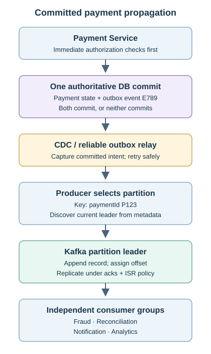
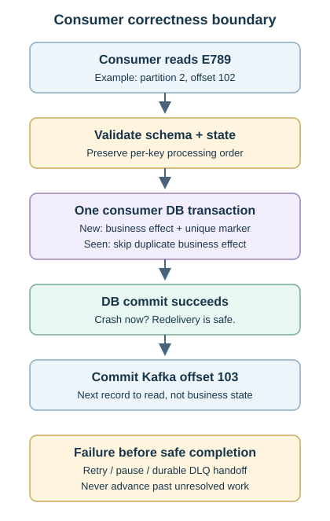
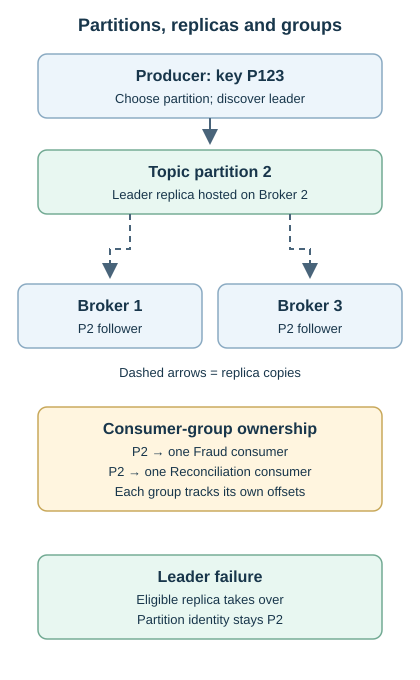
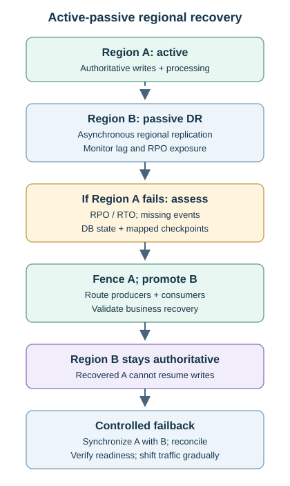

# Topic 7 — Kafka + Event-Driven Architecture

[Back to Architecture Drills](../README.md)

**Status:** Complete

A banking payment platform uses Kafka to decouple Fraud, Reconciliation, Notification and Analytics from completed payments. The accepted design combines **payment state + outbox in one DB transaction → CDC → Kafka → independent consumer groups → atomic business/idempotency writes → offset commit**, with bounded recovery and active-passive disaster recovery (DR).

**Payment owns authoritative payment state; Kafka carries committed facts.** Immediate balance, FX and authorization decisions stay on the synchronous path. Drill completion covers all 17 stages, not production certification. Numerical examples and constraint mutations are exercises; implementation SLOs, capacity, owners and sign-offs remain to be finalized.

## Contents

- [Problem & Requirements](#problem--requirements)
- [Final Architecture](#final-architecture)
- [End-to-End Flow](#end-to-end-flow)
- [Component Responsibilities](#component-responsibilities)
- [Key Architecture Decisions](#key-architecture-decisions)
- [Event-Driven Patterns](#event-driven-patterns)
- [Data & Consistency](#data--consistency)
- [Scaling](#scaling)
- [Reliability & Failure Modes](#reliability--failure-modes)
- [Security](#security)
- [Observability](#observability)
- [Constraint Mutations](#constraint-mutations)
- [Adversarial Architecture Review](#adversarial-architecture-review)
- [AI Intersection](#ai-intersection)
- [TPM Delivery](#tpm-delivery)
- [Program Risks](#program-risks)
- [TPM Constraint Mutations](#tpm-constraint-mutations)
- [Production Readiness](#production-readiness)
- [Rollout & Rollback](#rollout--rollback)
- [Concepts Learned](#concepts-learned)
- [Mental Models](#mental-models)

## Problem & Requirements

| Interaction / requirement | Decision and consequence |
|---|---|
| Available balance, current FX, authorization Fraud | Synchronous when needed before proceeding; define latency, timeout and failure policy. |
| Completed-payment fan-out | Publish once; independent consumer groups react at their own pace. |
| Ordering | Preserve one payment's lifecycle using `paymentId`; no global order promised. |
| Delivery / financial effects | At-least-once delivery with durable consumer idempotency; prevent duplicate business effects. |
| Consumer outages | Retained events buffer work; recovery must finish within retention and business lag limits. |
| Contracts / ownership | Payment owns a stable integration contract; consumers own their local state. |
| Regional recovery | Active-passive with explicit RPO/RTO, replication checks and controlled failback. |
| Operability | Platform health, consumer progress and business completion need separate evidence. |

Asynchronous work shortens the customer dependency chain but accepts temporary disagreement, duplicate/ordering controls and harder tracing. Kafka adds value for durable fan-out and replay; a simple immediate request/response does not need an event round trip.

## Final Architecture

### Committed payment propagation

[Open the scalable payment-propagation diagram](assets/payment-event-propagation.svg)

The outbox stores event intent in the **same transaction** as payment state. CDC captures committed outbox changes; a reliable poller/relay is an alternative. Publishing is asynchronous and may repeat the same logical event.

### Consumer correctness boundary

[Open the scalable consumer-correctness diagram](assets/consumer-correctness.svg)

Each service uses its own consumer group and database. Business state plus the processed-event marker commit together; the Kafka offset commits afterward. A crash between those commits can cause redelivery, which the consumer handles safely.

### Partition placement and replication

[Open the scalable partition-replica diagram](assets/partition-replicas.svg)

A topic contains partitions; each partition has replicas hosted on brokers. **A broker is not globally a leader or follower.** It can host leaders for some partitions and followers for others. The producer chooses the partition and discovers its leader through metadata.

## End-to-End Flow

1. **Decide:** Payment validates the command and any immediate authoritative dependencies before declaring completion.
2. **Commit:** update payment state and insert `PaymentCompleted`, with stable `eventId = E789` and `paymentId = P123`, in one local DB transaction.
3. **Publish:** CDC/relay reads committed intent, uses `P123` as the key, discovers the selected partition's leader and retries within policy without changing event identity.
4. **Replicate:** leader appends the record and assigns an offset; follower replicas copy the partition. Acknowledgement follows the configured durability policy.
5. **Consume:** Fraud, Reconciliation, Notification and Analytics independently read through their groups. Each partition has one assigned consumer per group; payload/type determines the business action.
6. **Apply:** validate, enforce version/state-transition rules, and commit business work plus a unique processed-event marker atomically. Then commit the next offset to read.
7. **Recover:** transient failure uses bounded retry/backoff or pause; terminal failure uses an owned DLQ. Govern replay, preserve ordering where required and throttle catch-up.
8. **Fail over:** assess regional data and checkpoints against RPO/RTO, fence old authority, promote DR and route clients. Keep the promoted region authoritative until controlled failback.

## Component Responsibilities

| Component | Responsibility / boundary |
|---|---|
| Payment Service / DB | Own payment invariants, authoritative state and transactional event intent. |
| Outbox / CDC relay | Durable intent / recoverable publication; monitor backlog, capture positions and source-log retention. |
| Producer / partitioner | Serialize the contract, select key/partition, discover leader, handle acknowledgements and retries. |
| Topic / partition | Logical stream / ordered log and unit of parallelism. |
| Broker / replicas | Host logs, append, serve fetches and replicate; do not execute consumer business logic. |
| Consumer-group coordination | Assign partitions and reassign after membership changes; group offsets track recovery positions. |
| Consumer / service DB | Validate, deduplicate, apply owned business state and commit progress safely. |
| Contract governance / registry | Own schema versions, compatibility checks, migration and consumer impact. |
| SRE / DR operations | Capacity, lag, alerts, failure recovery, regional authority and runbooks. |

## Key Architecture Decisions

| Decision / disposition | Why and trade-off |
|---|---|
| **Accepted:** async fan-out through independent groups | Isolates downstream outages; introduces convergence windows and operational work. |
| **Accepted:** `paymentId` partition key | Payment lifecycle order with broad distribution; not account-wide or merchant-wide order. |
| **Accepted:** at-least-once + consumer idempotency | Redelivery is safe when business effect and deduplication marker share a transaction. |
| **Accepted:** producer idempotence + strong acknowledgements | Reduces retry duplicates and acknowledged-loss exposure; does not replace consumer controls. |
| **Accepted:** transactional outbox + CDC | Closes the DB/event-intent atomicity gap; requires capture recovery and duplicate handling. |
| **Refined:** CDC can be replaced by a reliable relay | Preserve durable publication; the mechanism is replaceable, the correctness requirement is not. |
| **Accepted:** governed schemas, bounded retries/DLQ and scoped replay | Protect distinct contract, failure and recovery boundaries. |
| **Accepted:** active-passive DR | Simpler regional authority; asynchronous replication leaves measurable RPO exposure. |
| **Challenged:** merchant-wide ordering and absolute guarantees | Confirm business scope before accepting hotspots, latency or availability costs. |
| **Rejected:** direct DB/Kafka dual write or offset-first processing | Independent commits can lose propagation or skip business work. |
| **Rejected:** producer idempotence as end-to-end exactly-once | Consumer crashes, relay republishing and external effects still need protection. |
| **Rejected:** remove governance, retry forever, overwrite history | Breaks consumers, amplifies outages or destroys the business audit trail. |

## Event-Driven Patterns

| Pattern | Meaning / use in this design |
|---|---|
| Command / event | `AuthorizePayment` requests action and may be rejected; `PaymentAuthorized` records a completed fact. |
| Domain / integration event | Private domain fact / deliberately mapped external contract; do not expose the entire internal model. |
| Publish-subscribe fan-out | Several groups read the same records independently; no topic per consumer is required. |
| Competing consumers | Instances within one group share partitions; they divide that workload. |
| Transactional outbox + CDC | Atomically record business change and intent; capture committed changes for later publication. CDC also supports ordinary tables. |
| Local transactions + compensation | Services own their databases; later failure triggers new business actions/events instead of one cross-service DB transaction. |
| Replay / reprocessing | Read retained original events to recover or rebuild a projection; do not ask producers to recreate historical facts. |

Boundary ownership survives contract evolution: an internal rename can be mapped to the existing external field. If business meaning changes, evolve the integration contract deliberately. Fraud-specific `riskScore` belongs in a Fraud-owned event such as `FraudAssessmentCompleted`, not automatically in `PaymentCompleted`.

## Data & Consistency

### Event contract and schema evolution

**Record anatomy:** key routes; value carries the business payload; timestamp records creation/append time according to configuration; offset locates a record within one partition. `(topic, partition, offset)` identifies transport position, not business identity. `eventId` stays stable across retries; `paymentId` stays stable across lifecycle events.

The integration envelope carries event ID/type, schema version, payment ID, relevant account/merchant identifiers, amount/currency, status and business time. Include a source sequence/version for ordering guards. Define monetary representation and field semantics explicitly. JSON, Avro or Protobuf still require governed contracts; registry checks and real consumer tests must agree.

| Change / compatibility | Required control |
|---|---|
| Backward / forward / full | New reader reads old data / old reader reads new data / both directions; verify the chosen format and registry policy. |
| Add optional `merchantCategory` | Often compatible with appropriate defaults and tolerant readers; strict unknown-field rejection can still fail the whole event. |
| Change `amount` number → string | Breaking for existing numeric logic; migrate through a new field/version. |
| Rename `completedAt` | Add replacement, retain old field during migration, then deprecate; do not silently remove. |
| Remove optional `legacyMerchantCode` | Optional does not mean unused; inventory consumers and migrate dependencies first. |
| Rolling upgrades / replay | Test old/new producer-reader combinations and retained historical schemas before promotion. |

### Offsets and delivery semantics

An offset is a position, not a value, lock or business action. Groups track each partition separately; the committed offset denotes **the next record to read**. After processing offset 102 successfully, commit 103. Kafka does not inspect the consumer's database to discover whether work succeeded.

| Semantics / sequence | Consequence |
|---|---|
| At-most-once: advance before processing | A crash can skip the business action. |
| At-least-once: process before advancing | A crash can redeliver; accepted with durable deduplication. |
| Kafka exactly-once processing | Transactions can combine Kafka output and offsets; external DB/API effects require additional coordination. |

Use a uniqueness constraint on the event/business-effect identity and commit it with the business update. A separate marker write leaves a crash gap; a check without concurrency protection can race. A duplicate skips the effect and advances progress safely. Commit only contiguous completed work per partition. Remote notifications/postings need receiver idempotency or a durable dispatch/outbox boundary; a local DB marker alone cannot atomically cover a remote API. [Kafka delivery-semantics design](https://kafka.apache.org/40/design/design/).

### Eventual consistency and compensation

**Bounded convergence:** Payment can be complete while Reconciliation catches up within its agreed SLO. Six hours of growing lag is an incident when the limit is 15 minutes; “eventually” is not an unlimited allowance. Consumer failure does not invalidate the original payment fact or authorize another service to rewrite Payment's DB.

**Compensation:** retain `PaymentAuthorized → PaymentCompleted → SettlementRejected → PaymentReversed`. The owning service validates and commits the new transition, then publishes it. Notification sends an updated message; Reconciliation adjusts its state. Preserve history rather than erasing the earlier completion.

## Scaling

**Key selection follows the ordering boundary:** use `paymentId` for a payment, `accountId` for account-wide order, or `merchantId` only for a justified merchant-wide sequence. An event-specific idempotency key or changing transaction ID can scatter one lifecycle. Different keys can collide on a partition; good cardinality reduces skew but does not prove balanced load.

Ordering holds **within one topic partition**, in append order. Lifecycle events that require Kafka ordering must share that log; identical keys across separate topics do not create cross-topic order. Producers must preserve source sequence and consumers must not reorder effects through concurrent work.

- **Partitions:** provide ordered lanes and a ceiling on assigned consumer parallelism. Six partitions with three consumers typically means two each; eight consumers leaves two idle, not dedicated standbys.
- **Brokers:** add storage/network capacity and host replicas. Replication supplies resilience, not additional ordering lanes.
- **Consumers:** add workers up to useful partition parallelism; tune application and downstream DB/API capacity first when they are the bottleneck.
- **Rebalancing:** joins, failures and departures can reassign partitions. New owners resume from committed offsets; interruptions/churn increase lag and can redeliver work. Stop revoked work and coordinate in-flight commits.

Partition expansion leaves old records in place but can change routing for future keyed records. Use an approved drain/pause/throttle window or a sequenced topic migration. A 24×7 flow may not fully stop: plan headroom, checkpoints and a cutover barrier rather than assume empty backlog. Measure skew, broker saturation, consumer rate and downstream limits before increasing partitions.

## Reliability & Failure Modes

### Producer reliability and ISR

`acks=0` waits for no broker acknowledgement; `acks=1` waits for the leader. The selected posture uses **`acks=all`, producer idempotence and a minimum ISR policy**. ISR means in-sync replicas and includes the leader. With replication factor 3 and `min.insync.replicas=2`, two ISR members can sustain writes; below two, writes fail. `acks=all` waits for the current ISR, not just any two replicas or every configured follower. Stronger durability trades latency/availability for lower loss exposure. [Kafka producer configuration](https://kafka.apache.org/40/configuration/producer-configs/).

Lost acknowledgements create ambiguous outcomes. Producer IDs and per-partition sequences suppress duplicate appends from supported retries; a relay restart/application republish still needs stable event IDs and consumer deduplication. Validate compatible retry/in-flight settings, bound delivery attempts and retain unsent outbox intent. Never silently weaken durability to clear an incident.

| Failure | Containment and recovery |
|---|---|
| DB commits; relay crashes | Outbox intent survives; resume capture/publication from durable progress. |
| Publish succeeds; relay checkpoint fails | Same event may publish again; preserve event identity and deduplicate. |
| Leader broker fails | Elect an eligible replica, refresh client metadata; partition identity stays unchanged. Avoid unsafe promotion that discards acknowledged history. |
| Consumer commits DB, crashes before offset | New owner redelivers; atomic processed-event marker prevents another effect. |
| Dependency down | Backoff + jitter, bounded attempts, pause/throttle or durable retry path; lag still grows. |
| Poison record / retry exhaustion | Owned DLQ with source payload, event ID, topic/partition/offset, reason, attempts and timestamps. Alert, repair, then governed replay. |
| Retry/DLQ transfer fails | Do not advance source progress until durable handoff; tolerate duplicate handoff or use Kafka transactions where applicable. |
| Recovery flood | Ramp processing within downstream capacity; watch latency, saturation and backlog trend. |

**Ordering versus progress:** removing offset 201 allows 202/203 to proceed but can violate a lifecycle sequence. Pause or quarantine the affected ordered work when necessary; retry topics and DLQs do not preserve original processing order automatically. A valid event behind an unavailable dependency is not automatically poison. DLQs need owners, aging limits and resolution, not silent storage.

### Replay and reprocessing

Scope repair to affected time/partition/offset ranges, such as the drill's **2–4 PM** defect window. Use a separate replay group/checkpoint, throttle load and preserve source versions. Serialize by business key or isolate output so old replay cannot overwrite newer live state. Persist checkpoints for crash recovery; serialization alone does not remember progress.

Normal redelivery skips completed effects. Bug-fix recomputation may intentionally rebuild selected derived state, so define an explicit replay mode or isolated projection; blindly skipping all processed IDs would preserve the bug. Suppress duplicate notifications/postings, validate results before promotion and audit the replay. Retention, source logs and deduplication history must support the recovery horizon.

### Multi-region DR

[Open the scalable multi-region DR diagram](assets/multi-region-dr.svg)

**RPO** bounds acceptable data-loss exposure; **RTO** bounds restoration time. If DR is two minutes behind against a 30-second RPO, investigate recoverable missing events and escalate the availability-versus-loss decision; do not silently promote outside policy. Kafka replication alone does not recover payment databases, consumer state, schemas, identities or routes. Validate all of them and the replication tool's offset/checkpoint mapping; cross-cluster numeric offsets are not assumed identical.

Fence the old writer before promotion. Region B remains authoritative after takeover; recovered Region A must synchronize B's new history before controlled failback. Active-active adds ordering, duplication, conflict and split-brain risks. Synchronous cross-region durability adds remote latency and dependency on the link; asynchronous replication favors local availability with an RPO gap. If A is healthy but DR replication degrades, continue only within an explicitly accepted degraded-resilience policy, monitor exposure and reassess.

## Security

Use TLS, authenticated workload identities, least-privilege topic/group ACLs, network isolation, managed secrets and rotation. Separate runtime, replay and administrative rights; internal services are not automatically trusted. Minimize sensitive payloads, encrypt storage/backups, redact logs and audit contract/permission changes. Selecting fewer fields in code is not access isolation: a consumer that can read a topic sees its payload. Apply equivalent controls to retries, DLQs, archives and DR; enforce residency requirements.

## Observability

| Signals | What they reveal |
|---|---|
| Broker CPU/disk/network, availability | Infrastructure saturation and failure. |
| Leaders, ISR changes, under-replicated partitions | Durability and write-availability exposure. |
| Producer errors/retries; outbox/CDC backlog and age | Failed or delayed publication before consumers see events. |
| Group/partition lag, oldest-event age, catch-up rate | Whether consumers converge within business SLOs. |
| Consumer processing latency/errors, rebalances, DB/API pressure | Application bottlenecks despite healthy brokers. |
| Retry/DLQ volume, growth and oldest age | Persistent failures and unowned recovery work. |
| Commit/event creation → downstream completion | End-to-end business latency; Kafka lag alone is insufficient. |
| Regional replication lag, recovery time, reconciliation gaps | RPO/RTO exposure and failover readiness. |

When lag spikes with healthy brokers, inspect consumer capacity, slow dependencies, errors, skew and rebalance churn. Kafka has retained log data, not a queue that deletes records on consumption; backlog is relative to each group's progress. Correlate event/payment IDs across publication, processing and recovery. Launch dashboards summarize **Platform / Consumers / Business Flow / DR / Incidents**, with thresholds, owners and actions. Green brokers do not prove healthy settlement or reconciliation.

## Constraint Mutations

| Changed constraint | Accepted response / correction |
|---|---|
| One merchant creates **40%** of traffic; strict merchant order | Challenge scope first. If mandatory, use `merchantId` and accept the hotspot; consider terminal/store/account scope only if business permits. |
| Fraud must approve before completion within **150 ms** | Move that decision into the synchronous path with timeout/failure policy; retain async analytics afterward. |
| Reconciliation within **30 seconds**; Notification can wait | Challenge justification and measurement boundary; keep Reconciliation async with separate capacity, alerts and SLO. |
| Reconciliation must never post twice | Guarantee duplicate-safe effects through atomic idempotency/uniqueness, not a promise of no redelivery. |
| **Seven-year** audit retention | Keep complete immutable history in governed durable archive; size Kafka for operational recovery. Final-state-only retention loses the audit sequence. |
| Payment volume grows **10×** | Measure and scale the constrained partitions, brokers, consumers and downstream systems; govern routing changes. |
| Zero loss, zero duplicates, strict order, **sub-100 ms**, active-active | Reframe as durability/RPO policy, no duplicate effect, business-key order and separate synchronous/async SLOs; challenge active-active. |

## Adversarial Architecture Review

| Challenge | Outcome retained |
|---|---|
| Why keep consumer idempotency if the producer is idempotent? | They protect different boundaries: duplicate append versus duplicate business effect. |
| Why not retry forever and remove the DLQ? | Poison events block progress; retry storms overload dependencies. Keep bounded recovery and an owned terminal path. |
| Why not commit DB and publish Kafka together, or retry afterward? | Simultaneous calls are still independent commits; a crash can lose intent. Keep the transactional outbox. |
| Why not default to active-active? | Continuity gains must justify conflicts, ordering, checkpoints, split brain and failback complexity. |
| Why govern a producer-owned schema? | Ownership includes protecting dependent consumers; it is not unrestricted change permission. |
| Why set a lag SLO if work eventually completes? | Business obligations have deadlines; growing backlog needs an incident boundary. |
| Why not remove everything outside the synchronous path? | Replace CDC with a reliable relay if useful; retain schema governance, idempotency, recovery, DR and monitoring. |

## AI Intersection

Accepted use: **`PaymentCompleted` → asynchronous Fraud scoring → `FraudRiskScored`**, with `paymentId`, `riskScore`, `modelVersion` and `scoredAt`. Model version identifies the exact model, not merely scoring time. Preserve input/output traceability for audit and controlled re-scoring.

Use offline comparison → human review/approval → limited canary → monitored promotion. Compare score distributions, false positives/negatives, business impact and latency; pause or roll back abnormal behavior. During a **45-minute** AI outage, retain backlog and catch up within retention and agreed SLOs. If approval is required before authorization, it is a separate synchronous dependency with explicit failure controls.

AI must not overwrite authoritative Payment state. A suspicious completed payment emits `FraudReviewRequired` or `PaymentHoldRequested`; an authorized business workflow decides any new transition and preserves the original fact.

## TPM Delivery

| Outcome-based workstream | Completion evidence |
|---|---|
| Kafka/platform | Environments, topics, keys/partitions, replicas, capacity and client configuration. |
| Schema/contracts + consumer onboarding | Ownership, compatible schemas, group IDs, idempotency and dependency inventory. |
| Security | Service identity, ACLs, TLS, storage protection and InfoSec approval. |
| Testing | Functional, integration, load, failure, retry/DLQ, replay and contract evidence. |
| Operations/SRE | Lag SLOs, dashboards, runbooks, support model and escalation. |
| DR/resilience | Replication, state/checkpoint recovery, RPO/RTO and failover/failback exercises. |
| Release readiness | Dependencies, CAB/change plan, cutover, rollback and Go/No-Go evidence. |

**Critical path:** agree contracts/ordering/SLOs → integrate outbox, platform and consumers → prove peak/failure recovery → security/operational sign-offs → pilot. These are parallel workstreams with explicit dependencies; schema reviews, test design and runbooks need not wait for feature completion.

## Program Risks

| Risk / owner function | Mitigation → trigger → contingency |
|---|---|
| Operational readiness / SRE + TPM | Build alerts, RACI, runbooks and handover early → incomplete HOTO/support → delay launch or bridge with trained named coverage. |
| Performance/scalability / Platform + consumer teams | Test skew, peak load, lag and dependencies → hotspot or latency failure → repair, isolate/resize and repeat performance sign-off. |
| AI capability / Fraud + ML leadership | Staff and train model engineering/governance → specialist bottleneck → rebaseline AI integration dependencies and scope. |

Record named owners, due dates, evidence and residual-risk decisions in RAID. Probability/severity ratings were not scored in the drill; do not invent them. AI scope changes must preserve any mandatory authorization control.

## TPM Constraint Mutations

| Constraint | Delivery response |
|---|---|
| Performance passes; DR failover untested | **No-Go:** core resilience is unproven. Feature completion does not close the gate. |
| Technical controls proven; runbook walkthrough pending | Potential **Conditional Go** only for a non-critical residual item with owner, dated action and explicit acceptance. |
| Critical consumer lacks 24×7 staffing | Evaluate business impact, primary/secondary on-call, escalation and peak coverage. No-Go without credible support; trained temporary coverage may justify Conditional Go. |
| Launch-day executive visibility required | Show platform, consumers, business flow, DR and incidents with named response owners and rollback readiness. |

## Production Readiness

Required gates, **not claims of passed tests**. Each needs objective criteria, a named owner, evidence and sign-off.

| Gate | Evidence before Go |
|---|---|
| Contracts / correctness | Schema combinations, ordering, stable IDs, atomic deduplication and no duplicate financial effect. |
| Performance / capacity | Peak/10× scenarios, skew, p95/p99, per-consumer lag SLOs and controlled catch-up. |
| Failure / recovery | Broker loss, insufficient ISR, consumer crash/rebalance, relay restart, dependency outage, retry/DLQ and replay overlap/restart. |
| DR | RPO/RTO measurements, state/checkpoint recovery, fencing and failover/failback rehearsal. |
| Security | Validated identities/ACLs, encryption, sensitive-data controls and InfoSec sign-off. |
| Operations / release | Dashboards/thresholds, runbooks, ownership, escalation, HOTO, cutover/rollback and required testing approvals. |

No unresolved Sev-1/Sev-2 defect threatening production safety; no unproven core resilience or missing critical support. Define lag limits, end-to-end latency targets, ISR alerts and DLQ thresholds before launch. A document without tested recovery and actionable monitoring is insufficient.

## Rollout & Rollback

Use **lower environment → representative payment pilot → canary → limited cohort → progressive adoption**. Validate contracts, duplicate safety, business outcomes, lag, dependencies and recovery before expansion; coordinate producer/consumer versions and partition migrations through approved changes.

On regression, pause expansion and stop the faulty writer/consumer, preserve durable backlog/checkpoints, and restore a compatible version/configuration. Bound outbox/log growth during a pause. Reconcile already-applied effects; replay approved ranges or compensate through the owning domain. An offset reset is not a business rollback, a reverted binary does not undo a posting, and a recovered region does not automatically regain authority.

## Concepts Learned

| Concept | Working meaning / correction |
|---|---|
| Topic / partition / broker / replica | Logical stream / ordered lane / hosting server / copy of a partition. |
| Partition key / event ID | Business ordering scope / identity for deduplication; different jobs. |
| Offset / committed offset | Record position / next read position for a group and partition. |
| Group / rebalance | Independent workload / redistribution of partition assignments. |
| Acknowledgement / ISR | Producer durability confirmation / sufficiently synchronized replicas, including leader. |
| Producer / consumer idempotency | Suppress retry appends / prevent duplicate business effects. |
| Outbox / CDC | Atomic durable event intent / capture and publication of committed changes. |
| Retry / DLQ / replay | Recoverable attempts / terminal exception handling / governed historical processing. |
| Eventual consistency / compensation | Bounded temporary disagreement / new action correcting a prior outcome without erasing history. |
| RPO / RTO | Acceptable loss exposure / restoration-time target; routing alone proves neither. |

## Mental Models

- **Payment owns truth; Kafka distributes committed facts.**
- Commands request action; events state what happened; integration contracts protect domain boundaries.
- Partitions divide work; replicas copy it; brokers host both leaders and followers.
- Choose the key from the ordering requirement, then validate skew and cutover behavior.
- Value drives the action; offset tracks position; event ID protects the effect.
- Commit business state and deduplication together, then Kafka progress.
- Outbox closes the lost-intent gap; it does not eliminate redelivery.
- Eventual consistency needs a deadline; recovery throughput needs a budget.
- Replay preserves facts; compensation adds facts; neither erases authoritative history.
- One authoritative region, governed contracts and tested operations keep recovery explainable.

---

**Design basis:** completed 17-stage Topic 7 Kafka + Event-Driven Architecture drill, including accepted/refined/challenged/rejected proposals, failure analysis, constraint mutations, AI boundary and compact TPM delivery. Implementation safeguards make the decisions explicit without claiming certification. Previous: [Topic 6 — Distributed Cache](../06-distributed-cache/README.md). Next: [Topic 8 — Notification System](../08-notification-system/README.md).
