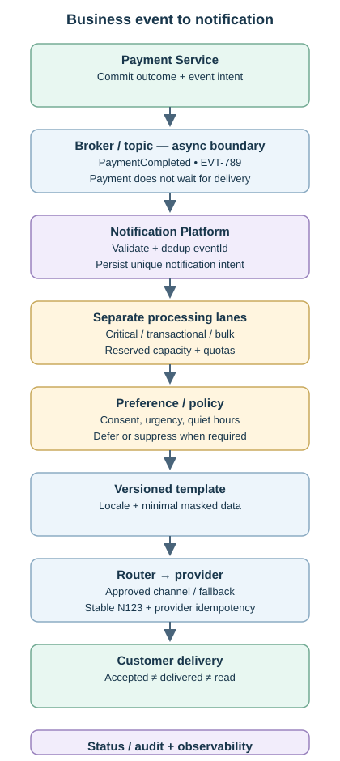
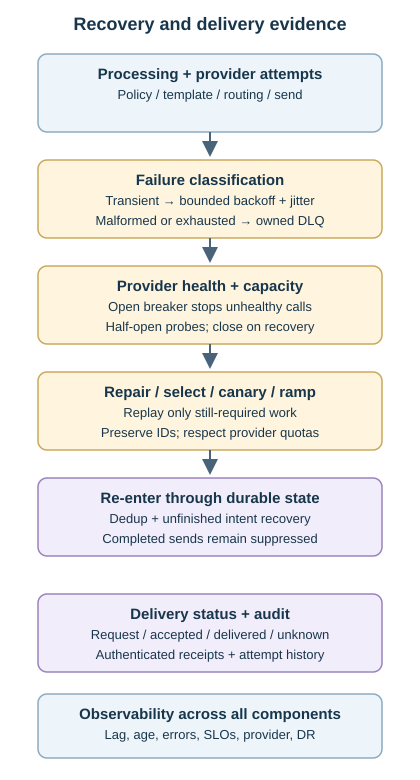
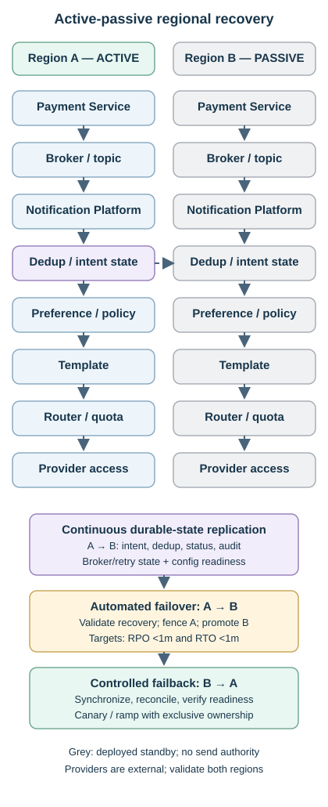

# Topic 8 — Notification System Architecture

[Back to Architecture Drills](../README.md)

**Status:** Complete

A customer completes a **CAD $500 payment** in mobile banking. The payment is already committed, so the bank must return success without waiting for an SMS carrier, email gateway or push provider. The customer still expects a prompt alert, compliance may require additional communication, and Operations must later explain whether each message was created, accepted, delivered or left uncertain.

Putting every provider integration inside Payment Service would mix payment correctness with phone numbers, device tokens, templates, consent, quiet hours, retries and vendor outages. A slow provider could then delay a completed payment; a retry after an uncertain timeout could send the same alert twice. Both outcomes damage customer trust.

The bank therefore centralizes communication behind a Notification Platform. Payment publishes the committed business fact; the platform determines whether communication is required, applies policy and preferences, renders approved content, selects an eligible channel and records delivery evidence. The accepted design is **Payment Service → broker → Notification Platform → dedup/idempotency → preference/policy → template → router → provider**, with isolated priority lanes, bounded recovery and active-passive disaster recovery (DR).

**Payment owns business truth; Notification owns customer communication.** Informational alerts are asynchronous and near-real-time. An OTP or customer challenge may still be a required dependency of the protected business workflow. Numerical scenarios are exercises, and implementation targets, owners and sign-offs still need evidence.

## Contents

- [Problem & Requirements](#problem--requirements)
- [Why Centralize Notifications](#why-centralize-notifications)
- [Events, Channels & Asynchronous Processing](#events-channels--asynchronous-processing)
- [Classification, Preferences & Routing](#classification-preferences--routing)
- [Final Architecture](#final-architecture)
- [End-to-End Flow](#end-to-end-flow)
- [Component Responsibilities](#component-responsibilities)
- [Key Architecture Decisions](#key-architecture-decisions)
- [Data & Consistency](#data--consistency)
- [Scaling](#scaling)
- [Reliability & Failure Modes](#reliability--failure-modes)
- [Security](#security)
- [Delivery Status & Audit](#delivery-status--audit)
- [Observability](#observability)
- [Constraint Mutations](#constraint-mutations)
- [Adversarial Architecture Review](#adversarial-architecture-review)
- [AI Intersection](#ai-intersection)
- [TPM Delivery](#tpm-delivery)
- [Program Risks](#program-risks)
- [TPM Constraint Mutations](#tpm-constraint-mutations)
- [Production Readiness](#production-readiness)
- [Rollout & Rollback](#rollout--rollback)
- [Concepts Learned](#concepts-learned)
- [Mental Models](#mental-models)

## Problem & Requirements

The CAD $500 payment creates several separate obligations. Payment must commit exactly once. A transactional alert should reach the customer quickly. A suspicious-login alert may need a faster deadline and a mandatory channel. A monthly statement can wait until quiet hours end. A promotion requires consent and may expire before delivery. Treating all four as “send a message” hides the business rules that make them different.

| Requirement | Decision and consequence |
|---|---|
| Payment, Fraud, Cards, Transfers, Security and Account events | Publish business facts such as `PaymentCompleted`, `PaymentReversed` and `SuspiciousLoginDetected`; centralize communication policy. |
| Informational alerts promptly after completion | Async near-real-time processing with measurable latency; provider failure does not invalidate or slow completed payments. |
| OTP / customer challenge required before authorization | Protected action waits for successful verification, with timeout/expiry and failure policy; do not hold a DB transaction open for customer input. Delivery can still use async mechanisms. |
| Different urgency and obligations | Critical, transactional and bulk/low-urgency lanes; consent, mandatory communication and expiry rules vary by type. |
| Recovery without repeated customer alerts | At-least-once attempts, stable IDs, durable deduplication and provider idempotency where supported. |
| Regional continuity | Prefer active-passive if measured **RPO <1 minute and RTO <1 minute** meet the requirement. |
| Operability and privacy | Trace delivery outcomes without unnecessarily copying sensitive data; prove failure recovery before launch. |

**Async is a coupling model; near-real-time (NRT) is a latency expectation.** The broker separates producer publication from consumer completion; Payment does not wait for notification delivery. Carry forward Topic 7's transactional outbox/reliable relay so payment commit and event intent cannot diverge. A broker outage retains publication intent; Notification does not become a synchronous payment dependency.

## Why Centralize Notifications

A centralized platform gives every banking domain one governed way to communicate without making it depend on vendor-specific APIs. Payment, Fraud, Cards and Account Services publish facts they own. The platform owns the changing communication concerns: destinations, consent, channel eligibility, templates, vendor quotas, retries, delivery evidence and operational recovery.

This boundary matters during failure. If the push provider is unavailable after the CAD $500 payment commits, Payment still returns success. The notification remains durable, enters bounded recovery and may use an approved fallback. The provider outage affects communication latency, not payment correctness. Centralization also creates one place to prevent duplicate sends, protect critical traffic from marketing volume and preserve an auditable history.

The design does introduce a shared platform whose policy, capacity and operations must be reliable. Teams need governed event contracts, platform ownership and clear onboarding. That cost is justified when it replaces duplicated provider logic and inconsistent customer treatment across many banking services.

## Events, Channels & Asynchronous Processing

The architecture begins with three different objects that must not be confused:

| Object | Meaning in the CAD $500 example |
|---|---|
| Business event | `PaymentCompleted` states that the payment already happened. Payment Service is the **producer** of this fact. |
| Notification intent | `N123` states that an eligible customer communication should be prepared and tracked under policy. |
| Provider attempt | A request asks a particular push, SMS or email provider to deliver one channel-specific message. |

A **message broker** durably stores and distributes events. A Notification consumer reads them independently of the producer. The broker is the asynchronous boundary: once Payment has safely published the event intent, it does not wait for notification processing to finish. Topic 7's transactional outbox or equivalent reliable relay keeps the payment commit and publication intent together so a crash cannot silently produce “payment committed, event forgotten.”

Asynchronous does not mean slow. It means the producer does not wait for the consumer's result. **Near-real-time** describes the separate latency objective: the platform may consume, classify and hand the alert to a provider within seconds while Payment has already returned success.

| Channel | Typical strength | Important limitation |
|---|---|---|
| Push | Fast, rich and inexpensive for a registered device | Device token may be missing, expired or disabled. |
| SMS | Broad reach and useful for urgent communication | Per-message cost, provider quotas, limited content and incomplete delivery evidence. |
| Email | Detailed, durable content | Slower customer attention, spam filtering and address/consent constraints. |
| In-app | Controlled experience inside bank channels | Customer must open or use the application. |

No channel is universally valid. Policy must consider purpose, urgency, consent, customer registration, content, cost, evidence and provider health.

## Classification, Preferences & Routing

Classification turns a generic event into an explicit communication obligation. It determines the lane, deadline, expiry, permitted channels, preference rules, retry budget and audit evidence before the router chooses a provider.

| Class / example | Normal behavior / degraded policy |
|---|---|
| Critical/security — `SuspiciousLoginDetected` | Reserved capacity and immediate approved channels; bypass quiet hours/preferences only under explicit security, legal and business policy. |
| Transactional — `PaymentCompleted`, `PaymentReversed` | Customer preference and NRT SLO; queue during preference failure within allowed latency, then apply approved degraded policy. |
| Mandatory regulatory communication | Governed content, eligible channels, retention and evidence; “mandatory” does not make every channel legally valid. |
| Low urgency — `StatementReady` | Schedule after quiet hours in the customer's timezone; low urgency does not imply discardable. |
| Promotional/bulk — marketing | Consent, strict throttling, deferral and policy-defined expiry; never consume critical reserved capacity. |
| OTP/customer challenge | Delivery may use asynchronous infrastructure, but the protected action waits for successful verification or expires. Never hold a database transaction open for customer input. |

For the CAD $500 alert, suppose the customer prefers push but has no registered mobile device. The platform first evaluates whether fallback is permitted for this notification type and consent state. It then selects an eligible SMS or email template, locale and destination only if policy allows. It does not assume that every message can use every channel.

Routing combines **type + urgency + preference + policy + destination validity + availability + cost**. For **10 PM–7 AM** quiet hours, a `StatementReady` message at 2 AM is scheduled for the next valid local delivery time; a governed critical-security alert may proceed immediately. Daylight-saving changes and timezone ownership belong in the scheduling policy. Fallback after a sufficiently successful delivery must not silently create another customer message.

## Final Architecture

The normal path is shown only after the responsibility and policy boundaries are clear. Green begins with committed banking truth, blue carries and delivers work, purple holds durable identity/status, and amber applies policy or recovery controls. Observability is cross-cutting: every stage emits evidence, rather than passing through one final monitoring box.

### Business event to customer communication

[Open the scalable notification-flow diagram](assets/notification-flow.svg)

The diagram keeps deduplication before policy and rendering so a redelivered `PaymentCompleted` event cannot create a second notification intent. Priority classification happens before shared downstream capacity is consumed. Status and audit span the whole lifecycle because a provider callback can arrive long after the original worker finishes.

### Recovery and delivery evidence

[Open the scalable recovery and status diagram](assets/recovery-status.svg)

Retry and the dead-letter queue (DLQ) are failure paths around processing and delivery, not mandatory sequential stages. A DLQ holds work that cannot safely progress after validation or bounded attempts; it requires an owner and a controlled replay procedure. Blue denotes services/transport, green successful progress, purple durable state, amber policy/recovery, and grey passive components, following Topic 7's palette and narrow SVG convention.

## End-to-End Flow

1. **Commit and publish:** the CAD $500 payment completes as `P123`; durable intent publishes business fact `PaymentCompleted`, `eventId=EVT-789`, through the broker. Payment does not choose `SendSMS` or call a provider.
2. **Validate and claim:** Notification validates the contract and atomically records unique event handling plus durable notification intent. Redelivery resumes existing work instead of creating another notification; acknowledge/commit broker progress only after durable handoff.
3. **Classify and apply policy:** choose critical/transactional/bulk capacity, evaluate preferences, consent, mandatory rules, language, timezone and quiet hours; persist suppression or scheduled deferral where appropriate.
4. **Prepare:** assign/recover stable `notificationId=N123`; pin an approved template version and validated minimal variables. Select the channel-specific template variant as routing requires.
5. **Route and attempt:** use the approved channel/fallback order, provider quota and circuit-breaker state. Persist send intent before calling the provider with the stable idempotency key.
6. **Track:** record provider acceptance separately from delivered/failed/unknown outcomes; reconcile authenticated receipts and correlate event, notification and provider IDs.
7. **Recover:** transient failures enter bounded retry; malformed/exhausted work enters an owned dead-letter queue (DLQ). Repair, canary and throttle replay with identities and completed-send protection intact.
8. **Survive regional failure:** fence old send authority, validate recovered state/checkpoints and promote standby. Recover uncertain sends using the same identities; synchronize and rehearse controlled failback.

At every step the platform records enough correlation to answer a practical support question: “Payment `P123` completed; what communication did policy require, which content and destination were used, what did the provider report, and what remains uncertain?” It stores evidence without turning notification state into the source of truth for the payment itself.

## Component Responsibilities

| Component | Responsibility / boundary |
|---|---|
| Business service + outbox/relay | Own the authoritative outcome and reliable business-event publication; no provider logic. **Boundary:** payment success never depends on notification delivery. |
| Broker / consumer group | Buffer events durably and track independent consumer progress. **Boundary:** broker acknowledgement is not proof of customer receipt. |
| Notification consumer / state store | Validate contracts, deduplicate events, create durable notification intent and schedule work. **Boundary:** notification state describes communication, not payment truth. |
| Classification / preference / policy | Decide urgency, consent, permitted overrides, quiet hours, fallback and expiry. **Boundary:** router or provider adapters cannot invent policy. |
| Template store / renderer | Supply approved immutable versions, localization, validated placeholders and masking. **Boundary:** rendering cannot introduce unapproved sensitive data. |
| Router / provider adapters | Select eligible channels/providers, enforce quotas and normalize acknowledgements/receipts. **Boundary:** provider acceptance remains distinct from delivery. |
| Retry / DLQ / replay operations | Bound recovery, preserve failed work and govern corrected re-entry. **Boundary:** replay reuses identity and does not mean “send everything again.” |
| Audit / observability / SRE | Explain outcomes, detect SLO failures and operate dependencies and regional recovery. **Boundary:** telemetry observes every stage; it is not a sequential business hop. |

## Key Architecture Decisions

| Decision / disposition | Why and trade-off |
|---|---|
| **Accepted:** broker-decoupled business events | Protect payment correctness/availability; introduces backlog and eventual delivery. |
| **Accepted:** `eventId` + stable `notificationId` + provider idempotency | Protect different replay/crash boundaries; external guarantees depend on provider capability. |
| **Accepted:** separate critical/transactional/bulk lanes | Reserved capacity protects urgent SLOs; throttling alone does not prevent shared-resource starvation. |
| **Accepted:** at-least-once attempts for critical alerts | Missing a security alert is worse than a controlled duplicate risk; customer receipt is not guaranteed. |
| **Accepted:** governed preferences, templates and fallback | Centralized, auditable behavior; adds configuration/dependency ownership. |
| **Accepted:** active-passive when it meets <1m RPO/RTO | Simpler authority and lower operational cost; asynchronous replication leaves loss/duplicate exposure. |
| **Challenged:** critical means ignore preferences; NRT means synchronous | Overrides need approved policy; latency and coupling are separate dimensions. |
| **Challenged:** active-active is automatically better | Justify coordination, split brain and operating cost; not every design needs a synchronous cross-region check per send. |
| **Rejected:** Payment sends/retries SMS; remove broker/state and retry three times | Reintroduces availability coupling and removes durable buffering, deduplication and recovery. |
| **Rejected:** payload-similarity dedup, unlimited retry, one FIFO for all work | Suppresses legitimate purchases, amplifies failure or blocks urgent alerts. |
| **Rejected:** mandatory AI decision in critical path | Adds latency, availability dependence and nondeterministic mandatory-communication decisions. |

The final executive defense prioritized **decoupling**, **deduplication/idempotency**, and **priority isolation**: protect payments, avoid repeated customer communications, and preserve urgent service under constrained capacity.

## Data & Consistency

At-least-once delivery means the same event may legitimately arrive more than once after a timeout, consumer restart, replay or regional recovery. The platform therefore promises duplicate-safe processing where it controls state; it does not pretend the transport delivers each record exactly once forever.

### Identity and durable processing

| Identity / state | Protects or explains |
|---|---|
| `eventId=EVT-789` | Same business event across producer retry, broker redelivery and replay; unique processing record prevents repeated creation. |
| `paymentId=P123` | Business correlation, not universal dedup: completion and reversal are distinct events for one payment. |
| `notificationId=N123` | Same logical communication across worker retry, restart and DR; persist before sending or derive reproducibly from stable intent. |
| Provider idempotency key / receipt ID | Duplicate-safe request within the provider's documented scope/window / correlation of delivery evidence. |
| Template/policy versions, attempt state | Explain what was decided and sent, when, through which channel/provider and with what result. |

Commit the unique event marker **with durable notification intent**, not separately before work exists. Concurrent check-then-send is unsafe; use uniqueness and atomic claims/ownership. A processed event means its work was safely recorded, not that the customer received it. Workers resume unfinished intent; acknowledge broker progress only after durable success/retry/DLQ handoff.

`P123/EVT-789` and `P124/EVT-790`, both CAD $500 payments, are legitimate separate notifications. Never deduplicate by customer, amount, merchant or a similarity time window. One event can produce several intended recipient/purpose/channel deliveries: define their identities explicitly while retaining the parent logical notification. Retries reuse the same identity; intentional additional delivery is not a retry.

### Crash and redelivery example

1. The consumer receives `EVT-789`, creates logical notification `N123` and persists the event marker plus notification intent atomically.
2. The push adapter sends provider request `PR-456` with a stable idempotency key derived from `N123`.
3. The provider accepts the request, but the worker crashes before recording the final acknowledgement.
4. The broker redelivers `EVT-789`. The event marker prevents a second notification intent; the worker resumes `N123` rather than creating `N124`.
5. The platform still does not know whether the external provider accepted the first attempt. It queries provider status where available or retries the **same** stable request key within the provider's documented idempotency window.

This separates two protections. **Consumer idempotency** prevents the same event from creating repeated internal work. **Provider-request idempotency** asks the external system to treat a repeated request as the same attempt. If the provider lacks this capability or its window has expired, the outcome remains uncertain: retry may duplicate the alert, while refusing to retry may lose it. Business urgency, reconciliation evidence and approved policy decide the response.

### External side effects and delivery semantics

**Provider accepts N123 → local process crashes before recording acceptance** is an uncertain external outcome. Local `eventId` dedup alone cannot close that gap. Retry the same provider request with the stable key, or reconcile status where supported. Validate provider key scope, payload rules and retention; changing provider does not share the original provider's idempotency history. Cross-provider fallback after an unknown outcome therefore carries residual duplicate risk and needs an explicit urgency/reconciliation policy.

At-most-once risks losing an attempt; at-least-once permits retry/redelivery and is preferred for critical alerts. Neither guarantees human receipt/read, and internal or Kafka guarantees do not establish exactly-once SMS delivery. Retain deduplication/send history across the maximum supported replay, retry and DR horizon; a five-minute window cannot protect a three-day replay. Expired history needs governed reconciliation before old sends are replayed.

## Scaling

Priority changes who receives scarce capacity first; it does not create capacity. Separate queues and worker pools stop a two-million-message campaign from sitting ahead of a security alert, while reserved provider budget prevents bulk workers from consuming every downstream request. **Rate limiting** caps the send rate, **backpressure** slows upstream consumption when downstream cannot keep up, and policy-defined **load shedding** discards only work that is explicitly optional or already expired.

- **Separate lanes and capacity:** critical reserved workers/provider budget, protected transactional capacity, throttled bulk/low-urgency work. Classification must occur early enough to avoid a shared ingress bottleneck; reserve state-store and provider resources too.
- **Partition-aware consumers:** one active consumer per partition per group. Ten partitions and thirty consumers leave twenty without assignments. Diagnose skew/hot customers or event types, database/template latency and provider limits before expanding partitions.
- **Provider-specific quotas:** aggregate across all workers, retries, replay and regional recovery. A 10K/sec sustainable quota stays at or below 10K unless an explicit burst allowance exists; queue space does not authorize a higher send rate.
- **Backpressure and capacity:** 8K/sec arrivals versus 5K/sec delivery grows backlog by 3K/sec, or **10.8 million/hour**. Rate limiting protects the provider; sustained overload requires capacity, permitted alternate channels/providers or demand controls.

Capacity approval is channel-specific: **20K/sec demand, 30K/sec platform, 12K/sec SMS** is insufficient if all demand is SMS, but potentially sufficient if SMS demand is 8K/sec. Test fallback load, retry amplification, retained backlog/storage and recovery headroom. Backlog drains only when sustainable service rate exceeds new eligible arrivals.

Deadlines matter during overload. A security alert that misses its usefulness window becomes an incident; an expired promotion may be safely discarded under policy; a mandatory statement notice must remain durable even if it is low priority. Retries also consume quota, so unbounded recovery can amplify the original shortage and starve new critical work.

## Reliability & Failure Modes

Failure handling follows a repeatable question: what failed, what can the customer observe, how is it detected, how is the blast radius contained, how does work recover, and what uncertainty remains?

| Failure sequence | Customer impact, detection and response |
|---|---|
| Broker unavailable after payment commit | **Impact:** notification publication is delayed; payment remains complete. **Detect:** outbox/relay backlog and oldest-unpublished age rise. **Contain/recover:** retain durable event intent, restore broker access and publish with the same event ID. **Residual risk:** outbox/source-log retention and NRT SLO may be exceeded. |
| Notification consumer crashes | **Impact:** work pauses and may be redelivered. **Detect:** consumer health, lag and oldest-event age. **Contain/recover:** group reassigns work; durable event marker and intent make redelivery safe. **Residual risk:** an external send may remain uncertain if the crash followed the provider call. |
| Preference or template service unavailable | **Impact:** channel/content cannot be safely selected. **Detect:** dependency errors and growing deferred work. **Contain/recover:** critical traffic uses only pre-approved degraded policy; transactional/low-urgency work defers; malformed or unavailable template work never falls back to invented content. **Residual risk:** deadlines may expire. |
| Provider timeout or acknowledgement lost | **Impact:** delivery may have occurred even though local state is unknown. **Detect:** timeout plus missing correlated receipt/status. **Contain/recover:** record `Unknown`, reconcile, and reuse the same provider idempotency key for a bounded retry where supported. **Residual risk:** retry can duplicate; no retry can omit. |
| Provider `429` / quota exhausted | **Impact:** backlog and delivery latency grow. **Detect:** throttling responses, quota telemetry, queue age. **Contain/recover:** reduce the aggregate provider rate, protect reserved critical budget and defer lower classes. **Residual risk:** more workers cannot raise vendor capacity. |
| Provider widespread outage / `503` | **Impact:** affected channel stops progressing. **Detect:** provider errors, latency and acceptance-rate drop. **Contain/recover:** open circuit breaker, preserve durable work, apply approved fallback, then half-open probes and controlled drain after recovery. **Residual risk:** cross-provider fallback after an uncertain send can duplicate communication. |
| Retry storm or lane saturation | **Impact:** new critical work competes with old failures. **Detect:** retry rate, queue age, worker/provider saturation. **Contain/recover:** bounded exponential backoff with jitter, separate retry capacity, admission controls and expiry. **Residual risk:** prioritization cannot solve a sustained capacity deficit. |
| Malformed input, template defect or retry exhaustion | **Impact:** selected notifications cannot progress. **Detect:** validation errors, DLQ depth and oldest age. **Contain/recover:** quarantine with reason and ownership; repair, select eligible records, canary and ramp replay. **Residual risk:** replay must re-evaluate expiry/consent and preserve identity. |
| Regional outage or failback error | **Impact:** delayed or duplicate sends if both regions act. **Detect:** regional health, replication lag, authority conflicts and delivery anomalies. **Contain/recover:** fence old authority, promote validated standby, reconcile uncertain sends, and fail back gradually. **Residual risk:** lost recent completion state can trigger another provider attempt. |

**Breaker:** `Closed → Open → cooldown → Half-open → Closed on success / Open on failure`. Retry governs an individual attempt; breaker governs whether to call an unhealthy dependency. Queue priority, retry timing and recovery rate solve different problems.

**Controlled replay:** for the drill's 5,000 template failures, deploy/verify the repair → select eligible records → small canary → verify acceptance/delivery/errors/duplicates → ramp within spare capacity. Preserve IDs, completed-send suppression, checkpoints and audit; stop on rising failures/throttling. Record any approved template-version correction. Recheck expiry and current applicable consent; replay does not mean send every stored record again.

### Multi-region DR

[Open the scalable multi-region DR diagram](assets/multi-region-dr.svg)

The full processing stack is deployed in both regions; grey means standby, not absent. Providers are external dependencies whose reachability and quotas must also be ready in DR. Stateless services need deployment/readiness, not state replication.

Under normal operation, Region A owns event consumption and provider sends. Region B is deployed and ready but fenced from sending. Durable notification intent, deduplication/send status, retry/deferred work, audit evidence and the required broker/checkpoint state replicate continuously. Replicating only the event stream is insufficient: Region B could replay an event without knowing that Region A already completed the external send.

During failover, automation first assesses replication lag and recovered state, then prevents Region A from retaining send authority. Only after that fencing is effective may Region B acquire consumer/provider ownership and resume. Stable notification and provider-request identities allow it to suppress known completions and reconcile uncertain attempts. During failback, Region B remains authoritative until Region A is synchronized, healthy and canaried; both regions must never independently decide to send the same work.

| Control | Required design / evidence |
|---|---|
| RPO — Recovery Point Objective | Bounds acceptable recent state-loss exposure. Continuously replicate notification intent, dedup/send status and audit; monitor lag before the **<1-minute** target is breached. |
| RTO — Recovery Time Objective | Bounds restoration time. Pre-provision standby, automate detection/promotion/routing and prove useful processing resumes in **<1 minute**. |
| Complete recovery state | Include broker backlog/checkpoint mapping, retry/deferred/DLQ work, templates/policy/preferences or available dependencies, secrets access and provider connectivity. Broker replication alone is insufficient. |
| Failover authority | Validate recovery point; fence old consumers/senders with enforceable ownership/leases/epochs before promotion. A routing switch alone does not stop an isolated region sending. |
| Uncertain/replayed sends | Recover the same notification identity; use provider idempotency/reconciliation. Replication lag can lose recent completion markers and trigger duplicate attempts. |
| Failback | Keep B authoritative; synchronize A from B, reconcile state/checkpoints, verify dependencies and fencing, then canary/ramp with exclusive ownership per workload. |

**Two clocks:** state 30 seconds behind at failure and service restored five minutes later means 30 seconds of loss exposure and five minutes of recovery—not 4m30s. RPO is not a replication schedule. Continuous asynchronous replication targets low loss but cannot guarantee a fixed lag during every failure; define escalation and promotion decisions when the target is exceeded.

Active-active requires cross-region identity and deterministic ownership/coordination, with additional split-brain and operational complexity. It need not synchronously consult another region on every send, but must justify its correctness and availability trade-offs. Prefer active-passive when tested recovery meets the business need; do not claim zero duplicates merely because one region is normally active.

## Security

Transport security answers whether data is encrypted and which workload is connected. Application authorization answers whether that workload may publish an event, read contact data or retrieve a provider credential. Communication policy separately answers whether the bank may contact this customer through this channel. All three controls are required; none substitutes for another.

| Area | Control |
|---|---|
| Data boundary | Classify and minimize fields; use customer/contact references and masked last four digits where sufficient. Do not copy full account numbers, address or all contact data by default. |
| Templates | Immutable approved versions, locale/language variants, validated placeholders, length/escaping rules and malicious-input tests; content owner approves changes. |
| Historical evidence | Capture template and policy versions with IDs/status/timestamps; retain historical versions. Any necessary rendered-content evidence belongs in restricted governed storage. |
| Logs / audit / DLQ | Metadata and redacted errors by default; protect sensitive payloads with least privilege, retention/deletion policy and encryption. Masking an SMS does not sanitize logs. |
| Credentials | Managed secrets store, workload identity, least-privilege retrieval, rotation and access audit. Payment does not need SMS keys. |
| Service identity | Authenticate producers/consumers; broker ACLs restrict publish/consume separately; TLS in transit and encryption at rest. Encryption is not authorization. |
| Provider callbacks | Authenticate/validate receipts, deduplicate updates and prevent stale/out-of-order callbacks from corrupting lifecycle state. |

Regional replication and audit retention extend the privacy boundary. Contact data, rendered content, DLQ payloads and provider receipts must follow approved residency, access and deletion rules in both active and standby regions. Security notifications also require integrity: only authorized producers can cause them, and template/policy changes remain versioned and attributable.

## Delivery Status & Audit

The lifecycle is evidence, not a single Boolean:

`Created → Queued/Deferred → Processing → Provider Request Sent → Provider Accepted → Delivered / Failed / Unknown / Expired`

`Provider Accepted` means the provider took responsibility for an attempt. It does not prove that a handset displayed a push, an SMS reached the customer or a person read an email. `Delivered` is recorded only when the channel/provider supplies credible delivery evidence. `Read/Open` is an additional channel-specific interaction signal where supported, never a universal status.

Provider acknowledgements and authenticated webhooks update the lifecycle using the notification ID, stable provider request ID, provider message ID and attempt number. Callbacks may be duplicated, delayed or arrive out of order, so updates need idempotency and valid state-transition rules. Reconciliation queries or reports close gaps when callbacks are missing; otherwise the platform preserves `Unknown` instead of inventing success.

Audit records connect `eventId`, `notificationId`, classification/policy version, template version, locale, masked destination reference, channel/provider, attempt timestamps, outcomes and error codes. Retention follows business, legal and privacy policy. Operational logs use metadata and redaction rather than copying rendered customer content by default.

## Observability

The Notification state store is authoritative for **recorded notification workflow and evidence**, not payment truth or an unsupported claim of human receipt. Track `Created → Queued/Deferred → Sent to Provider → Provider Accepted → Delivered / Failed / Unknown`, plus policy suppression/expiry and per-attempt history. `Read/Open` exists only where instrumented and supported; SMS acceptance does not prove delivery or reading.

| Signals | Meaning / response |
|---|---|
| Broker/group lag, queue depth, oldest unprocessed age | Amount of work versus time waiting; a small stuck partition can breach the SLO despite low total depth. |
| Processing throughput/errors, dedup/duplicate rates | Internal health, retry amplification and correctness. |
| Provider latency, acceptance/delivery rates, `429/503`, breaker/fallback | Downstream health by channel/provider and permitted recovery action. |
| Retry/DLQ depth, growth, oldest age | Owned unresolved failures and replay readiness. |
| Event creation → accepted; event creation → delivered | Separate end-to-end SLO boundaries, including broker, policy and provider delays. |
| Replication lag, authority conflicts, actual recovery time | RPO/RTO exposure and split-brain risk. |

The drill's **99% provider acceptance within 10 seconds** is breached by 45–60-second backlog even if service availability is 99.99%. Measure checkpoints to locate delay; separately define customer-delivery targets and receipt coverage. Define eligible populations, suppression/deferral treatment, observation window and missing-outcome handling so failed work cannot disappear from the denominator.

Dashboards separate **Platform / Delivery / Provider / DR / Incidents**. SLO-derived thresholds and sustained breaches page named owners; dashboards alone do not alert. Runbooks, RACI, on-call, vendor contacts, escalation, fallback authority and customer/business communication plans must exist before a 2 AM incident.

## Constraint Mutations

| Changed constraint | Accepted response / correction |
|---|---|
| Preference service down **20 minutes** | Critical alerts use pre-approved emergency routing; transactional work queues within SLO/degraded policy; statements defer. |
| SMS outage expected **60 minutes**, push healthy | Critical alerts use approved immediate fallback; breaker/backoff protects SMS. On recovery, suppress already-satisfied sends and drain pending work gradually. |
| `EVT-789` arrives three times after push delivered `N123` | Event dedup prevents new intent; notification status/idempotency prevents another send merely due to redelivery. |
| **10× traffic for two hours** | Reserve critical capacity, protect transactional SLOs, throttle/defer bulk. Drop only where explicit business/expiry policy permits. |
| **Two million** marketing messages | Separate queues and worker/provider budgets; priority labels in one FIFO are insufficient. |
| Region fails after provider acceptance, before local update | Reuse stable `N123`, fence ownership and reconcile/provider-deduplicate; never regenerate identity on failover. |

## Adversarial Architecture Review

| Challenge | Outcome retained |
|---|---|
| Remove broker/state; synchronous SMS plus three retries? | Reject loss of buffering, failure isolation, durable idempotency and recovery. Dependency inversion alone does not remove runtime coupling. |
| Upstream publishes once, so no dedup? | Redelivery, worker crashes, replay and failover still repeat work. |
| Retry forever or release all backlog at recovery? | Bound retry, quarantine poison work and rate-limit recovery within provider capacity. |
| All channels equally reliable; accepted means received? | Keep channel-specific evidence and unknown states; provider acceptance is a separate milestone. |
| Low priority means discard; critical means bypass consent? | Priority allocates capacity; explicit policy governs loss and overrides. |
| Internal events can carry all customer data? | Minimize every boundary, including logs, replicated stores and DLQs. |
| Healthy services mean no notification SLO needed? | Customer-facing delay can breach requirements while every service is up. |

## AI Intersection

**Rejected:** mandatory AI inference deciding whether/how to send critical notifications; the drill's **3–5-second** inference delay or outage would directly harm latency/availability. Deterministic policy controls mandatory communications, urgency and approved overrides. AI must not invent payment facts, suppress critical alerts, or expose sensitive customer data.

Useful optional work includes delivery-anomaly detection, volume forecasting, provider-performance analysis, and reviewed channel/send-time/template/localization recommendations for eligible communications. Minimize inputs; retain model/policy versions and decision provenance. Evaluate offline → human approval → limited canary → monitored promotion, with deterministic fallback and rollback. AI unavailability must not block mandatory delivery; recommendations remain inside consent, security and communication rules.

## TPM Delivery

| Outcome-based workstream | Completion evidence |
|---|---|
| Events / messaging / onboarding | Business schemas, reliable publication, groups/partitions/replicas, ACLs and producer ownership. |
| Notification platform | Durable IDs/state, policy/scheduling, lanes, routing, retry/DLQ/replay and status. |
| Preferences + templates | APIs/UI, consent/timezone data, approved overrides, immutable localized templates and content governance. |
| Providers | Sandbox/certification, credentials, quotas, fallback capacity, receipt/idempotency contracts and support SLAs. |
| Infrastructure / DR / InfoSec | Capacity, state replication, fencing, rehearsed recovery and security/privacy approval. |
| Observability / operations | SLOs, dashboards, alerts, production runbooks, RACI, escalation and handover to operations (HOTO). |
| Testing / release | DIT/SIT/UAT, performance/resilience evidence, business sign-off, rollout/rollback and Go/No-Go. |

**Critical path:** agree classification/contracts/SLOs → secure preference, template and provider readiness → integrate → prove peak and failure recovery → operational/security/business sign-offs → canary. Track parallel workstream dependencies; operational readiness (MOR) and tests start before feature completion.

## Program Risks

| Risk / owner function | Mitigation → trigger → contingency |
|---|---|
| Provider onboarding, contract/SLA or quota / vendor + platform | Confirm certification, limits and fallback → unproven readiness → rebaseline or use an approved tested alternative. |
| Preference data / customer platform | Validate consent/timezone contracts → unavailable/incorrect policy inputs → restrict rollout; governed degraded mode only. |
| Template approval / business + compliance | Version and approve content early → missing approval → hold affected notification types. |
| Capacity / platform + SRE | Test channel mix, burst, skew and catch-up → SLO/backlog breach → isolate bulk, obtain capacity and retest. |
| Privacy/security / InfoSec | Review payloads, logs, identities and secrets → critical finding → remediate before launch. |
| DR, downstream readiness or HOTO / SRE + TPM | Rehearse with named support and dependencies → missing recovery evidence/coverage → No-Go or resolve a narrowly accepted non-critical gap. |

Maintain named owners, dates, evidence and residual-risk decisions in RAID; these are delivery controls, not invented drill risk scores.

## TPM Constraint Mutations

| Constraint | Delivery response |
|---|---|
| **48 hours to launch**; functional/performance pass, DR and SMS fallback untested | **No-Go.** Dashboards, runbooks and on-call cannot substitute for proven core failure paths. |
| Platform 30K/sec; peak 20K/sec; SMS quota 12K/sec | No blanket Go: establish channel mix, fallback demand and SLO headroom first. |
| Core controls proven; non-critical runbook walkthrough outstanding | Potential **Conditional Go** only with named owner, dated closure, explicit acceptance and credible support; not a waiver for untested resilience. |

## Production Readiness

Required gates, **not claims of passed production tests**. Each needs criteria, owner, evidence and sign-off.

| Gate | Evidence before Go |
|---|---|
| Functional / contract | Unit, development/system integration (DIT/SIT), provider sandbox, end-to-end and user acceptance (UAT); schema, preference/opt-out, quiet-hours and template/version tests. |
| Correctness / negative tests | Duplicate events, concurrent claims, crash after provider acceptance, receipt replay/reordering, malformed/malicious inputs and safe stable-ID replay. |
| Performance / capacity | Peak/10×, bulk isolation, hot partitions, channel quotas, fallback load, backlog aging and controlled drain. |
| Resilience / DR | Provider outage/breaker/fallback, retry exhaustion, DLQ repair/replay, regional failure at send boundary, measured RPO/RTO, fencing and failback. |
| Security / business | InfoSec/privacy approval, service identities/ACLs, secrets rotation, approved content, mandatory-policy and retention decisions. |
| Operations / release | Actionable alerts, runbooks, escalation/vendor contacts, RACI, coverage/HOTO, rollback rehearsal and release sign-offs. |

No unresolved critical defect or unproven critical recovery path. Final thresholds, capacity and provider capability must be verified before launch; a completed architecture drill is not that verification.

## Rollout & Rollback

Use lower environments → representative notification cohort → canary → progressive rollout. Monitor latency, duplicate/unknown outcomes, consent correctness, provider limits and DR readiness. Stop expansion on regression, pause faulty dispatch while preserving durable work, and restore compatible code/configuration or an approved template/policy version.

Reconcile in-flight provider outcomes before replay. Rollback cannot unsend an SMS; deleting state or resetting offsets can create more duplicates. Keep IDs/history, apply controlled recovery, and issue any corrective communication through an approved business process.

## Concepts Learned

| Concept | Working meaning / correction |
|---|---|
| Event / command | Completed business fact / requested action; `PaymentCompleted` preserves the upstream boundary. |
| Async / NRT | Independent processing / latency target; neither implies the other. |
| Dedup / idempotency | Recognize repeated identity / prevent repeated effects across retries. |
| Event / notification / provider identity | Input processing / logical communication / external request and evidence boundaries. |
| Accepted / delivered / read | Provider responsibility / channel delivery evidence / supported human-interaction evidence. |
| Retry / breaker / backpressure | Attempt again / stop calling unhealthy service / control downstream load. |
| Priority / expiry | Allocate scarce capacity / decide whether delayed work remains valid. |
| RPO / RTO | Acceptable state-loss exposure / time to restore useful service; separate clocks. |

## Mental Models

- **Payment owns truth; Notification owns communication.**
- Fast notifications do not require payment to wait for them.
- Stable IDs survive retries, replay and regional recovery.
- Internal deduplication cannot atomically cover an external provider call.
- Priority protects urgent work; backpressure protects capacity; neither creates capacity.
- Provider accepted is a milestone, not proof the customer read the message.
- Replicate state, fence send ownership, and test both failover and failback.
- AI advises outside the mandatory path; deterministic policy remains accountable.

---

**Design basis:** accepted/refined/challenged/rejected proposals, constraint mutations, AI boundaries and compact TPM delivery. Previous: [Topic 7 — Kafka + Event-Driven Architecture](../07-kafka-event-driven-architecture/README.md). Next: Topic 9 — Distributed Scheduler (planned).
