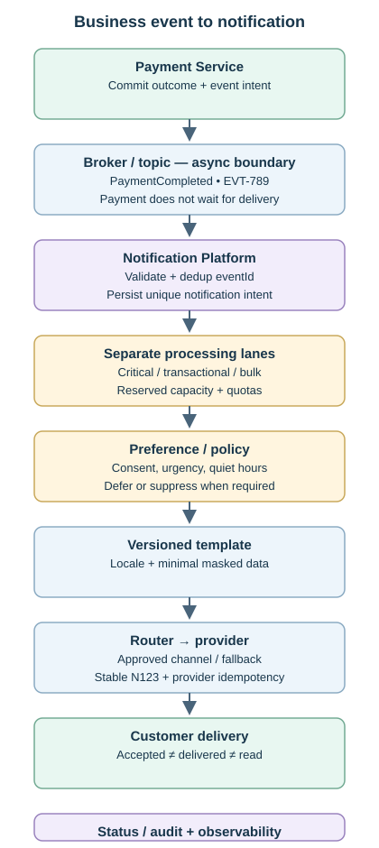
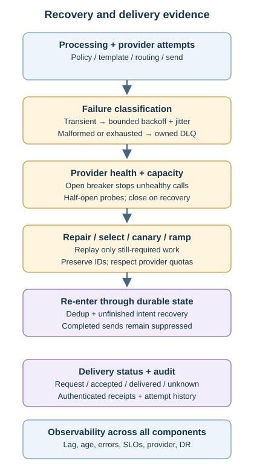
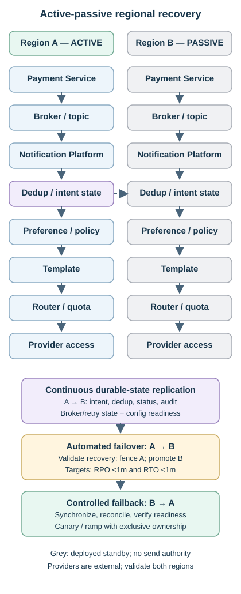

# Topic 8 — Notification System Architecture

[Back to Architecture Drills](../README.md)

**Status:** Complete

A bank's centralized Notification Platform translates committed business events into push, SMS, email and in-app communications. The accepted design is **Payment Service → broker → Notification Platform → dedup/idempotency → preference/policy → template → router → provider**, with durable status, bounded recovery, isolated priority lanes and active-passive disaster recovery (DR).

**Payment owns business truth; Notification owns customer communication.** Informational alerts are asynchronous and near-real-time. OTP/challenge verification may remain a required synchronous business dependency. Numerical scenarios are exercises, and implementation targets, owners and sign-offs still need evidence.

## Contents

- [Problem & Requirements](#problem--requirements)
- [Final Architecture](#final-architecture)
- [End-to-End Flow](#end-to-end-flow)
- [Component Responsibilities](#component-responsibilities)
- [Key Architecture Decisions](#key-architecture-decisions)
- [Classification, Preferences & Routing](#classification-preferences--routing)
- [Data & Consistency](#data--consistency)
- [Scaling](#scaling)
- [Reliability & Failure Modes](#reliability--failure-modes)
- [Security](#security)
- [Observability](#observability)
- [Constraint Mutations](#constraint-mutations)
- [Adversarial Architecture Review](#adversarial-architecture-review)
- [AI Intersection](#ai-intersection)
- [TPM Delivery](#tpm-delivery)
- [Program Risks](#program-risks)
- [TPM Constraint Mutations](#tpm-constraint-mutations)
- [Production Readiness](#production-readiness)
- [Rollout & Rollback](#rollout--rollback)
- [Concepts Learned](#concepts-learned)
- [Mental Models](#mental-models)

## Problem & Requirements

| Requirement | Decision and consequence |
|---|---|
| Payment, Fraud, Cards, Transfers, Security and Account events | Publish business facts such as `PaymentCompleted`, `PaymentReversed` and `SuspiciousLoginDetected`; centralize communication policy. |
| Informational alerts promptly after completion | Async near-real-time processing with measurable latency; provider failure does not invalidate or slow completed payments. |
| OTP / customer challenge required before authorization | Protected action waits for successful verification, with timeout/expiry and failure policy; do not hold a DB transaction open for customer input. Delivery can still use async mechanisms. |
| Different urgency and obligations | Critical, transactional and bulk/low-urgency lanes; consent, mandatory communication and expiry rules vary by type. |
| Recovery without repeated customer alerts | At-least-once attempts, stable IDs, durable deduplication and provider idempotency where supported. |
| Regional continuity | Prefer active-passive if measured **RPO <1 minute and RTO <1 minute** meet the requirement. |
| Operability and privacy | Trace delivery outcomes without unnecessarily copying sensitive data; prove failure recovery before launch. |

**Async is a coupling model; near-real-time (NRT) is a latency expectation.** The broker separates producer publication from consumer completion; Payment does not wait for notification delivery. Carry forward Topic 7's transactional outbox/reliable relay so payment commit and event intent cannot diverge. A broker outage retains publication intent; Notification does not become a synchronous payment dependency.

## Final Architecture

### Business event to customer communication

[Open the scalable notification-flow diagram](assets/notification-flow.svg)

### Recovery and delivery evidence

[Open the scalable recovery and status diagram](assets/recovery-status.svg)

Retry/DLQ is a failure path around processing and delivery, not a mandatory step immediately after deduplication. Status records the lifecycle; observability spans every component. Blue denotes services/transport, green successful progress, purple durable state, amber policy/recovery, and grey passive components, following Topic 7's palette and narrow SVG convention.

## End-to-End Flow

1. **Commit and publish:** a $12 payment completes as `P123`; durable intent publishes business fact `PaymentCompleted`, `eventId=EVT-789`, through the broker. Payment does not choose `SendSMS` or call a provider.
2. **Validate and claim:** Notification validates the contract and atomically records unique event handling plus durable notification intent. Redelivery resumes existing work instead of creating another notification; acknowledge/commit broker progress only after durable handoff.
3. **Classify and apply policy:** choose critical/transactional/bulk capacity, evaluate preferences, consent, mandatory rules, language, timezone and quiet hours; persist suppression or scheduled deferral where appropriate.
4. **Prepare:** assign/recover stable `notificationId=N123`; pin an approved template version and validated minimal variables. Select the channel-specific template variant as routing requires.
5. **Route and attempt:** use the approved channel/fallback order, provider quota and circuit-breaker state. Persist send intent before calling the provider with the stable idempotency key.
6. **Track:** record provider acceptance separately from delivered/failed/unknown outcomes; reconcile authenticated receipts and correlate event, notification and provider IDs.
7. **Recover:** transient failures enter bounded retry; malformed/exhausted work enters an owned dead-letter queue (DLQ). Repair, canary and throttle replay with identities and completed-send protection intact.
8. **Survive regional failure:** fence old send authority, validate recovered state/checkpoints and promote standby. Recover uncertain sends using the same identities; synchronize and rehearse controlled failback.

## Component Responsibilities

| Component | Responsibility / boundary |
|---|---|
| Business service + outbox/relay | Authoritative outcome and reliable business-event publication; no provider logic. |
| Broker / consumer group | Durable buffering, independent consumption, partitions and progress; not proof of customer receipt. |
| Notification orchestrator / state store | Event deduplication, durable work, notification identity, scheduling and delivery lifecycle. |
| Classification / preference / policy | Urgency, consent, permitted overrides, quiet hours, fallback and expiry decisions. |
| Template store / renderer | Approved immutable versions, localization, validated placeholders and masking. |
| Router / provider adapters | Channel selection, quotas, breaker, provider idempotency and receipt normalization. |
| Retry / DLQ / replay operations | Bounded recovery, exception ownership and controlled re-entry. |
| Audit / observability / SRE | Explain outcomes, detect SLO failures, operate dependencies and regional recovery. |

## Key Architecture Decisions

| Decision / disposition | Why and trade-off |
|---|---|
| **Accepted:** broker-decoupled business events | Protect payment correctness/availability; introduces backlog and eventual delivery. |
| **Accepted:** `eventId` + stable `notificationId` + provider idempotency | Protect different replay/crash boundaries; external guarantees depend on provider capability. |
| **Accepted:** separate critical/transactional/bulk lanes | Reserved capacity protects urgent SLOs; throttling alone does not prevent shared-resource starvation. |
| **Accepted:** at-least-once attempts for critical alerts | Missing a security alert is worse than a controlled duplicate risk; customer receipt is not guaranteed. |
| **Accepted:** governed preferences, templates and fallback | Centralized, auditable behavior; adds configuration/dependency ownership. |
| **Accepted:** active-passive when it meets <1m RPO/RTO | Simpler authority and lower operational cost; asynchronous replication leaves loss/duplicate exposure. |
| **Challenged:** critical means ignore preferences; NRT means synchronous | Overrides need approved policy; latency and coupling are separate dimensions. |
| **Challenged:** active-active is automatically better | Justify coordination, split brain and operating cost; not every design needs a synchronous cross-region check per send. |
| **Rejected:** Payment sends/retries SMS; remove broker/state and retry three times | Reintroduces availability coupling and removes durable buffering, deduplication and recovery. |
| **Rejected:** payload-similarity dedup, unlimited retry, one FIFO for all work | Suppresses legitimate purchases, amplifies failure or blocks urgent alerts. |
| **Rejected:** mandatory AI decision in critical path | Adds latency, availability dependence and nondeterministic mandatory-communication decisions. |

The final executive defense prioritized **decoupling**, **deduplication/idempotency**, and **priority isolation**: protect payments, avoid repeated customer communications, and preserve urgent service under constrained capacity.

## Classification, Preferences & Routing

| Class / example | Normal behavior / degraded policy |
|---|---|
| Critical — `SuspiciousLoginDetected` | Reserved capacity, immediate approved channels; bypass quiet hours/preferences only under explicit security/business policy. |
| Transactional — `PaymentCompleted`, `PaymentReversed` | Customer preference and NRT SLO; queue during preference failure within allowed latency, then apply approved degraded policy. |
| Low urgency — `StatementReady` | Schedule after quiet hours in customer timezone; may still be mandatory, so low urgency does not imply discardable. |
| Bulk — marketing | Consent, strict throttling, deferral and policy-defined expiry; never consume critical reserved capacity. |

Routing combines **type + urgency + preference + policy + destination validity + availability + cost**. With permitted order `Push → SMS → Email`, an invalid push token selects the next eligible channel; low-priority work may wait rather than incur SMS cost. In-app delivery and push availability are distinct capabilities. Providers/channels differ in latency, receipts, content limits and cost.

For **10 PM–7 AM** quiet hours, defer `StatementReady` at 2 AM to the next valid 7 AM local delivery time; account for timezone/daylight-saving changes. A critical alert follows the approved immediate policy. Preference bypass is never an ad-hoc router decision. Policy may intentionally require multiple channels; fallback after a successful sufficient delivery must not silently create extra sends.

## Data & Consistency

### Identity and durable processing

| Identity / state | Protects or explains |
|---|---|
| `eventId=EVT-789` | Same business event across producer retry, broker redelivery and replay; unique processing record prevents repeated creation. |
| `paymentId=P123` | Business correlation, not universal dedup: completion and reversal are distinct events for one payment. |
| `notificationId=N123` | Same logical communication across worker retry, restart and DR; persist before sending or derive reproducibly from stable intent. |
| Provider idempotency key / receipt ID | Duplicate-safe request within the provider's documented scope/window / correlation of delivery evidence. |
| Template/policy versions, attempt state | Explain what was decided and sent, when, through which channel/provider and with what result. |

Commit the unique event marker **with durable notification intent**, not separately before work exists. Concurrent check-then-send is unsafe; use uniqueness and atomic claims/ownership. A processed event means its work was safely recorded, not that the customer received it. Workers resume unfinished intent; acknowledge broker progress only after durable success/retry/DLQ handoff.

`P123/EVT-789` and `P124/EVT-790`, both $12 purchases, are legitimate separate notifications. Never deduplicate by customer, amount, merchant or a similarity time window. One event can produce several intended recipient/purpose/channel deliveries: define their identities explicitly while retaining the parent logical notification. Retries reuse the same identity; intentional additional delivery is not a retry.

### External side effects and delivery semantics

**Provider accepts N123 → local process crashes before recording acceptance** is an uncertain external outcome. Local `eventId` dedup alone cannot close that gap. Retry the same provider request with the stable key, or reconcile status where supported. Validate provider key scope, payload rules and retention; changing provider does not share the original provider's idempotency history. Cross-provider fallback after an unknown outcome therefore carries residual duplicate risk and needs an explicit urgency/reconciliation policy.

At-most-once risks losing an attempt; at-least-once permits retry/redelivery and is preferred for critical alerts. Neither guarantees human receipt/read, and internal or Kafka guarantees do not establish exactly-once SMS delivery. Retain deduplication/send history across the maximum supported replay, retry and DR horizon; a five-minute window cannot protect a three-day replay. Expired history needs governed reconciliation before old sends are replayed.

## Scaling

- **Separate lanes and capacity:** critical reserved workers/provider budget, protected transactional capacity, throttled bulk/low-urgency work. Classification must occur early enough to avoid a shared ingress bottleneck; reserve state-store and provider resources too.
- **Partition-aware consumers:** one active consumer per partition per group. Ten partitions and thirty consumers leave twenty without assignments. Diagnose skew/hot customers or event types, database/template latency and provider limits before expanding partitions.
- **Provider-specific quotas:** aggregate across all workers, retries, replay and regional recovery. A 10K/sec sustainable quota stays at or below 10K unless an explicit burst allowance exists; queue space does not authorize a higher send rate.
- **Backpressure and capacity:** 8K/sec arrivals versus 5K/sec delivery grows backlog by 3K/sec, or **10.8 million/hour**. Rate limiting protects the provider; sustained overload requires capacity, permitted alternate channels/providers or demand controls.

Capacity approval is channel-specific: **20K/sec demand, 30K/sec platform, 12K/sec SMS** is insufficient if all demand is SMS, but potentially sufficient if SMS demand is 8K/sec. Test fallback load, retry amplification, retained backlog/storage and recovery headroom. Backlog drains only when sustainable service rate exceeds new eligible arrivals.

## Reliability & Failure Modes

| Failure | Containment and recovery |
|---|---|
| Provider `503` / transient dependency failure | Bounded exponential backoff + jitter, durable retry scheduling and attempt/elapsed-time limits. |
| Provider `429` / quota pressure | Respect throttling guidance, reduce aggregate rate and defer; more workers do not increase quota. |
| Malformed payload / invalid template input | Quarantine/DLQ with reason; unchanged data will not heal through retry. |
| Retry exhaustion | Owned DLQ and escalation; critical unresolved work remains an incident, not silent completion. |
| Provider widespread outage | Open breaker, preserve backlog and use approved fallback; stop repeated futile calls. |
| Provider recovery | Half-open probes, validate health, close breaker, then drain only still-required work at a controlled rate. |
| Receipt absent / acceptance uncertain | Record unknown, reconcile if possible; apply bounded, governed resend/fallback policy. |
| Retry/DLQ handoff failure | Keep source work recoverable; do not acknowledge away the only durable copy. |

**Breaker:** `Closed → Open → cooldown → Half-open → Closed on success / Open on failure`. Retry governs an individual attempt; breaker governs whether to call an unhealthy dependency. Queue priority, retry timing and recovery rate solve different problems.

**Controlled replay:** for the drill's 5,000 template failures, deploy/verify the repair → select eligible records → small canary → verify acceptance/delivery/errors/duplicates → ramp within spare capacity. Preserve IDs, completed-send suppression, checkpoints and audit; stop on rising failures/throttling. Record any approved template-version correction. Recheck expiry and current applicable consent; replay does not mean send every stored record again.

### Multi-region DR

[Open the scalable multi-region DR diagram](assets/multi-region-dr.svg)

The full processing stack is deployed in both regions; grey means standby, not absent. Providers are external dependencies whose reachability and quotas must also be ready in DR. Stateless services need deployment/readiness, not state replication.

| Control | Required design / evidence |
|---|---|
| RPO — Recovery Point Objective | Bounds acceptable recent state-loss exposure. Continuously replicate notification intent, dedup/send status and audit; monitor lag before the **<1-minute** target is breached. |
| RTO — Recovery Time Objective | Bounds restoration time. Pre-provision standby, automate detection/promotion/routing and prove useful processing resumes in **<1 minute**. |
| Complete recovery state | Include broker backlog/checkpoint mapping, retry/deferred/DLQ work, templates/policy/preferences or available dependencies, secrets access and provider connectivity. Broker replication alone is insufficient. |
| Failover authority | Validate recovery point; fence old consumers/senders with enforceable ownership/leases/epochs before promotion. A routing switch alone does not stop an isolated region sending. |
| Uncertain/replayed sends | Recover the same notification identity; use provider idempotency/reconciliation. Replication lag can lose recent completion markers and trigger duplicate attempts. |
| Failback | Keep B authoritative; synchronize A from B, reconcile state/checkpoints, verify dependencies and fencing, then canary/ramp with exclusive ownership per workload. |

**Two clocks:** state 30 seconds behind at failure and service restored five minutes later means 30 seconds of loss exposure and five minutes of recovery—not 4m30s. RPO is not a replication schedule. Continuous asynchronous replication targets low loss but cannot guarantee a fixed lag during every failure; define escalation and promotion decisions when the target is exceeded.

Active-active requires cross-region identity and deterministic ownership/coordination, with additional split-brain and operational complexity. It need not synchronously consult another region on every send, but must justify its correctness and availability trade-offs. Prefer active-passive when tested recovery meets the business need; do not claim zero duplicates merely because one region is normally active.

## Security

| Area | Control |
|---|---|
| Data boundary | Classify and minimize fields; use customer/contact references and masked last four digits where sufficient. Do not copy full account numbers, address or all contact data by default. |
| Templates | Immutable approved versions, locale/language variants, validated placeholders, length/escaping rules and malicious-input tests; content owner approves changes. |
| Historical evidence | Capture template and policy versions with IDs/status/timestamps; retain historical versions. Any necessary rendered-content evidence belongs in restricted governed storage. |
| Logs / audit / DLQ | Metadata and redacted errors by default; protect sensitive payloads with least privilege, retention/deletion policy and encryption. Masking an SMS does not sanitize logs. |
| Credentials | Managed secrets store, workload identity, least-privilege retrieval, rotation and access audit. Payment does not need SMS keys. |
| Service identity | Authenticate producers/consumers; broker ACLs restrict publish/consume separately; TLS in transit and encryption at rest. Encryption is not authorization. |
| Provider callbacks | Authenticate/validate receipts, deduplicate updates and prevent stale/out-of-order callbacks from corrupting lifecycle state. |

## Observability

The Notification state store is authoritative for **recorded notification workflow and evidence**, not payment truth or an unsupported claim of human receipt. Track `Created → Queued/Deferred → Sent to Provider → Provider Accepted → Delivered / Failed / Unknown`, plus policy suppression/expiry and per-attempt history. `Read/Open` exists only where instrumented and supported; SMS acceptance does not prove delivery or reading.

| Signals | Meaning / response |
|---|---|
| Broker/group lag, queue depth, oldest unprocessed age | Amount of work versus time waiting; a small stuck partition can breach the SLO despite low total depth. |
| Processing throughput/errors, dedup/duplicate rates | Internal health, retry amplification and correctness. |
| Provider latency, acceptance/delivery rates, `429/503`, breaker/fallback | Downstream health by channel/provider and permitted recovery action. |
| Retry/DLQ depth, growth, oldest age | Owned unresolved failures and replay readiness. |
| Event creation → accepted; event creation → delivered | Separate end-to-end SLO boundaries, including broker, policy and provider delays. |
| Replication lag, authority conflicts, actual recovery time | RPO/RTO exposure and split-brain risk. |

The drill's **99% provider acceptance within 10 seconds** is breached by 45–60-second backlog even if service availability is 99.99%. Measure checkpoints to locate delay; separately define customer-delivery targets and receipt coverage. Define eligible populations, suppression/deferral treatment, observation window and missing-outcome handling so failed work cannot disappear from the denominator.

Dashboards separate **Platform / Delivery / Provider / DR / Incidents**. SLO-derived thresholds and sustained breaches page named owners; dashboards alone do not alert. Runbooks, RACI, on-call, vendor contacts, escalation, fallback authority and customer/business communication plans must exist before a 2 AM incident.

## Constraint Mutations

| Changed constraint | Accepted response / correction |
|---|---|
| Preference service down **20 minutes** | Critical alerts use pre-approved emergency routing; transactional work queues within SLO/degraded policy; statements defer. |
| SMS outage expected **60 minutes**, push healthy | Critical alerts use approved immediate fallback; breaker/backoff protects SMS. On recovery, suppress already-satisfied sends and drain pending work gradually. |
| `EVT-789` arrives three times after push delivered `N123` | Event dedup prevents new intent; notification status/idempotency prevents another send merely due to redelivery. |
| **10× traffic for two hours** | Reserve critical capacity, protect transactional SLOs, throttle/defer bulk. Drop only where explicit business/expiry policy permits. |
| **Two million** marketing messages | Separate queues and worker/provider budgets; priority labels in one FIFO are insufficient. |
| Region fails after provider acceptance, before local update | Reuse stable `N123`, fence ownership and reconcile/provider-deduplicate; never regenerate identity on failover. |

## Adversarial Architecture Review

| Challenge | Outcome retained |
|---|---|
| Remove broker/state; synchronous SMS plus three retries? | Reject loss of buffering, failure isolation, durable idempotency and recovery. Dependency inversion alone does not remove runtime coupling. |
| Upstream publishes once, so no dedup? | Redelivery, worker crashes, replay and failover still repeat work. |
| Retry forever or release all backlog at recovery? | Bound retry, quarantine poison work and rate-limit recovery within provider capacity. |
| All channels equally reliable; accepted means received? | Keep channel-specific evidence and unknown states; provider acceptance is a separate milestone. |
| Low priority means discard; critical means bypass consent? | Priority allocates capacity; explicit policy governs loss and overrides. |
| Internal events can carry all customer data? | Minimize every boundary, including logs, replicated stores and DLQs. |
| Healthy services mean no notification SLO needed? | Customer-facing delay can breach requirements while every service is up. |

## AI Intersection

**Rejected:** mandatory AI inference deciding whether/how to send critical notifications; the drill's **3–5-second** inference delay or outage would directly harm latency/availability. Deterministic policy controls mandatory communications, urgency and approved overrides. AI must not invent payment facts, suppress critical alerts, or expose sensitive customer data.

Useful optional work includes delivery-anomaly detection, volume forecasting, provider-performance analysis, and reviewed channel/send-time/template/localization recommendations for eligible communications. Minimize inputs; retain model/policy versions and decision provenance. Evaluate offline → human approval → limited canary → monitored promotion, with deterministic fallback and rollback. AI unavailability must not block mandatory delivery; recommendations remain inside consent, security and communication rules.

## TPM Delivery

| Outcome-based workstream | Completion evidence |
|---|---|
| Events / messaging / onboarding | Business schemas, reliable publication, groups/partitions/replicas, ACLs and producer ownership. |
| Notification platform | Durable IDs/state, policy/scheduling, lanes, routing, retry/DLQ/replay and status. |
| Preferences + templates | APIs/UI, consent/timezone data, approved overrides, immutable localized templates and content governance. |
| Providers | Sandbox/certification, credentials, quotas, fallback capacity, receipt/idempotency contracts and support SLAs. |
| Infrastructure / DR / InfoSec | Capacity, state replication, fencing, rehearsed recovery and security/privacy approval. |
| Observability / operations | SLOs, dashboards, alerts, production runbooks, RACI, escalation and handover to operations (HOTO). |
| Testing / release | DIT/SIT/UAT, performance/resilience evidence, business sign-off, rollout/rollback and Go/No-Go. |

**Critical path:** agree classification/contracts/SLOs → secure preference, template and provider readiness → integrate → prove peak and failure recovery → operational/security/business sign-offs → canary. Track parallel workstream dependencies; operational readiness (MOR) and tests start before feature completion.

## Program Risks

| Risk / owner function | Mitigation → trigger → contingency |
|---|---|
| Provider onboarding, contract/SLA or quota / vendor + platform | Confirm certification, limits and fallback → unproven readiness → rebaseline or use an approved tested alternative. |
| Preference data / customer platform | Validate consent/timezone contracts → unavailable/incorrect policy inputs → restrict rollout; governed degraded mode only. |
| Template approval / business + compliance | Version and approve content early → missing approval → hold affected notification types. |
| Capacity / platform + SRE | Test channel mix, burst, skew and catch-up → SLO/backlog breach → isolate bulk, obtain capacity and retest. |
| Privacy/security / InfoSec | Review payloads, logs, identities and secrets → critical finding → remediate before launch. |
| DR, downstream readiness or HOTO / SRE + TPM | Rehearse with named support and dependencies → missing recovery evidence/coverage → No-Go or resolve a narrowly accepted non-critical gap. |

Maintain named owners, dates, evidence and residual-risk decisions in RAID; these are delivery controls, not invented drill risk scores.

## TPM Constraint Mutations

| Constraint | Delivery response |
|---|---|
| **48 hours to launch**; functional/performance pass, DR and SMS fallback untested | **No-Go.** Dashboards, runbooks and on-call cannot substitute for proven core failure paths. |
| Platform 30K/sec; peak 20K/sec; SMS quota 12K/sec | No blanket Go: establish channel mix, fallback demand and SLO headroom first. |
| Core controls proven; non-critical runbook walkthrough outstanding | Potential **Conditional Go** only with named owner, dated closure, explicit acceptance and credible support; not a waiver for untested resilience. |

## Production Readiness

Required gates, **not claims of passed production tests**. Each needs criteria, owner, evidence and sign-off.

| Gate | Evidence before Go |
|---|---|
| Functional / contract | Unit, development/system integration (DIT/SIT), provider sandbox, end-to-end and user acceptance (UAT); schema, preference/opt-out, quiet-hours and template/version tests. |
| Correctness / negative tests | Duplicate events, concurrent claims, crash after provider acceptance, receipt replay/reordering, malformed/malicious inputs and safe stable-ID replay. |
| Performance / capacity | Peak/10×, bulk isolation, hot partitions, channel quotas, fallback load, backlog aging and controlled drain. |
| Resilience / DR | Provider outage/breaker/fallback, retry exhaustion, DLQ repair/replay, regional failure at send boundary, measured RPO/RTO, fencing and failback. |
| Security / business | InfoSec/privacy approval, service identities/ACLs, secrets rotation, approved content, mandatory-policy and retention decisions. |
| Operations / release | Actionable alerts, runbooks, escalation/vendor contacts, RACI, coverage/HOTO, rollback rehearsal and release sign-offs. |

No unresolved critical defect or unproven critical recovery path. Final thresholds, capacity and provider capability must be verified before launch; a completed architecture drill is not that verification.

## Rollout & Rollback

Use lower environments → representative notification cohort → canary → progressive rollout. Monitor latency, duplicate/unknown outcomes, consent correctness, provider limits and DR readiness. Stop expansion on regression, pause faulty dispatch while preserving durable work, and restore compatible code/configuration or an approved template/policy version.

Reconcile in-flight provider outcomes before replay. Rollback cannot unsend an SMS; deleting state or resetting offsets can create more duplicates. Keep IDs/history, apply controlled recovery, and issue any corrective communication through an approved business process.

## Concepts Learned

| Concept | Working meaning / correction |
|---|---|
| Event / command | Completed business fact / requested action; `PaymentCompleted` preserves the upstream boundary. |
| Async / NRT | Independent processing / latency target; neither implies the other. |
| Dedup / idempotency | Recognize repeated identity / prevent repeated effects across retries. |
| Event / notification / provider identity | Input processing / logical communication / external request and evidence boundaries. |
| Accepted / delivered / read | Provider responsibility / channel delivery evidence / supported human-interaction evidence. |
| Retry / breaker / backpressure | Attempt again / stop calling unhealthy service / control downstream load. |
| Priority / expiry | Allocate scarce capacity / decide whether delayed work remains valid. |
| RPO / RTO | Acceptable state-loss exposure / time to restore useful service; separate clocks. |

## Mental Models

- **Payment owns truth; Notification owns communication.**
- Fast notifications do not require payment to wait for them.
- Stable IDs survive retries, replay and regional recovery.
- Internal deduplication cannot atomically cover an external provider call.
- Priority protects urgent work; backpressure protects capacity; neither creates capacity.
- Provider accepted is a milestone, not proof the customer read the message.
- Replicate state, fence send ownership, and test both failover and failback.
- AI advises outside the mandatory path; deterministic policy remains accountable.

---

**Design basis:** accepted/refined/challenged/rejected proposals, constraint mutations, AI boundaries and compact TPM delivery. Previous: [Topic 7 — Kafka + Event-Driven Architecture](../07-kafka-event-driven-architecture/README.md). Next: Topic 9 — Distributed Scheduler (planned).
