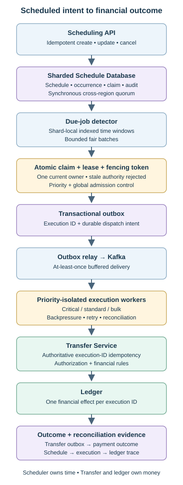
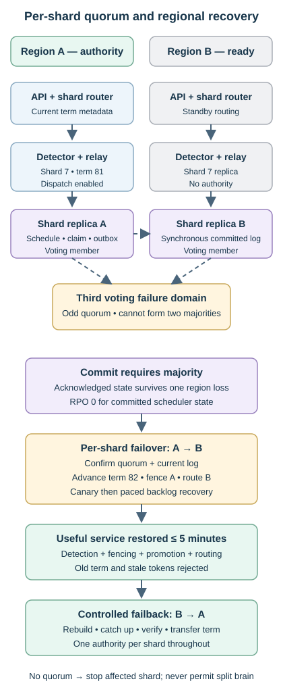

# Topic 9 — Distributed Scheduler

[Back to Architecture Drills](../README.md)

**Status:** Complete

A bank's Distributed Scheduler durably records future and recurring work, detects jobs when they become eligible, grants one fenced execution authority, and dispatches execution intent without making the scheduler the owner of financial truth. The accepted design is **Scheduling API → sharded Schedule Database → due-job detector → atomic claim + lease + fencing token → transactional outbox → Kafka → workers → Transfer Service → ledger**, with reconciliation, priority isolation, synchronous cross-region durability and quorum-safe per-shard recovery.

**The Scheduler owns time and dispatch intent; the Transfer Service and ledger own the financial outcome.** Delivery is at least once. Stable execution IDs and authoritative idempotency turn repeated delivery into one financial effect. The recovery objectives are **RPO 0** for committed schedules and execution state and **RTO 5 minutes** for regional recovery. Numerical scenarios are exercises; production targets, capacity and sign-offs still require evidence.

## Contents

- [Problem & Requirements](#problem--requirements)
- [Final Architecture](#final-architecture)
- [End-to-End Flow](#end-to-end-flow)
- [Component Responsibilities](#component-responsibilities)
- [Key Architecture Decisions](#key-architecture-decisions)
- [Classification, Preferences & Routing](#classification-preferences--routing)
- [Data & Consistency](#data--consistency)
- [Scaling](#scaling)
- [Reliability & Failure Modes](#reliability--failure-modes)
- [Security](#security)
- [Observability](#observability)
- [Constraint Mutations](#constraint-mutations)
- [Adversarial Architecture Review](#adversarial-architecture-review)
- [AI Intersection](#ai-intersection)
- [TPM Delivery](#tpm-delivery)
- [Program Risks](#program-risks)
- [TPM Constraint Mutations](#tpm-constraint-mutations)
- [Production Readiness](#production-readiness)
- [Rollout & Rollback](#rollout--rollback)
- [Concepts Learned](#concepts-learned)
- [Mental Models](#mental-models)

## Problem & Requirements

| Requirement | Decision and consequence |
|---|---|
| One-time and recurring financial jobs | Persist the schedule before acknowledging it; materialize each occurrence as a distinct execution with a stable ID. |
| Survive service, worker and regional failure | Durable state, atomic claims, renewable leases, fencing tokens and replicated recovery state; no correctness dependence on process memory. |
| Execute close to the requested time | Indexed time buckets and continuous due-job detection; define measurable lateness rather than claiming exact wall-clock execution. |
| Prevent duplicate debits | Enforce the same execution ID at the Transfer Service and authoritative ledger boundary; Kafka delivery semantics alone are insufficient. |
| Avoid lost dispatch after a database commit | Write schedule/execution changes and an outbox row in one local transaction; relay the outbox to Kafka. |
| Handle recurrence, time zones and daylight saving time | Store the recurrence rule, IANA time-zone ID, policy and next occurrence; calculate occurrences deterministically. |
| Protect constrained transfer capacity | Global admission control, backpressure and isolated priority lanes; reserve capacity for critical payments. |
| Scale beyond one database | Shard by stable routing key, retain per-shard due indexes and assign exclusive fenced ownership. |
| Regional continuity | Synchronous cross-region quorum for committed state, per-shard authority, fencing and rehearsed failover/failback: **RPO 0, RTO 5 minutes**. |
| Operability and auditability | Trace schedule → occurrence → claim → dispatch → financial outcome; prove recovery and reconciliation before launch. |

A cron process answers “what should run on this machine?” A distributed financial scheduler must additionally answer **where durable intent lives, who owns an occurrence, what happens after every crash boundary, and how repeated dispatch avoids repeated money movement**. It coordinates time; it does not absorb Transfer Service or ledger responsibilities.

## Final Architecture

### Scheduled intent to financial outcome

[Open the scalable scheduler-flow diagram](assets/scheduler-flow.svg)

### Claim, lease and fencing boundary

[Open the scalable claim and fencing diagram](assets/claim-fencing.svg)

### Quorum-safe regional recovery

[Open the scalable multi-region DR diagram](assets/multi-region-dr.svg)

Blue denotes services and transport, green successful progress, purple durable state, amber policy or recovery controls, red rejected stale authority, and grey passive components. The SVGs use Topic 8's narrow layout and palette for readable rendering on mobile and desktop.

## End-to-End Flow

1. **Accept:** authenticate and validate a one-time or recurring request. The client supplies an idempotency key; the API resolves it to one durable `scheduleId` and returns only after the write meets cross-region commit policy.
2. **Persist:** store schedule definition, state, normalized time data and the next eligible occurrence. For a financial occurrence, create a stable `executionId` such as `scheduleId + occurrenceInstant` under a uniqueness constraint.
3. **Detect:** shard-local detectors query an indexed time range using database time and bounded batches. They do not scan the full table or rely on one process timer.
4. **Claim:** one contender atomically changes an eligible execution to claimed, records `leaseUntil`, owner and a monotonically increasing fencing token. Conditional update or locked selection prevents two successful claims.
5. **Dispatch durably:** in the same transaction as the state transition, write an outbox record containing the stable execution ID, token and minimal command data. The relay retries publication to Kafka and marks publication progress.
6. **Execute safely:** workers consume at least once and call the Transfer Service using the same execution ID. The Transfer Service checks idempotency in its authoritative database transaction and the ledger enforces a unique financial reference.
7. **Record outcome:** the Transfer Service publishes a payment-outcome event through its own outbox. The Scheduler records `Succeeded`, `Failed`, `Unknown` or retry state, but the ledger remains the authority for money movement.
8. **Recover:** expired claims may be reclaimed with a higher token. A downstream that accepts tokens rejects stale work. For a financial call with an unknown outcome, reconcile by execution ID before retrying.
9. **Advance recurrence:** after materializing the current occurrence, compute the next local-time occurrence from the pinned rule and time-zone policy. Each occurrence has independent state and identity.
10. **Control overload:** admission and dispatch rates respect global Transfer Service capacity. Critical payments use reserved lanes; routine and bulk work wait without losing durable intent.
11. **Survive region loss:** quorum determines each shard's surviving authority. Fence the failed side, promote only with a majority and current log, restore useful service within five minutes, then fail back through synchronization and controlled ownership transfer.

## Component Responsibilities

| Component | Responsibility / boundary |
|---|---|
| Scheduling API | Authentication, authorization, validation, request idempotency, create/update/cancel and status; no in-memory-only schedules. |
| Shard router / metadata | Stable route from tenant/customer or schedule key to shard; versioned mapping and controlled resharding. |
| Schedule Database | Authoritative schedule, occurrence, claim, lease, token, outbox and audit state; indexed due-time access. |
| Due-job detector | Find bounded eligible work per shard, fairly and repeatedly; tolerate overlap and missed polling cycles. |
| Claim coordinator | Atomic state transition, lease renewal, token increment and ownership rules. |
| Outbox relay | Publish committed dispatch intent to Kafka, retry safely and expose lag; not proof of execution. |
| Kafka | Durable buffering, partitions, consumer groups and redelivery; not the financial idempotency authority. |
| Execution workers | Validate command, honor priority and capacity controls, call Transfer Service and preserve execution identity. |
| Transfer Service + ledger | Authorize and atomically enforce one financial effect per execution ID; return/reconcile authoritative outcome. |
| Retry / DLQ / replay operations | Bounded retries, unknown-outcome reconciliation, poison-work quarantine and controlled replay. |
| Quorum / shard authority control | Cross-region commit, leader/term ownership, fencing, failover and failback for each shard. |
| Observability / SRE / audit | End-to-end evidence, SLOs, alerts, capacity and recovery operations. |

## Key Architecture Decisions

| Decision / disposition | Why and trade-off |
|---|---|
| **Accepted:** durable database is schedule authority | Timers and Kafka delays are accelerators, not the only copy; indexed polling adds database load. |
| **Accepted:** atomic claim + lease + monotonically increasing fencing token | Leases recover abandoned work; fencing protects against a paused former owner. Token enforcement is required at mutable boundaries. |
| **Accepted:** transactional outbox before Kafka | Removes the database-commit/publish gap; relay and broker may duplicate messages. |
| **Accepted:** stable execution ID at Scheduler, Transfer Service and ledger | Converts redelivery, retry and failover into one financial effect; requires retained idempotency history and payload consistency checks. |
| **Accepted:** one occurrence row per recurring fire | Gives each run identity, status and audit evidence; increases storage and lifecycle work. |
| **Accepted:** database sharding with shard-local due indexes | Scales writes and polling; introduces routing, rebalancing and per-shard recovery complexity. |
| **Accepted:** global backpressure plus reserved priority capacity | Protects Transfer Service and critical payments; routine work may become late. |
| **Accepted:** synchronous cross-region quorum per shard | Meets RPO 0 for acknowledged commits and safe authority transfer; raises write latency and may reject writes without quorum. |
| **Accepted:** RTO 5 minutes is a release gate | Makes recovery measurable; demands pre-provisioning, automation and rehearsals. |
| **Accepted:** AI is asynchronous and advisory | Forecasting and anomaly insight can help without controlling financial correctness. |
| **Rejected:** one cron leader with local memory | Loses work/ownership evidence and creates a single failure and scale boundary. |
| **Rejected:** `SELECT` then later `UPDATE` as a claim | Two workers can observe and dispatch the same row. |
| **Rejected:** lease expiry alone proves old worker stopped | A paused worker can resume after expiry; only enforceable fencing closes that race. |
| **Rejected:** Kafka exactly-once means exactly-once debit | Broker scope does not atomically include the Transfer Service and ledger. |
| **Rejected:** asynchronous cross-region replicas for RPO 0 | An acknowledged commit may be absent after regional loss. |
| **Rejected:** active-active writers without quorum ownership | Partitioned regions can both dispatch the same shard. |
| **Rejected:** unlimited retry or release all backlog at once | Amplifies dependency failure and overload. |

The final Architecture Review Board defense prioritized **financial correctness**, **exclusive distributed ownership with durable recovery**, and **controlled execution under constrained capacity**.

## Classification, Preferences & Routing

Scheduling policy classifies work by **timing model, priority, misfire behavior and financial criticality** before dispatch. Routing selects the owning database shard, Kafka partition, worker lane and Transfer Service capacity budget. These decisions are deterministic and versioned; they do not depend on a worker's local clock or an AI prediction.

| Class / example | Scheduling and constrained-capacity behavior |
|---|---|
| Critical financial — regulatory or time-bound payment | Reserved dispatch and Transfer Service capacity; immediate recovery within authorization and ledger controls. |
| Standard financial — scheduled transfer or bill payment | Execute within its lateness SLO; queue durably and reconcile unknown outcomes before retry. |
| Recurring routine — periodic account sweep | Apply its explicit time-zone, misfire and catch-up policy; do not issue every missed transfer automatically. |
| Bulk / administrative — reports or maintenance | Throttle or defer first; never consume the capacity reserved for critical payments. |

Priority allocates scarce capacity; it never bypasses authorization, account state, limits or ledger controls. A class label in one shared FIFO is insufficient: the design reserves worker, Kafka, database and Transfer Service capacity for the lanes that must remain available.

### Time model

Persist instants in UTC and preserve the user's scheduling intent separately: original local date/time, IANA time-zone ID such as `America/Toronto`, recurrence rule, daylight-saving policy and rule version. An offset such as `-05:00` is not a time zone and cannot describe future transitions.

| Case | Explicit policy |
|---|---|
| One-time instant | Convert the validated local request to one UTC instant and retain the original context for audit. |
| Spring-forward nonexistent local time | Reject, move to the next valid instant or apply a product-specific rule; never silently guess. |
| Fall-back ambiguous local time | Select first/second occurrence or require disambiguation; persist the choice. |
| Daily local-time recurrence | Recalculate from local calendar intent and zone rules; do not add 24 hours to the prior UTC instant. |
| Fixed elapsed interval | Add the specified duration; this is different from “same local time every day.” |
| Time-zone rule update | Define whether future occurrences use current rules or pinned rules; record the effective version. |

### Recurrence, misfire and cancellation

Materialize only a bounded horizon or the next occurrence so an unbounded recurrence does not create infinite rows. Advance with compare-and-set so competing schedulers cannot materialize the same occurrence twice. A unique key on `(scheduleId, occurrenceKey)` is the final duplicate guard.

A **misfire** is an occurrence that became due but was not dispatched within its expected window. Policy is business-specific: execute immediately, skip, coalesce missed occurrences, or replay a bounded number. A recurring payment should not automatically issue every missed debit after a long outage. Persist the selected policy and expose misfire count and age.

Cancellation is a state transition, not deletion. If cancellation wins before claim/dispatch, suppress the occurrence. If dispatch already committed, the API returns an explicit `too_late` or `cancellation_pending` result and coordinates with the Transfer Service where cancellation is supported. A tombstone and audit record prevent recovery code from recreating cancelled work. Never promise that deleting a row recalls a Kafka message or reverses a debit.

Clock skew is bounded operationally and reduced by using authoritative database time for eligibility and leases. Monotonic elapsed time helps local lease renewal, but persisted comparisons use a shared time source. Alert on NTP drift; safety still relies on atomic state and fencing, not perfect clocks.

## Data & Consistency

### Core records

| Record / key | Purpose and invariant |
|---|---|
| `Schedule(scheduleId, clientKey, shardKey, rule, zone, state, nextFireAt, version)` | Durable user intent; unique scoped client key makes create retry-safe. |
| `Execution(executionId, scheduleId, occurrenceKey, dueAt, priority, state)` | One logical occurrence; unique `(scheduleId, occurrenceKey)`. |
| Claim fields: `ownerId, leaseUntil, fencingToken` | Recoverable ownership; token increases on every successful new claim. |
| `Outbox(eventId, executionId, payloadHash, publishedAt)` | Dispatch intent committed with execution state; unique event ID. |
| Transfer idempotency record | Unique execution ID plus request hash, stored atomically with transfer/ledger mutation. |
| Financial outcome | Authoritative transfer/ledger result correlated to execution ID. |
| Attempt / transition audit | Append-only evidence for claims, sends, retries, cancellation and operations. |

### Atomic claim and fencing

An eligible claim is a single conditional write: state is due or the prior lease expired, cancellation is absent, and the expected version still matches. The transaction increments the fencing token and may write the dispatch outbox. If two workers race, at most one conditional update succeeds.

A lease is a liveness mechanism: another worker can recover after the owner disappears. It is not a safety mechanism once the old worker has read the job. Every downstream mutation that can be fenced stores the greatest accepted token for that resource or shard and rejects smaller tokens. For the financial side effect, the stable execution ID is the non-negotiable guard even when token propagation is unavailable.

### Transactional outbox and Kafka

Writing `Dispatched` and publishing to Kafka cannot be one ordinary atomic transaction. The outbox keeps the database transition and publication intent together. The relay may publish, crash before marking published, and publish again. Kafka may redeliver after a consumer crash. Therefore:

- reuse `eventId` and `executionId` on every publication attempt;
- key records for required ordering, without assuming global order;
- mark scheduler handoff only after durable outbox creation;
- commit consumer progress after durable downstream handoff;
- retain idempotency state at least as long as any retry, replay, DR and audit horizon.

### Financial idempotency and reconciliation

The Scheduler's unique execution row prevents duplicate intent but cannot atomically cover a remote debit. The Transfer Service must enforce a unique execution ID in the same authoritative transaction as the transfer and ledger entries. A repeated ID with the same request returns the stored result; the same ID with a different payload is a conflict and an alert.

If the worker times out after the Transfer Service commits, the outcome is **unknown**, not failed. Query/reconcile by execution ID before retrying. Transfer outcome events use the Transfer Service's outbox so committed money movement and outcome intent do not diverge. Periodic reconciliation compares Scheduler executions, transfer records and ledger references; discrepancies enter an owned exception workflow.

## Scaling

- **Due index:** index `(state, dueAt)` or shard/time-bucket equivalents. Fetch small ordered batches and use a look-ahead window. Avoid full-table scans and one giant hot queue.
- **Sharding:** route by stable customer/tenant key where ordering or per-customer controls matter. Each shard owns schedule, execution and outbox state together. Cross-shard business operations remain outside the Scheduler.
- **Detector parallelism:** assign shard or bucket ranges through exclusive leases/consensus. Overlapping detection is acceptable when claims remain atomic; unbounded duplicate scans are not.
- **Kafka partitions:** choose a key aligned with necessary ordering and distribute hot tenants using approved subkeys when strict total customer ordering is unnecessary.
- **Hot customers:** per-tenant quotas, fair queues and split routing prevent one customer from monopolizing a shard. Moving a hot key requires versioned routing, dual-read or migration state, and single write authority.
- **Backpressure:** bound in-flight calls and adjust dispatcher admission from Transfer Service latency, errors, quota and queue age. Polling more due rows does not create downstream capacity.
- **Priority:** separate critical, standard and bulk lanes with reserved worker, database, Kafka and Transfer Service capacity. Labels in one FIFO do not isolate resources.

If 20K jobs/sec become due and Transfer Service safely accepts 12K/sec, backlog grows by **8K/sec or 28.8 million/hour**. More scheduler workers worsen pressure unless downstream capacity changes. During overload, preserve durable intent, admit at the safe global rate, reserve critical capacity, defer lower classes and expose projected drain time. Backlog drains only while sustainable completion exceeds new eligible arrivals.

Global rate limiting cannot be a disconnected per-worker guess. Allocate regional/shard budgets from one capacity policy with conservative local fallback. Include new work, retries, replay and DR recovery in the same envelope. Prefer shedding new optional schedules at the API over accepting work that cannot meet its contract; never silently drop committed financial jobs.

## Reliability & Failure Modes

| Failure | Containment and recovery |
|---|---|
| API times out after commit | Client retries same idempotency key; return the existing schedule and reject payload mismatch. |
| Detector crashes | Another detector scans the same time range; durable eligible rows remain discoverable. |
| Worker dies after claim | Lease expires; new owner claims with higher token and resumes from durable state. |
| Old worker resumes after expiry | Downstream rejects stale fencing token; financial boundary also deduplicates execution ID. |
| DB commit succeeds, Kafka unavailable | Outbox retains intent; relay backs off and publishes after recovery. |
| Kafka publish succeeds, relay state update fails | Duplicate publication uses same IDs and is safely consumed. |
| Consumer crashes after transfer commit | Redelivery reuses execution ID; Transfer Service returns stored result. |
| Transfer timeout / unknown outcome | Reconcile by execution ID before retry; do not classify timeout as no debit. |
| Invalid command or permanent business rejection | Record terminal reason; quarantine technical poison messages without retrying unchanged input. |
| Transient dependency error | Exponential backoff with jitter, bounded attempts/elapsed time and shared capacity budget. |
| Retry exhaustion | DLQ/exception queue with named owner, audit, repair and controlled replay. |
| Scheduler outage / misfire backlog | Apply per-job misfire policy and drain within safe downstream capacity. |
| Clock drift | Alert, remove unhealthy nodes and use database time; claims and uniqueness preserve safety. |
| Shard leader/region loss | Majority elects current authority, increments term/token and restores processing within RTO. |
| Loss of cross-region quorum | Stop acknowledging writes/dispatch for affected shards rather than risk RPO 0 or split brain. |

Retry policy separates transient, permanent and unknown outcomes. Circuit breakers stop futile calls to an unhealthy Transfer Service; backpressure limits aggregate work; priority decides who receives scarce capacity. These controls solve different problems and all are required.

**Controlled DLQ replay:** repair and verify the cause → select eligible executions → reconcile financial state → canary a small set with original IDs → verify ledger/outcomes/errors → ramp inside spare capacity → stop on mismatch, throttling or duplicate-effect signals. Resetting offsets or generating new IDs is not repair.

### Multi-region durability and recovery

RPO 0 means every acknowledged schedule, cancellation, claim and execution transition required for correctness survives loss of either region. The accepted design commits through a cross-region majority for each shard. A two-region topology therefore needs a quorum arrangement that does not let both isolated regions form authority—commonly an odd voting set or a managed consensus system with a third failure domain. Two independent regional primaries are not a quorum.

| Control | Required design / evidence |
|---|---|
| RPO 0 | Synchronous quorum before acknowledgement; committed log and snapshots include schedules, executions, tokens, outbox and cancellation state. |
| RTO 5 minutes | Pre-provisioned services, automated health/quorum decision, shard promotion, routing and backlog restart; measure useful processing, not merely DNS change. |
| Per-shard authority | One leader/term at a time; routing carries the current epoch and clients reject stale metadata. |
| Fencing | Promotion advances term/token; old-region dispatch and writes are rejected at database, relay and downstream boundaries. |
| Kafka continuity | Replicate or recreate topics, offsets and producer/consumer identity without losing the database outbox as the recovery source. |
| Failover | Confirm majority and current log, fence old authority, promote shard, route, canary and ramp inside Transfer capacity. |
| Failback | Keep recovery region authoritative, rebuild and catch up original region, verify equality, transfer each shard deliberately, then canary/ramp. |
| Degraded quorum | Prefer consistency: reject or queue unacknowledged requests at a controlled edge; do not lower durability silently. |

Failover is per shard so healthy shards need not move. Automation must prevent a mass promotion from releasing the whole backlog simultaneously. A five-minute RTO includes detection, decision, fencing, promotion, routing and resumption. RPO 0 does not promise zero duplicate delivery; stable IDs and reconciliation handle repeated attempts.

## Security

| Area | Control |
|---|---|
| API and ownership | Strong client/service identity, authorization by tenant/account, scoped idempotency keys and immutable audit. |
| Payload | Store references and minimum execution data; keep credentials, full account data and unnecessary personal data out of Kafka and logs. |
| Commands/events | Schema validation, authenticated producers, topic ACLs, integrity checks and controlled version compatibility. |
| Database | Encryption, least privilege, separation of API/detector/relay roles, backup protection and audited administrative changes. |
| Financial boundary | Transfer Service reauthorizes the operation; Scheduler identity never bypasses limits, sanctions, account state or ledger controls. |
| Operations | Dual control for bulk cancellation/replay, bounded tools, dry-run/canary, approval evidence and immutable operator audit. |
| Secrets | Managed secrets, workload identity, rotation and no credentials in schedule payloads. |
| AI | Minimized/redacted inputs, approved models, no autonomous transfer decision, provenance and deterministic fallback. |

## Observability

The Scheduler is authoritative for recorded schedule and dispatch workflow. The Transfer Service and ledger are authoritative for financial outcome. Correlate `scheduleId`, `executionId`, `eventId`, shard, claim token, Kafka partition/offset, transfer ID and ledger reference without logging sensitive payloads.

| Signals | Meaning / response |
|---|---|
| API success/error/latency and idempotency conflicts | Ingress health and unsafe client reuse. |
| Due jobs, oldest due age and schedule-to-dispatch latency | Customer-visible scheduler timeliness; depth alone hides old work. |
| Claim success/conflict, expired leases and stale-token rejects | Ownership health, slow workers or split-brain attempts. |
| Outbox depth/age and publish latency | Database-to-Kafka handoff health. |
| Kafka lag by priority/shard and rebalance rate | Dispatch backlog, skew and consumer stability. |
| Transfer latency, quota, `429/5xx`, breaker and unknown outcomes | Downstream capacity and reconciliation demand. |
| Retry/DLQ depth, growth and oldest age | Unresolved work and operational ownership. |
| Misfire/cancellation-race counts | Time semantics and product-policy impact. |
| Idempotency hit/conflict and reconciliation mismatch | Duplicate recovery behavior and financial correctness. |
| Quorum health, commit latency, leader changes and stale terms | RPO exposure and authority safety. |
| Failover phase and measured restoration time | RTO evidence per shard and region. |

Define SLOs for create durability, dispatch lateness by priority, terminal financial outcome, reconciliation age and regional restoration. “Service is up” does not satisfy a schedule that is 20 minutes late. Dashboards separate **API / Scheduling / Dispatch / Financial Outcomes / Capacity / DR / Exceptions**; alerts have thresholds, sustained windows, named owners and runbooks.

## Constraint Mutations

| Changed constraint | Accepted response / correction |
|---|---|
| Transfer capacity falls by 50% | Reduce global dispatch, preserve critical reserve, defer standard/bulk, stop retry amplification and publish drain forecast. |
| 10× schedules become due together | Fair bounded claims, isolated priority lanes and paced release; do not load all rows or flood Kafka/Transfer. |
| Kafka unavailable for 30 minutes | Outbox accumulates durable intent; alert on age/storage, then drain under Transfer capacity after recovery. |
| Worker pauses beyond its lease | New owner receives higher token; stale worker is rejected and repeated execution ID cannot debit again. |
| Region A loses network to Region B/witness | Only the side with quorum remains authoritative; the minority stops writes and dispatch. |
| Cancellation races with dispatch | Conditional state decides the winner; return explicit result and reconcile if external execution may have begun. |
| DST skips 02:30 | Apply the stored nonexistent-time policy and audit the resolution; never infer silently. |
| Three days of missed recurring payments | Apply configured skip/coalesce/bounded catch-up policy and capacity control; never blindly issue all debits. |
| AI service unavailable | Core scheduling and financial flow continue unchanged; defer forecasts/recommendations. |

## Adversarial Architecture Review

| Challenge | Outcome retained |
|---|---|
| Replace the database with Kafka delayed messages? | Reject as sole authority: cancellation, recurrence, queries, long horizons and replay need durable schedule state. Kafka may assist dispatch. |
| Use Redis TTL for every job? | Reject as sole durable source for financial intent; optional near-term acceleration must rebuild from the database. |
| One elected scheduler means claims are unnecessary? | Reject: leadership can overlap during pause/partition and workers still crash. Atomic state and fencing remain required. |
| A long lease prevents duplicates? | Reject: it slows recovery and still cannot stop a stale process. |
| Transfer Service is reliable, so Scheduler dedup is enough? | Reject: the remote commit/response gap makes authoritative idempotency mandatory. |
| Async replication plus fast failover can claim RPO 0? | Reject: fast recovery does not restore an unreplicated acknowledged write. |
| Keep both regions active for availability? | Only with one quorum-controlled owner per shard; two independent writers violate safety. |
| Critical priority may bypass financial controls? | Reject: priority allocates capacity, never authorization, limits or ledger correctness. |
| Retry until success? | Reject for permanent and unknown outcomes; bound retry and reconcile. |
| DR can launch after production? | Reject. Failed or unproven five-minute regional recovery is a No-Go. |

## AI Intersection

**Rejected:** synchronous AI deciding whether a financial job executes, assigning authoritative priority, resolving ambiguous time, or approving a retry. Model latency, availability and nondeterminism do not belong in the correctness path.

Useful asynchronous work includes arrival/capacity forecasting, hot-shard prediction, anomaly detection across lateness and retries, operator summaries, and recommendations for resharding or capacity allocation. Inputs are minimized and redacted. Every recommendation stays within deterministic policy and requires measurable evaluation: offline replay → human review → shadow mode → limited canary → monitored expansion. Record model/version and recommendation provenance. AI failure leaves the core scheduler unchanged.

## TPM Delivery

| Outcome-based workstream | Completion evidence |
|---|---|
| Architecture baseline | Approved boundaries, state model, shard ownership, fencing, RPO 0/RTO 5m and decision record. |
| Scheduling platform | Idempotent APIs, schedule/occurrence store, due detection, claims, recurrence, cancellation and audit. |
| Kafka / outbox | Contracts, topics/partitions, relay, retry/DLQ, schema compatibility and capacity. |
| Transfer / ledger | Execution-ID contract, atomic idempotency, outcome outbox, query/reconciliation and business rejection semantics. |
| Data / infrastructure / DR | Shards, quorum, routing, backup/restore, fencing, automated failover/failback and capacity. |
| Security / compliance | Threat model, identities/ACLs, data minimization, retention, operator controls and InfoSec approval. |
| Observability / operations | SLOs, dashboards, alerts, runbooks, RACI, on-call, vendor escalation and handover. |
| Testing / release | DIT/SIT/UAT, performance, resilience, reconciliation, DR evidence, rollout/rollback and formal Go/No-Go. |

**Critical path:** approve architecture and financial identity → finalize API/event/ledger contracts → prove atomic idempotency and claim fencing → integrate end to end → prove peak/backlog/reconciliation → prove RPO 0 and RTO 5 minutes → complete security/operations/business sign-offs → canary.

Milestones use entry/exit criteria, dated dependency owners and evidence. The four primary workstreams—Scheduling Platform, Kafka, Transfer Service and Infrastructure—integrate through versioned contracts and shared end-to-end tests. Operational readiness begins while features are built, not after code completion.

## Program Risks

| Risk / owner function | Mitigation → trigger → contingency |
|---|---|
| Transfer idempotency incomplete / Payments | Unique execution reference and concurrency tests → duplicate/mismatch evidence → block financial rollout. |
| Quorum design cannot meet latency/availability / Data + SRE | Prototype cross-region commits and failure modes → SLO or quorum loss → re-architect/topology decision, not weaker hidden durability. |
| Hot shard or due-time burst / Platform | Distribution analysis, fair quotas and load tests → age/skew breach → split key, isolate tenant and add capacity. |
| Backlog overwhelms Transfer / Payments + SRE | Shared rate envelope and recovery tests → quota/latency breach → pause lower lanes and controlled drain. |
| DST/recurrence policy ambiguity / Product + Compliance | Approve testable rules → unresolved edge case → hold affected schedule type. |
| Reconciliation ownership gap / Operations + Finance | Exception workflow and SLA → unknown outcome ages → stop expansion/escalate. |
| DR vendor remediation / Infrastructure | Milestones and repeated rehearsal → RTO >5m → No-Go and executive escalation. |
| Security/privacy finding / InfoSec | Early threat/data review → critical finding → remediate before launch. |

Maintain named owners, dates, evidence, triggers and residual-risk decisions in RAID. Status colour does not replace proof.

## TPM Constraint Mutations

| Constraint | Delivery response |
|---|---|
| Development complete; Kafka and idempotency pass; DR exceeds five minutes; launch date fixed | **No-Go.** Escalate to sponsor/steering committee, keep remediation on the critical path, retest and obtain formal sign-off. |
| Cross-region write latency threatens the API SLO | Quantify and optimize quorum placement/batching; do not silently relax RPO 0. Escalate the business trade-off if objectives conflict. |
| Peak load passes but backlog drain starves new critical work | Fail the capacity gate; require priority isolation and recovery-envelope retest. |
| Non-critical documentation remains after all safety paths pass | Conditional Go only with named owner/date, explicit risk acceptance and no effect on operational response. |

Business pressure does not erase an agreed resilience requirement. Changing RPO/RTO requires formal risk governance; it is not an informal release workaround.

## Production Readiness

Required gates, **not claims of passed production tests**. Each needs criteria, owner, evidence and sign-off.

| Gate | Evidence before Go |
|---|---|
| Functional / contract | Create/update/cancel/status, one-time/recurring rules, API/Event schema compatibility, Transfer outcomes and UAT. |
| Correctness / concurrency | Duplicate creates, simultaneous claims, lease expiry, stale token, duplicate Kafka, payload mismatch and one ledger effect. |
| Time behavior | DST gaps/overlaps, time-zone changes, clock drift, leap/calendar boundaries, misfires and cancellation races. |
| Failure boundaries | Crash before/after claim, outbox commit/publish, transfer commit/response and outcome publication; reconciliation closes unknowns. |
| Performance / capacity | Peak and 10× burst, hot shard/customer, global Transfer quota, priority isolation, retry amplification and controlled drain. |
| Data resilience | Backup/restore, quorum loss, replica rebuild, resharding, retention and audit integrity. |
| Regional DR | Region loss at critical boundaries, per-shard fencing/promotion, measured **RPO 0/RTO ≤5m**, backlog pacing and failback. |
| Security / compliance | Threat model, InfoSec/privacy approval, identities/ACLs, secrets, financial authorization and operator dual control. |
| Operations / release | Actionable alerts, runbooks, RACI, on-call/HOTO, finance exception ownership, rollback rehearsal and sign-offs. |

No unresolved critical defect, unproven financial idempotency, stale-owner path, reconciliation gap or regional recovery path. A failed five-minute DR test is a No-Go even if feature development and ordinary integration tests pass.

## Rollout & Rollback

Use dark reads/shadow detection → non-financial canary → limited low-risk financial cohort → progressive shard/tenant expansion. Keep the legacy scheduler from dispatching the same cohort: migration establishes one authority and reconciles open schedules before cutover. Monitor lateness, duplicate attempts/effects, unknown outcomes, Transfer pressure, shard skew and quorum health.

Rollback stops new admissions/dispatch for the affected cohort, preserves schedule/execution/outbox/idempotency state and transfers authority through a controlled fence. It cannot undo a committed transfer. Reconcile in-flight executions before replay or migration. Never rollback by deleting rows, regenerating execution IDs or resetting Kafka offsets without state-aware controls.

## Concepts Learned

| Concept | Working meaning / correction |
|---|---|
| Schedule / occurrence / execution | User recurrence intent / one calendar fire / one stable unit of work and identity. |
| Due detection / claim | Find candidates / atomically grant recoverable authority. |
| Lease / fencing token | Time-bounded liveness / monotonic protection against stale owners. |
| Outbox / Kafka | Atomic local dispatch intent / durable at-least-once transport. |
| Idempotency / deduplication | Same identity produces one authoritative effect / repeated delivery is recognized. |
| Failed / unknown | Confirmed negative outcome / result not yet known and requiring reconciliation. |
| Misfire / retry | Missed scheduling window / another attempt after a classified failure. |
| Priority / backpressure | Allocate scarce capacity / constrain offered load. |
| Shard / quorum | Scale and failure unit / votes required for safe committed authority. |
| RPO / RTO | Acceptable committed-data loss / time to restore useful service. Here: 0 and 5 minutes. |

## Mental Models

- **The Scheduler owns time; the ledger owns money.**
- Durable intent comes before acknowledgement.
- Detect broadly; claim atomically; execute with stable identity.
- A lease enables recovery. A fencing token stops a stale owner.
- The outbox closes the local commit/publish gap; downstream idempotency closes the remote effect gap.
- Every recurring occurrence gets its own deterministic execution ID.
- A timeout is an unknown outcome until reconciled.
- Backpressure protects capacity; priority decides who uses it; neither creates capacity.
- RPO 0 requires synchronous commit to a quorum, not hopeful replication.
- Failover transfers authority per shard; failback is another controlled migration.
- AI advises outside the financial path; deterministic controls remain accountable.

---

**Design basis:** 44 completed questions across 11 stages, accepted/refined/challenged/rejected proposals, constraint mutations, AI boundaries and Staff TPM delivery. Previous: [Topic 8 — Notification System Architecture](../08-notification-system/README.md). Next: Topic 10 — CDN + Edge Architecture (planned).
