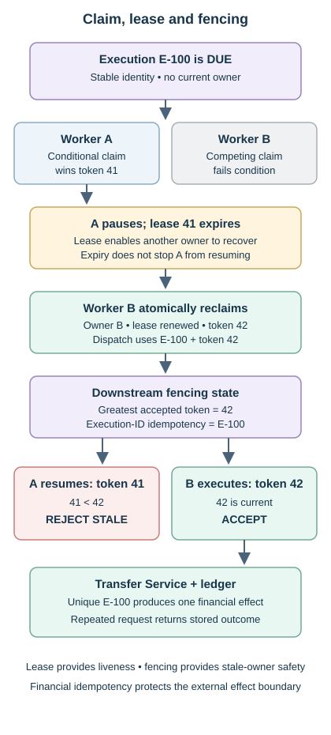

# Topic 9 — Distributed Scheduler

[Back to Architecture Drills](../README.md)

**Status:** Complete

At 8:30 AM, a customer schedules a **$5,000 transfer for 9:00 AM**. The bank accepts the request and shows it as scheduled. At 9:00, a Scheduler node finds the payment and begins dispatching it. Then the node pauses, another node takes over, and Kafka later redelivers the same command. The customer intended one transfer. A design that turns those retries into two debits is incorrect, even if every individual service behaved as configured.

This chapter designs the distributed scheduling platform that prevents that outcome. The accepted path is **Scheduling API → sharded Schedule Database → due-job detector → atomic claim → transactional outbox → Kafka → workers → Transfer Service → ledger**. Leases and fencing tokens control competing Scheduler nodes. Stable execution IDs and authoritative idempotency protect the financial effect. Synchronous cross-region quorum protects committed scheduler state.

The central ownership rule is: **the Scheduler owns time and dispatch intent; the Transfer Service and ledger own the financial outcome.** Delivery is at least once, so correctness comes from durable identity and reconciliation rather than a claim of exactly-once transport. The recovery objectives are **RPO 0** for acknowledged scheduler state and **RTO 5 minutes** for regional recovery. Numerical scenarios are teaching exercises; production thresholds, capacity and sign-offs still require measured evidence.

## Contents

- [Problem & Requirements](#problem--requirements)
- [Final Architecture](#final-architecture)
- [End-to-End Flow](#end-to-end-flow)
- [Component Responsibilities](#component-responsibilities)
- [Data & Consistency](#data--consistency)
- [Scaling](#scaling)
- [Reliability & Failure Modes](#reliability--failure-modes)
- [Security](#security)
- [Observability](#observability)
- [Key Architecture Decisions](#key-architecture-decisions)
- [Constraint Mutations](#constraint-mutations)
- [Adversarial Architecture Review](#adversarial-architecture-review)
- [AI Intersection](#ai-intersection)
- [TPM Delivery](#tpm-delivery)
- [Program Risks](#program-risks)
- [TPM Constraint Mutations](#tpm-constraint-mutations)
- [Production Readiness](#production-readiness)
- [Rollout & Rollback](#rollout--rollback)
- [Concepts Learned](#concepts-learned)
- [Mental Models](#mental-models)

## Problem & Requirements

The business request sounds simple: remember a payment and start it at the requested time. The engineering problem is harder because the scheduled time may arrive during a process crash, a deployment, a network partition or a regional outage. The platform must recover without losing the payment and without applying it twice.

For the $5,000 example, four conditions must all hold:

1. The bank must not acknowledge the schedule until the intent is durable.
2. At 9:00 AM, several Scheduler nodes may discover the same due row, but only one current owner may dispatch it.
3. If dispatch or the financial result is uncertain, every retry must preserve the same execution identity.
4. The Transfer Service and ledger must enforce one financial effect for that identity.

### Scheduling fundamentals

A **scheduler** stores an instruction and makes it eligible for execution at the correct time. A **one-time job** has one requested due time. A **recurring job** describes a series of future occurrences, often with a calendar rule or a **cron expression** such as “09:00 every weekday.” The cron expression describes when occurrences should become due; it does not provide durable storage, distributed ownership or financial correctness.

The **scheduled time** is the customer's requested time. The **due time** is the instant at which an occurrence becomes eligible for dispatch after applying its time-zone and calendar rules. The **actual execution time** is when the Transfer Service begins or completes the financial work. Their difference is **scheduling latency** or lateness. A payment can therefore be durably scheduled for 9:00 AM, become due at 9:00 AM and execute at 9:00:03 without changing its identity.

An occurrence moves through explicit states such as `Scheduled → Due → Claimed → Dispatched → Succeeded / Failed / Unknown`. A **misfire** occurs when it is not dispatched within its expected window. A **retry** repeats the same execution after a recoverable failure; **rescheduling** changes when a future occurrence should become due. A retry must preserve the execution ID, while an approved schedule modification creates or recalculates future occurrences under versioned rules.

Cancellation also changes durable state. It does not erase a Kafka record or reverse a transfer that has already committed. Time zones and daylight-saving transitions determine which instant a local calendar rule means; they are part of the schedule definition rather than display-only metadata.

### Why distributed scheduling is hard

An in-memory cron process can work for replaceable housekeeping tasks. It is insufficient for acknowledged bank payments because its timers disappear with the process, two nodes can fire the same job, and a regional failure can remove both the timer and its progress. A distributed scheduler must separate **discovery** from **ownership**, persist every important transition and assume that messages and calls may be repeated.

The difficult boundary is not merely “run at 9:00.” It is “recover after any crash without losing the instruction or creating a second debit.” That requirement drives atomic claims, leases, fencing tokens, the transactional outbox, stable execution identities and financial reconciliation.

| Requirement | Decision and consequence |
|---|---|
| One-time and recurring financial jobs | Persist the schedule before acknowledging it; materialize each occurrence as a distinct execution with a stable ID. |
| Survive service, worker and regional failure | Durable state, atomic claims, renewable leases, fencing tokens and replicated recovery state; no correctness dependence on process memory. |
| Execute close to the requested time | Indexed time buckets and continuous due-job detection; define measurable lateness rather than claiming exact wall-clock execution. |
| Prevent duplicate debits | Enforce the same execution ID at the Transfer Service and authoritative ledger boundary; Kafka delivery semantics alone are insufficient. |
| Avoid lost dispatch after a database commit | Write schedule/execution changes and an outbox row in one local transaction; relay the outbox to Kafka. |
| Handle recurrence, time zones and daylight saving time | Store the recurrence rule, IANA time-zone ID, policy and next occurrence; calculate occurrences deterministically. |
| Protect constrained transfer capacity | Global admission control, backpressure and isolated priority lanes; reserve capacity for critical payments. |
| Scale beyond one database | Shard by stable routing key, retain per-shard due indexes and assign exclusive fenced ownership. |
| Regional continuity | Synchronous cross-region quorum for committed state, per-shard authority, fencing and rehearsed failover/failback: **RPO 0, RTO 5 minutes**. |
| Operability and auditability | Trace schedule → occurrence → claim → dispatch → financial outcome; prove recovery and reconciliation before launch. |

A cron process answers “what should run on this machine?” A distributed financial scheduler must additionally answer **where durable intent lives, who owns an occurrence, what happens after every crash boundary, and how repeated dispatch avoids repeated money movement**. The Scheduler coordinates time and handoff. It must never bypass financial authorization, invent a transfer outcome or become a second ledger.

**Scope boundary.** The chapter covers one-time and recurring schedules, dispatch, failure recovery and the handoff to an existing Transfer Service. It does not redesign payment authorization, account limits, sanctions controls or double-entry accounting.

**Inputs still requiring production validation.** Traffic distribution, recurrence mix, record size, retention, shard count, Kafka partitions, safe Transfer Service rate, cross-region write latency and alert thresholds were not established by the drill. The examples below explain reasoning; they are not benchmark results.

## Final Architecture

The baseline diagram comes first so the normal payment path is clear before leases, fencing and regional recovery are introduced.

### Architecture at a glance

[Open the scalable scheduler-flow diagram](assets/scheduler-flow.svg)

The API stores schedule intent in the authoritative database. Due-job detectors find eligible executions through indexed queries. A successful claim creates durable dispatch intent in the transactional outbox. Kafka buffers that intent for workers, while the Transfer Service and ledger enforce the financial result. The normal path remains valid even though the transport can redeliver.

### Baseline and extensions

The baseline contains the Scheduling API, one logical authoritative Schedule Database, due-job detection, atomic claims, the outbox/Kafka handoff, workers and Transfer Service idempotency. Sharding and cross-region quorum extend that baseline to meet scale and recovery requirements. They do not change the stable schedule and execution identities.

## End-to-End Flow

The customer schedules transfer `S-501` for 9:00 AM. Its 9:00 occurrence becomes execution `E-501-0900`.

1. **Accept the schedule.** The channel sends the payment details, requested local time, time zone and an idempotency key. The API authenticates the caller, validates the rule and maps repeated identical requests to the same `scheduleId=S-501`.
2. **Persist durable intent.** The database stores the schedule, normalized timing data and next occurrence. The API responds only after the write satisfies the cross-region commit policy. A successful response therefore means the bank can recover the schedule after a process or regional failure.
3. **Materialize the occurrence.** The platform creates `executionId=E-501-0900` under a uniqueness constraint. A recurring schedule receives a different deterministic execution ID for every occurrence.
4. **Discover due work.** At 9:00 AM, shard-local detectors query an indexed due-time range in bounded batches. More than one detector may see the row; discovery does not grant execution authority.
5. **Claim atomically.** One contender changes the row from `Due` to `Claimed`, records its lease and receives the next fencing token. Other contenders fail the conditional update.
6. **Commit dispatch intent.** The same database transaction writes an outbox record for `E-501-0900`. This prevents a crash between “claimed” and “remembered for publication” from losing the payment.
7. **Publish and consume.** The outbox relay publishes to Kafka. A worker consumes the command and calls the Transfer Service with the original execution ID. Publication and consumption are at least once, so duplicates are expected.
8. **Apply one financial effect.** The Transfer Service stores `E-501-0900` atomically with the transfer and ledger entries. A repeated request with the same identity returns the stored result rather than creating another $5,000 debit.
9. **Record the outcome.** The Transfer Service publishes its outcome through its own outbox. The Scheduler records success, failure or an unknown result, while the ledger remains the authority for the money movement.
10. **Recover safely.** If the first Scheduler pauses, a new owner may reclaim the expired lease with a higher token. If the worker times out after the transfer committed, reconciliation looks up `E-501-0900` before any retry.

**Recurring schedules.** After materializing the current occurrence, the Scheduler calculates the next occurrence from the stored local-time rule and time-zone policy. It does not derive “9:00 AM tomorrow” by blindly adding 24 hours to a UTC timestamp.

## Component Responsibilities

| Component | Responsibility, purpose and boundary |
|---|---|
| Scheduling API | Authenticates, authorizes and validates create/update/cancel/status requests; request idempotency prevents duplicate schedules. **Why:** Channels need one durable contract. **Boundary:** It does not execute transfers or keep acknowledged schedules only in memory. |
| Shard router / metadata | Maps a stable tenant/customer or schedule key to its current shard. **Why:** Callers must find the authoritative owner as data grows. **Boundary:** Mapping changes are versioned migrations, not arbitrary rerouting. |
| Schedule Database | Owns schedule, occurrence, claim, lease, fencing token, outbox and audit state. **Why:** Recovery needs one durable record of intent and progress. **Boundary:** It records scheduling state, not the authoritative financial balance. |
| Due-job detector | Queries indexed time ranges and proposes bounded eligible batches. **Why:** Millions of future schedules cannot live as process timers. **Boundary:** Seeing a row does not authorize dispatch. |
| Claim coordinator | Performs the conditional state change, lease assignment and token increment. **Why:** Competing nodes need one current owner. **Boundary:** A lease alone cannot stop a stale owner after it resumes. |
| Outbox relay | Publishes committed dispatch records and exposes publication lag. **Why:** Database commit and Kafka publish cannot be one ordinary transaction. **Boundary:** “Published” is not “money moved.” |
| Kafka | Buffers commands, partitions work and redelivers after failure. **Why:** Workers and the Scheduler recover independently. **Boundary:** Broker guarantees do not provide ledger idempotency. |
| Execution workers | Preserve identity, obey priority/capacity controls and call the Transfer Service. **Why:** Execution can scale independently from due detection. **Boundary:** Workers do not generate a new ID on retry. |
| Transfer Service + ledger | Reauthorize and atomically enforce one financial effect per execution ID. **Why:** This is the authoritative external-effect boundary. **Boundary:** The Scheduler cannot declare a debit successful on its behalf. |
| Retry / DLQ / reconciliation | Classifies failures, resolves unknown outcomes, quarantines poison work and controls replay. **Why:** Not every failure should be retried in the same way. **Boundary:** Replay preserves original identities and capacity limits. |
| Quorum / shard authority control | Establishes one regional leader/term per shard and fences previous authority. **Why:** RPO 0 and safe failover require durable agreement. **Boundary:** A minority partition must stop. |
| Observability / SRE / audit | Measures lateness, correctness signals, capacity and recovery; supplies runbooks and evidence. **Why:** A healthy process can still deliver a payment late. **Boundary:** Telemetry supports decisions but does not replace the authoritative records. |

## Data & Consistency

The database is authoritative for schedule and dispatch state; the Transfer Service and ledger are authoritative for the financial outcome. Process memory, Kafka offsets and worker logs are useful evidence, but none can replace those owners.

The data model separates three ideas that are easy to blur:

- A **schedule** is the customer's one-time or recurring instruction.
- An **occurrence** is one calendar firing of that instruction.
- An **execution** is the stable unit of dispatch and financial idempotency for that occurrence.

For example, schedule `S-501` may run every weekday at 9:00 AM. Monday and Tuesday are separate occurrences with separate execution IDs. Retrying Monday must reuse Monday's identity; it must not create Tuesday's identity or a second Monday debit.

### Scheduling policy, time and cancellation

Scheduling policy classifies work by timing model, priority, misfire behavior and financial criticality. Routing then selects the database shard, Kafka partition, worker lane and Transfer Service capacity budget. These decisions are deterministic and versioned.

Persist instants in UTC and preserve the user's scheduling intent separately: original local date/time, IANA time-zone ID such as `America/Toronto`, recurrence rule, daylight-saving policy and rule version. An offset such as `-05:00` is not a time zone because it cannot describe future daylight-saving transitions.

| Case | Explicit policy |
|---|---|
| One-time instant | Convert the validated local request to one UTC instant and retain the original context for audit. |
| Spring-forward nonexistent local time | Reject, move to the next valid instant or apply an approved product rule; never guess silently. |
| Fall-back ambiguous local time | Select the first or second occurrence, or require disambiguation; persist the choice. |
| Daily local-time recurrence | Recalculate from local calendar intent and zone rules; do not add 24 hours to the previous UTC instant. |
| Fixed elapsed interval | Add the specified duration; this differs from “same local time every day.” |
| Time-zone rule update | Define whether future occurrences use current or pinned rules and record the effective version. |

On the spring-forward date in Toronto, **2:30 AM does not exist**. The product must define whether that occurrence is rejected, skipped or moved. During the fall-back transition, **1:30 AM occurs twice**. The stored policy determines which instant is intended. These are financial behavior decisions, not parser details.

Materialize only the next occurrence or a bounded horizon. A unique `(scheduleId, occurrenceKey)` prevents competing nodes from creating the same occurrence twice. A **misfire** means an occurrence became due but was not dispatched within its expected window. Policy may execute immediately, skip, coalesce or replay a bounded count; after a three-day outage, the bank must not blindly issue every missed debit.

Cancellation is a state transition, not deletion. If cancellation wins before claim, the occurrence is suppressed. If dispatch already committed, the API returns `too_late` or `cancellation_pending` and follows the Transfer Service's supported process. Deleting a row cannot recall a Kafka command or reverse a debit.

Clock skew is reduced by using database time for eligibility and persisted leases. Nodes still monitor NTP drift, but safety relies on atomic state, uniqueness and fencing rather than perfectly synchronized clocks.

### Core records

| Record / key | Purpose and invariant |
|---|---|
| `Schedule(scheduleId, clientKey, shardKey, rule, zone, state, nextFireAt, version)` | Durable user intent; unique scoped client key makes create retry-safe. |
| `Execution(executionId, scheduleId, occurrenceKey, dueAt, priority, state)` | One logical occurrence; unique `(scheduleId, occurrenceKey)`. |
| Claim fields: `ownerId, leaseUntil, fencingToken` | Recoverable ownership; token increases on every successful new claim. |
| `Outbox(eventId, executionId, payloadHash, publishedAt)` | Dispatch intent committed with execution state; unique event ID. |
| Transfer idempotency record | Unique execution ID plus request hash, stored atomically with transfer/ledger mutation. |
| Financial outcome | Authoritative transfer/ledger result correlated to execution ID. |
| Attempt / transition audit | Append-only evidence for claims, sends, retries, cancellation and operations. |

### Atomic claim and fencing

A **race condition** exists when two nodes read the same `Due` row and each acts as if it owns it. A **claim** closes that race through one atomic database transition. Conceptually, the update says: claim this execution only if it is still due, not cancelled and either unowned or covered by an expired lease. This is a compare-and-set operation: the database checks the expected state and changes it as one indivisible action. One node observes success; the other observes that its condition no longer matches.

A **lease** makes ownership temporary. Node A records `owner=A` and `leaseUntil=09:00:30`, then renews the lease while it is healthy. If A disappears, another node can recover after that time. Renewal is also conditional on A still being the current owner and presenting the current token; a former owner cannot extend a lease that has already been replaced.

The diagram shows why the lease is not enough.

[Open the scalable claim and fencing diagram](assets/claim-fencing.svg)

The race unfolds chronologically:

1. Node A claims `E-100` and receives token 41.
2. A pauses long enough that its lease expires.
3. Node B atomically reclaims `E-100` and receives token 42.
4. A resumes with its old in-memory work and token 41.
5. The Schedule Database, outbox transition and any token-aware downstream boundary compare the presented token with the greatest accepted token. They accept 42 and reject stale token 41.

A **fencing token** is therefore a monotonically increasing ownership epoch. Every new claim receives a greater token. Validation must happen where stale work could change state—not only inside the node that issued the token.

A lease provides **liveness**—work can be recovered. Fencing provides **stale-owner safety**. Fencing does not retract a Kafka command or undo a Transfer Service request that already escaped before ownership changed. The stable execution ID and authoritative Transfer Service idempotency remain the non-negotiable protection for the financial effect.

### Transactional outbox and Kafka

This chapter carries forward Topic 7's reliable event-publication pattern. A direct database update followed by a Kafka publish is a **dual write**: the first operation can commit while the second never happens. For `E-501-0900`, the Scheduler could record dispatch intent, crash before Kafka accepts the command and leave no durable reminder to publish it.

A **transactional outbox** closes that local failure window. One database transaction changes the execution state and inserts an outbox row containing the same `eventId`, `executionId`, fencing token and minimal command data. Either both records commit or neither does.

The relay can poll the outbox or use **change data capture (CDC)**, which streams committed database changes from the transaction log. CDC changes how committed rows are detected; it does not remove the need for the outbox record, stable IDs or duplicate handling.

The outbox does not create exactly-once delivery. The relay may publish, crash before marking the row published and send it again. Kafka may also redeliver after a consumer crash. Therefore:

- reuse `eventId` and `executionId` on every publication attempt;
- key records for required ordering, without assuming global order;
- mark scheduler handoff only after durable outbox creation;
- commit consumer progress after durable downstream handoff;
- retain idempotency state at least as long as any retry, replay, DR and audit horizon.

### Financial idempotency and reconciliation

The identity chain prevents retries from becoming new business actions:

- `scheduleId=S-501` identifies the customer's instruction.
- `occurrenceKey=2026-11-16T09:00:00-05:00` identifies this firing of a recurring rule.
- `executionId=E-501-0900` identifies the one financial execution for that occurrence.
- The same execution ID becomes the Transfer Service's stable idempotency key and the ledger's unique financial reference.

**Idempotency** means repeating the same logical operation produces the same final effect. The Scheduler's unique execution row prevents duplicate dispatch intent but cannot atomically cover a remote debit. The Transfer Service enforces the execution ID in the same authoritative transaction as the transfer and ledger entries. A duplicate Kafka command with the same ID and request returns the stored result. Reusing the ID with a different amount or destination is a conflict, not a second transfer.

Suppose the Transfer Service commits the $5,000 debit, but the response is lost and the worker times out. The timeout proves only that the worker did not receive an answer. It does not prove that the debit failed. The Scheduler records an **unknown outcome** and queries or reconciles by `E-501-0900`. If a retry is required, it uses that same ID. Creating a new identity would turn uncertainty into a possible second debit.

A confirmed business or technical rejection may become `Failed`; an uncertain call remains `Unknown` until reconciliation resolves it. Transfer outcome events use the Transfer Service's own outbox so committed money movement and outcome intent do not diverge. Periodic reconciliation compares Scheduler executions, Transfer Service records and ledger references; discrepancies enter an owned exception workflow.

## Scaling

Scaling a Scheduler is not only a question of how many rows it can scan. The system must find due work without creating a database hotspot, distribute ownership without losing ordering requirements and keep the dispatch rate inside the Transfer Service's safe capacity.

A single logical database is the simplest starting point, but schedule history, occurrence creation, claim updates, outbox writes and due-time queries all compete for storage, I/O and connections. **Database sharding** divides authoritative records across independent owners using a stable routing key such as tenant or customer. Each shard keeps its own due-time index and outbox. Sharding is justified by a measured ownership limit; it is not merely another way to add workers.

**Worker partitioning** divides processing capacity. More workers can consume more Kafka partitions or scan more assigned time buckets, but they do not divide the database's stored ownership. Conversely, adding database shards does not guarantee enough Transfer Service capacity. The two scaling decisions solve different bottlenecks.

### Capacity exercises that changed the reasoning

| Exercise | Result and implication |
|---|---|
| 20,000 executions become due each second; Transfer Service accepts 12,000/sec | **Backlog growth:** 8,000/sec, or **28.8 million/hour** Adding Scheduler workers increases pressure unless downstream capacity changes. |
| A 30-minute Kafka outage at 12,000 eligible executions/sec | **Accumulated intent:** 21.6 million executions Recovery needs outbox storage, Kafka capacity and a paced drain plan. |
| Recovery dispatches 18,000/sec while 12,000/sec of new work continues | **Net drain:** 6,000/sec A 21.6 million backlog needs about **60 minutes** to drain, assuming the higher rate is safe and sustained. |
| One customer contributes 40% of a shard's due rows | Fleet averages can look healthy while one shard is late Use per-tenant fairness, quotas and a controlled routing-key migration. |

These are hypothetical exercises, not verified production measurements. Their purpose is to expose the capacity relationships that tests must prove.

- **Due index and time buckets:** index `(state, dueAt)` or shard/time-bucket equivalents. Fetch small ordered batches and use a look-ahead window. Time buckets narrow the scan, but bucket boundaries must overlap safely so a polling pause cannot hide due work.
- **Sharding:** route by stable customer/tenant key where ordering or per-customer controls matter. Each shard owns schedule, execution and outbox state together. Cross-shard business operations remain outside the Scheduler.
- **Detector parallelism:** assign shard or bucket ranges through exclusive leases/consensus. Overlapping detection is acceptable when claims remain atomic; unbounded duplicate scans are not.
- **Kafka partitions:** choose a key aligned with necessary ordering and distribute hot tenants using approved subkeys when strict total customer ordering is unnecessary.
- **Hot customers:** per-tenant quotas, fair queues and split routing prevent one customer from monopolizing a shard. Moving a hot key requires versioned routing, dual-read or migration state, and single write authority.
- **Connections and rebalancing:** size pools within a global database connection budget. Rebalancing a shard copies durable state, catches up changes and transfers one fenced write authority; it is a migration, not a routing-table edit.
- **Backpressure:** bound in-flight calls and adjust dispatcher admission from Transfer Service latency, errors, quota and queue age. Polling more due rows does not create downstream capacity.
- **Priority:** separate critical, standard and bulk lanes with reserved worker, database, Kafka and Transfer Service capacity. Labels in one FIFO do not isolate resources.

During overload, preserve durable intent, admit at the safe global rate, reserve critical capacity, defer lower classes and expose projected drain time. Backlog drains only while sustainable completion exceeds new eligible arrivals.

Global rate limiting cannot be a disconnected per-worker guess. Allocate regional/shard budgets from one capacity policy with conservative local fallback. Include new work, retries, replay and DR recovery in the same envelope. Prefer shedding new optional schedules at the API over accepting work that cannot meet its contract; never silently drop committed financial jobs.

Priority determines how the safe budget is allocated. Critical time-bound payments receive reserved capacity. Standard scheduled transfers use the remaining committed lane. Routine recurrence and bulk administrative work can wait longer. Priority never bypasses authorization or ledger rules, and labels in one shared FIFO do not provide isolation; the worker, Kafka, database and Transfer Service budgets must support the separation.

## Reliability & Failure Modes

Failure handling begins with one Scheduler node and expands outward to Kafka, the Transfer Service, the database and an entire region. At every boundary, the design asks: **what failed, what durable state remains, how is failure detected, how does recovery proceed, and what financial uncertainty still needs reconciliation?**

| Failure and durable evidence | Detection, recovery and correctness |
|---|---|
| API times out after the schedule commit; the schedule row remains durable | **Detect:** Client timeout plus API/database correlation. **Recover:** Retry the same request idempotency key; return `S-501` and reject a mismatched payload. |
| Due-job detector crashes; due rows remain indexed in the database | **Detect:** Missing heartbeat and scan-progress/lateness signals. **Recover:** Another detector scans the same range. Atomic claims tolerate overlap; no financial call has occurred yet. |
| Node A pauses after claim; lease and token 41 remain recorded | **Detect:** Lease renewal stops and `leaseUntil` passes. **Recover:** Node B claims with token 42. Stale A is fenced; if A already emitted a command, execution-ID idempotency still protects the transfer. |
| Worker crashes after Kafka receipt but before a financial commit | **Detect:** Consumer session/offset is lost; no Transfer record exists. **Recover:** Kafka redelivers the same command and execution ID. The Transfer Service performs one effect. |
| Transfer commits, but worker crashes or times out before recording the response | **Detect:** Scheduler sees timeout or missing outcome; Transfer/ledger retain `E-501-0900`. **Recover:** Mark `Unknown`, reconcile by execution ID and reuse that ID on retry. Do not infer failure from silence. |
| Scheduler commits an outbox row while Kafka is unavailable | **Detect:** Outbox age/depth rises and broker publish fails. **Recover:** Retain intent, back off and publish after recovery. Pace the drain within Kafka and Transfer capacity. |
| Kafka accepts a publish, but relay crashes before marking it published | **Detect:** Outbox row remains unpublished while Kafka contains the record. **Recover:** Relay publishes again with the same IDs. Consumer and Transfer idempotency absorb the duplicate. |
| Invalid command or permanent business rejection | **Detect:** Validation or Transfer response classifies the failure. **Recover:** Record the terminal reason. Quarantine poison work; unchanged input is not retried indefinitely. |
| Transient dependency error | **Detect:** Bounded error/latency thresholds and breaker signals. **Recover:** Retry with backoff and jitter inside the global budget; reconcile any uncertain financial call first. |
| Retry exhaustion | **Detect:** Attempt or elapsed-time limit is reached. **Recover:** Move to an owned DLQ/exception queue. Repair and replay with the original identity; reconcile financial state. |
| Scheduler outage creates a misfire backlog | **Detect:** Oldest-due age and missed-window counts rise. **Recover:** Apply skip/coalesce/catch-up policy, then drain within safe Transfer capacity. Priority changes allocation, not capacity. |
| Database leader fails; replicas retain committed quorum state | **Detect:** Consensus observes missed heartbeats and leader loss. **Recover:** Elect an eligible current leader, advance the term and reroute. Uncommitted work is not treated as acknowledged. |
| Two owners appear for one shard | **Detect:** Conflicting terms, token rejects or authority alarms. **Recover:** Only the quorum-backed term continues. Fence the other owner and reconcile commands that may have escaped. |
| Region fails; surviving quorum retains acknowledged scheduler state | **Detect:** Regional health, quorum and routing signals. **Recover:** Promote affected shards, advance terms and pace backlog release. Transfer outcomes remain separately authoritative. |
| Original region returns during failback | **Detect:** Replica catch-up and consistency checks complete. **Recover:** Keep the recovery region authoritative until state matches, then transfer each shard with a new term and reconcile in-flight work. |
| Cross-region quorum is lost | **Detect:** Majority cannot be formed. **Recover:** Stop acknowledging writes and dispatch. Controlled unavailability is safer than split brain or a false RPO 0 claim. |

Retry policy separates transient, permanent and unknown outcomes. Circuit breakers stop futile calls to an unhealthy Transfer Service; backpressure limits aggregate work; priority decides who receives scarce capacity. These controls solve different problems and all are required.

**Controlled DLQ replay:** repair and verify the cause → select eligible executions → reconcile financial state → canary a small set with original IDs → verify ledger/outcomes/errors → ramp inside spare capacity → stop on mismatch, throttling or duplicate-effect signals. Resetting offsets or generating new IDs is not repair.

### Multi-region durability and recovery

**Recovery Point Objective (RPO)** is the maximum accepted loss of committed data after recovery. RPO 0 means every acknowledged schedule, cancellation and execution transition needed for correctness must survive loss of either region. **Recovery Time Objective (RTO)** is the target time to restore useful service; here it is five minutes.

The accepted design commits through a cross-region **quorum**, the minimum voting majority required to acknowledge state and establish authority. A two-region topology needs an arrangement that prevents both isolated regions from forming separate majorities—commonly an odd voting set or a managed consensus system with a third failure domain. Two independent regional primaries are not a quorum.

[Open the scalable multi-region DR diagram](assets/multi-region-dr.svg)

In the diagram, Region A owns shard 7 in term 81. If A fails, Region B may take ownership only after the surviving voters confirm the current committed log. Promotion advances the term to 82, which fences term 81. This prevents the isolated old region from resuming dispatch when its network returns.

Synchronous commit protects acknowledged **scheduler state**: schedule definitions, occurrences, claims, cancellation state and outbox intent. It does not prove that an in-flight transfer completed. If the region disappears after the Transfer Service or ledger commits but before the Scheduler records the outcome, regional recovery still classifies that execution as unknown and reconciles by execution ID.

| Control | Required design / evidence |
|---|---|
| RPO 0 | Synchronous quorum before acknowledgement; committed log and snapshots include schedules, executions, tokens, outbox and cancellation state. |
| RTO 5 minutes | Pre-provisioned services, automated health/quorum decision, shard promotion, routing and backlog restart; measure useful processing, not merely DNS change. |
| Per-shard authority | One leader/term at a time; routing carries the current epoch and clients reject stale metadata. |
| Fencing | Promotion advances term/token; old-region dispatch and writes are rejected at database, relay and downstream boundaries. |
| Kafka continuity | Replicate or recreate topics, offsets and producer/consumer identity without losing the database outbox as the recovery source. |
| Failover | Confirm majority and current log, fence old authority, promote shard, route, canary and ramp inside Transfer capacity. |
| Failback | Keep recovery region authoritative, rebuild and catch up original region, verify equality, transfer each shard deliberately, then canary/ramp. |
| Degraded quorum | Prefer consistency: reject or queue unacknowledged requests at a controlled edge; do not lower durability silently. |

Failover is per shard so healthy shards need not move. The surviving region must have enough database, Kafka, worker and Transfer Service headroom to carry its promoted load; successful election without survivor capacity does not restore useful service. Automation must also prevent mass promotion from releasing the whole backlog simultaneously.

A five-minute RTO includes detection, decision, fencing, promotion, routing and resumption of useful processing. RPO 0 does not promise zero duplicate delivery, and neither objective is a claim of achieved production performance until a representative regional exercise measures it. Stable IDs and reconciliation handle repeated attempts during recovery.

## Security

The most important security boundary is the handoff to the Transfer Service. A valid Scheduler command proves that an approved schedule reached execution; it does not prove that the transfer is still allowed. The Transfer Service must reapply account status, limits, sanctions and other financial controls at execution time.

| Area | Control |
|---|---|
| API and ownership | Strong client/service identity, authorization by tenant/account, scoped idempotency keys and immutable audit. |
| Payload | Store references and minimum execution data; keep credentials, full account data and unnecessary personal data out of Kafka and logs. |
| Commands/events | Schema validation, authenticated producers, topic ACLs, integrity checks and controlled version compatibility. |
| Database | Encryption, least privilege, separation of API/detector/relay roles, backup protection and audited administrative changes. |
| Financial boundary | Transfer Service reauthorizes the operation; Scheduler identity never bypasses limits, sanctions, account state or ledger controls. |
| Operations | Dual control for bulk cancellation/replay, bounded tools, dry-run/canary, approval evidence and immutable operator audit. |
| Secrets | Managed secrets, workload identity, rotation and no credentials in schedule payloads. |
| AI | Minimized/redacted inputs, approved models, no autonomous transfer decision, provenance and deterministic fallback. |

## Observability

The Scheduler is authoritative for recorded schedule and dispatch workflow. The Transfer Service and ledger are authoritative for financial outcome. Correlate `scheduleId`, `executionId`, `eventId`, shard, claim token, Kafka partition/offset, transfer ID and ledger reference without logging sensitive payloads.

| Signals | Meaning / response |
|---|---|
| API success/error/latency and idempotency conflicts | Ingress health and unsafe client reuse. |
| Due jobs, oldest due age and schedule-to-dispatch latency | Customer-visible scheduler timeliness; depth alone hides old work. |
| Claim success/conflict, expired leases and stale-token rejects | Ownership health, slow workers or split-brain attempts. |
| Outbox depth/age and publish latency | Database-to-Kafka handoff health. |
| Kafka lag by priority/shard and rebalance rate | Dispatch backlog, skew and consumer stability. |
| Transfer latency, quota, `429/5xx`, breaker and unknown outcomes | Downstream capacity and reconciliation demand. |
| Retry/DLQ depth, growth and oldest age | Unresolved work and operational ownership. |
| Misfire/cancellation-race counts | Time semantics and product-policy impact. |
| Idempotency hit/conflict and reconciliation mismatch | Duplicate recovery behavior and financial correctness. |
| Quorum health, commit latency, leader changes and stale terms | RPO exposure and authority safety. |
| Failover phase and measured restoration time | RTO evidence per shard and region. |

Define SLOs for create durability, dispatch lateness by priority, terminal financial outcome, reconciliation age and regional restoration. “Service is up” does not satisfy a schedule that is 20 minutes late. Dashboards separate **API / Scheduling / Dispatch / Financial Outcomes / Capacity / DR / Exceptions**; alerts have thresholds, sustained windows, named owners and runbooks.

For `E-501-0900`, a trace should answer: when was the schedule accepted, when did it become due, who claimed it, which token was used, when did the outbox publish, which Kafka record was consumed, what did the Transfer Service record and which ledger reference proves the outcome? That chain supports both incident response and financial investigation without placing sensitive payment data in ordinary logs.

## Key Architecture Decisions

The decisions below follow from the failure examples rather than from a preference for distributed components.

| Decision / disposition | Reasoning and trade-off |
|---|---|
| **Accepted:** durable database is schedule authority | Process timers and Kafka delays cannot be the only copy of a bank-acknowledged instruction. Indexed polling adds database load but makes work recoverable and queryable. |
| **Accepted:** atomic claim, lease and fencing token | The claim chooses one current owner; the lease permits recovery; fencing rejects a former owner that resumes. Token enforcement adds state to downstream boundaries. |
| **Accepted:** transactional outbox before Kafka | It closes the local database-commit/publish gap. The cost is an outbox relay, retained rows and duplicate publication handling. |
| **Accepted:** stable execution ID at Scheduler, Transfer Service and ledger | It converts redelivery, retry and failover into one financial effect. Idempotency history and payload hashes must outlive every supported replay horizon. |
| **Accepted:** one occurrence row per recurring firing | Every run receives independent identity, status and audit evidence. Storage and lifecycle management increase. |
| **Accepted:** sharded database with shard-local due indexes | It distributes storage, writes and polling. Routing, rebalancing, hot shards and per-shard recovery become explicit operational work. |
| **Accepted:** global backpressure and reserved priority capacity | It protects Transfer Service and critical payments during overload. Standard or bulk work can become late and must expose that impact. |
| **Accepted:** synchronous cross-region quorum per shard | It supports RPO 0 and safe authority transfer. Cross-region latency rises and the system must stop when it cannot form a safe majority. |
| **Accepted:** RTO 5 minutes is a release gate | Recovery becomes a measurable capability rather than a diagram. Pre-provisioning, automation and repeated rehearsals are required. |
| **Accepted:** AI remains asynchronous and advisory | Forecasting and anomaly detection may help operations without becoming a financial correctness dependency. |
| **Rejected:** one cron leader with local memory | A process crash loses intent or ownership evidence and creates one scale/failure boundary. |
| **Rejected:** `SELECT` followed later by `UPDATE` as a claim | Two workers can read the same due row before either update occurs. |
| **Rejected:** lease expiry proves the old worker stopped | A paused worker can resume after expiry; only enforceable fencing closes the stale-owner race. |
| **Rejected:** Kafka exactly-once means exactly-once debit | Broker guarantees do not atomically include the Transfer Service and ledger. |
| **Rejected:** asynchronous regional replication can provide RPO 0 | An acknowledged write can be absent from the surviving region. |
| **Rejected:** independent active-active regional writers | A partition can create competing owners and duplicate dispatch. |
| **Rejected:** unlimited retry or unrestricted backlog release | Recovery traffic can amplify the original failure and overwhelm the Transfer Service. |

The final Architecture Review Board defense prioritized **financial correctness**, **exclusive distributed ownership with durable recovery**, and **controlled execution under constrained capacity**.

## Constraint Mutations

| Changed constraint | Accepted response / correction |
|---|---|
| Transfer capacity falls by 50% | Reduce global dispatch, preserve critical reserve, defer standard/bulk, stop retry amplification and publish drain forecast. |
| 10× schedules become due together | Fair bounded claims, isolated priority lanes and paced release; do not load all rows or flood Kafka/Transfer. |
| Kafka unavailable for 30 minutes | Outbox accumulates durable intent; alert on age/storage, then drain under Transfer capacity after recovery. |
| Worker pauses beyond its lease | New owner receives higher token; stale worker is rejected and repeated execution ID cannot debit again. |
| Region A loses network to Region B/witness | Only the side with quorum remains authoritative; the minority stops writes and dispatch. |
| Cancellation races with dispatch | Conditional state decides the winner; return explicit result and reconcile if external execution may have begun. |
| DST skips 02:30 | Apply the stored nonexistent-time policy and audit the resolution; never infer silently. |
| Three days of missed recurring payments | Apply configured skip/coalesce/bounded catch-up policy and capacity control; never blindly issue all debits. |
| AI service unavailable | Core scheduling and financial flow continue unchanged; defer forecasts/recommendations. |

## Adversarial Architecture Review

| Challenge | Outcome retained |
|---|---|
| Replace the database with Kafka delayed messages? | Reject as sole authority: cancellation, recurrence, queries, long horizons and replay need durable schedule state. Kafka may assist dispatch. |
| Use Redis TTL for every job? | Reject as sole durable source for financial intent; optional near-term acceleration must rebuild from the database. |
| One elected scheduler means claims are unnecessary? | Reject: leadership can overlap during pause/partition and workers still crash. Atomic state and fencing remain required. |
| A long lease prevents duplicates? | Reject: it slows recovery and still cannot stop a stale process. |
| Transfer Service is reliable, so Scheduler dedup is enough? | Reject: the remote commit/response gap makes authoritative idempotency mandatory. |
| Async replication plus fast failover can claim RPO 0? | Reject: fast recovery does not restore an unreplicated acknowledged write. |
| Keep both regions active for availability? | Only with one quorum-controlled owner per shard; two independent writers violate safety. |
| Critical priority may bypass financial controls? | Reject: priority allocates capacity, never authorization, limits or ledger correctness. |
| Retry until success? | Reject for permanent and unknown outcomes; bound retry and reconcile. |
| DR can launch after production? | Reject. Failed or unproven five-minute regional recovery is a No-Go. |

## AI Intersection

**Rejected:** synchronous AI deciding whether a financial job executes, assigning authoritative priority, resolving ambiguous time, or approving a retry. Model latency, availability and nondeterminism do not belong in the correctness path.

Useful asynchronous work includes arrival/capacity forecasting, hot-shard prediction, anomaly detection across lateness and retries, operator summaries, and recommendations for resharding or capacity allocation. Inputs are minimized and redacted. Every recommendation stays within deterministic policy and requires measurable evaluation: offline replay → human review → shadow mode → limited canary → monitored expansion. Record model/version and recommendation provenance. AI failure leaves the core scheduler unchanged.

## TPM Delivery

| Outcome-based workstream | Completion evidence |
|---|---|
| Architecture baseline | Approved boundaries, state model, shard ownership, fencing, RPO 0/RTO 5m and decision record. |
| Scheduling platform | Idempotent APIs, schedule/occurrence store, due detection, claims, recurrence, cancellation and audit. |
| Kafka / outbox | Contracts, topics/partitions, relay, retry/DLQ, schema compatibility and capacity. |
| Transfer / ledger | Execution-ID contract, atomic idempotency, outcome outbox, query/reconciliation and business rejection semantics. |
| Data / infrastructure / DR | Shards, quorum, routing, backup/restore, fencing, automated failover/failback and capacity. |
| Security / compliance | Threat model, identities/ACLs, data minimization, retention, operator controls and InfoSec approval. |
| Observability / operations | SLOs, dashboards, alerts, runbooks, RACI, on-call, vendor escalation and handover. |
| Testing / release | DIT/SIT/UAT, performance, resilience, reconciliation, DR evidence, rollout/rollback and formal Go/No-Go. |

### Sequence and critical path

**Architecture and financial identity → API/event/ledger contracts → atomic idempotency and claim fencing → end-to-end integration → peak/backlog/reconciliation evidence → RPO 0 and RTO 5-minute evidence → security, operations and business sign-offs → canary.**

The four primary implementation workstreams—Scheduling Platform, Kafka, Transfer Service and Infrastructure—can proceed in parallel once their contracts and ownership boundaries are stable. Their integration is the schedule-driving dependency. Security and operational readiness run throughout delivery rather than appearing after feature completion.

### Milestones and evidence

1. **Architecture baseline:** approved boundaries, state model, schedule/execution identity, shard ownership, fencing, RPO/RTO and decision record.
2. **Integration-ready components:** idempotent APIs, outbox/CDC publishing, Kafka contracts, Transfer Service idempotency and usable cross-region data layer.
3. **End-to-end correctness:** schedule → due detection → claim → Kafka → Transfer → ledger outcome, including duplicate delivery and unknown-outcome reconciliation.
4. **Non-functional evidence:** peak and hot-shard load, Transfer capacity constraints, backlog drain, stale fencing tokens, quorum loss, failover and failback.
5. **Production readiness:** InfoSec approval, SRE runbooks, alerts, on-call and support handover, rollback evidence and accountable residual-risk decisions.
6. **Go/No-Go:** formal sign-offs with no unproven financial correctness or mandatory regional recovery path.

Each milestone needs entry and exit criteria, a dated owner and reviewable evidence. “Development complete” does not mean the integrated financial path is ready.

## Program Risks

| Risk / owner function | Mitigation → trigger → contingency |
|---|---|
| Transfer idempotency incomplete / Payments | Unique execution reference and concurrency tests → duplicate/mismatch evidence → block financial rollout. |
| Quorum design cannot meet latency/availability / Data + SRE | Prototype cross-region commits and failure modes → SLO or quorum loss → re-architect/topology decision, not weaker hidden durability. |
| Hot shard or due-time burst / Platform | Distribution analysis, fair quotas and load tests → age/skew breach → split key, isolate tenant and add capacity. |
| Backlog overwhelms Transfer / Payments + SRE | Shared rate envelope and recovery tests → quota/latency breach → pause lower lanes and controlled drain. |
| DST/recurrence policy ambiguity / Product + Compliance | Approve testable rules → unresolved edge case → hold affected schedule type. |
| Reconciliation ownership gap / Operations + Finance | Exception workflow and SLA → unknown outcome ages → stop expansion/escalate. |
| DR vendor remediation / Infrastructure | Milestones and repeated rehearsal → RTO >5m → No-Go and executive escalation. |
| Security/privacy finding / InfoSec | Early threat/data review → critical finding → remediate before launch. |

Maintain named owners, dates, evidence, triggers and residual-risk decisions in RAID. Status colour does not replace proof.

## TPM Constraint Mutations

| Constraint | Delivery response |
|---|---|
| Development complete; Kafka and idempotency pass; DR exceeds five minutes; launch date fixed | **No-Go.** Escalate to sponsor/steering committee, keep remediation on the critical path, retest and obtain formal sign-off. |
| Cross-region write latency threatens the API SLO | Quantify and optimize quorum placement/batching; do not silently relax RPO 0. Escalate the business trade-off if objectives conflict. |
| Peak load passes but backlog drain starves new critical work | Fail the capacity gate; require priority isolation and recovery-envelope retest. |
| Non-critical documentation remains after all safety paths pass | Conditional Go only with named owner/date, explicit risk acceptance and no effect on operational response. |

Business pressure does not erase an agreed resilience requirement. Changing RPO/RTO requires formal risk governance; it is not an informal release workaround.

## Production Readiness

Required gates, **not claims of passed production tests**. Each needs criteria, owner, evidence and sign-off.

| Gate | Evidence before Go |
|---|---|
| Functional / contract | Create/update/cancel/status, one-time/recurring rules, API/Event schema compatibility, Transfer outcomes and UAT. |
| Correctness / concurrency | Duplicate creates, simultaneous claims, lease expiry, stale token, duplicate Kafka, payload mismatch and one ledger effect. |
| Time behavior | DST gaps/overlaps, time-zone changes, clock drift, leap/calendar boundaries, misfires and cancellation races. |
| Failure boundaries | Crash before/after claim, outbox commit/publish, transfer commit/response and outcome publication; reconciliation closes unknowns. |
| Performance / capacity | Peak and 10× burst, hot shard/customer, global Transfer quota, priority isolation, retry amplification and controlled drain. |
| Data resilience | Backup/restore, quorum loss, replica rebuild, resharding, retention and audit integrity. |
| Regional DR | Region loss at critical boundaries, per-shard fencing/promotion, measured **RPO 0/RTO ≤5m**, backlog pacing and failback. |
| Security / compliance | Threat model, InfoSec/privacy approval, identities/ACLs, secrets, financial authorization and operator dual control. |
| Operations / release | Actionable alerts, runbooks, RACI, on-call/HOTO, finance exception ownership, rollback rehearsal and sign-offs. |

No unresolved critical defect, unproven financial idempotency, stale-owner path, reconciliation gap or regional recovery path. A failed five-minute DR test is a No-Go even if feature development and ordinary integration tests pass.

## Rollout & Rollback

Use dark reads/shadow detection → non-financial canary → limited low-risk financial cohort → progressive shard/tenant expansion. Keep the legacy scheduler from dispatching the same cohort: migration establishes one authority and reconciles open schedules before cutover. Monitor lateness, duplicate attempts/effects, unknown outcomes, Transfer pressure, shard skew and quorum health.

Rollback stops new admissions/dispatch for the affected cohort, preserves schedule/execution/outbox/idempotency state and transfers authority through a controlled fence. It cannot undo a committed transfer. Reconcile in-flight executions before replay or migration. Never rollback by deleting rows, regenerating execution IDs or resetting Kafka offsets without state-aware controls.

## Concepts Learned

| Concept | Working meaning / correction |
|---|---|
| Schedule / occurrence / execution | User recurrence intent / one calendar fire / one stable unit of work and identity. |
| Due detection / claim | Find candidates / atomically grant recoverable authority. |
| Lease / fencing token | Time-bounded liveness / monotonic protection against stale owners. |
| Outbox / Kafka | Atomic local dispatch intent / durable at-least-once transport. |
| Idempotency / deduplication | Same identity produces one authoritative effect / repeated delivery is recognized. |
| Failed / unknown | Confirmed negative outcome / result not yet known and requiring reconciliation. |
| Misfire / retry | Missed scheduling window / another attempt after a classified failure. |
| Priority / backpressure | Allocate scarce capacity / constrain offered load. |
| Shard / quorum | Scale and failure unit / votes required for safe committed authority. |
| RPO / RTO | Acceptable committed-data loss / time to restore useful service. Here: 0 and 5 minutes. |

## Mental Models

- **The Scheduler owns time; the ledger owns money.**
- Durable intent comes before acknowledgement.
- Detect broadly; claim atomically; execute with stable identity.
- A lease enables recovery. A fencing token stops a stale owner.
- The outbox closes the local commit/publish gap; downstream idempotency closes the remote effect gap.
- Every recurring occurrence gets its own deterministic execution ID.
- A timeout is an unknown outcome until reconciled.
- Backpressure protects capacity; priority decides who uses it; neither creates capacity.
- RPO 0 requires synchronous commit to a quorum, not hopeful replication.
- Failover transfers authority per shard; failback is another controlled migration.
- AI advises outside the financial path; deterministic controls remain accountable.

---

**Design basis:** 44 completed questions across 11 stages, accepted/refined/challenged/rejected proposals, constraint mutations, AI boundaries and Staff TPM delivery. Previous: [Topic 8 — Notification System Architecture](../08-notification-system/README.md). Next: Topic 10 — CDN + Edge Architecture (planned).
