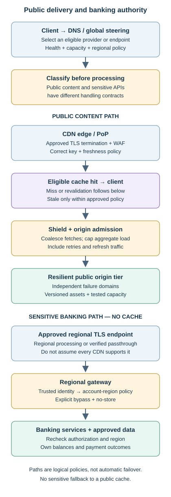

# Topic 10 — CDN + Edge Architecture

[Back to Architecture Drills](../README.md)

**Status:** Complete

At 9:00 AM, a bank launches a campaign across Canada, the US, the UK and Ireland. Traffic grows from **100,000 requests per second at a 90% cache hit ratio** to **500,000 requests per second at a 70% hit ratio**. The public website still appears to be working at many edge locations, but origin demand has risen from **10,000 to 150,000 requests per second**. The origin's safe limit is **15,000**. At the same time, customers need to check balances and make payments. Serving the campaign must not exhaust the systems that serve their accounts.

This chapter designs the CDN and edge architecture that contains that failure. Start with two distinct paths: **public content is accelerated at the edge**, while **sensitive balance and payment requests remain on an approved regional banking path**. The architecture first shows those paths end to end; CDN, PoP, Anycast, DNS and GLB mechanics are introduced afterward, once the reader can see what problem each mechanism solves.

The central ownership rule is: **the edge accelerates approved content; regional banking services retain authority over identity, data access and financial outcomes.** Never cache sensitive balance or payment APIs. Never relax residency boundaries to rescue availability. Keep AI outside the synchronous banking path. The drill's recovery target is **five minutes**; a measured **12-minute failover is a NO-GO**. Numerical scenarios are teaching exercises, not production benchmarks or evidence of a successful launch.

## Contents

- [Problem & Requirements](#problem--requirements)
- [Final Architecture](#final-architecture)
- [End-to-End Flow](#end-to-end-flow)
- [Edge & Routing Fundamentals](#edge--routing-fundamentals)
- [Component Responsibilities](#component-responsibilities)
- [Data & Consistency](#data--consistency)
- [Scaling](#scaling)
- [Reliability & Failure Modes](#reliability--failure-modes)
- [Security](#security)
- [Observability](#observability)
- [Key Architecture Decisions](#key-architecture-decisions)
- [Constraint Mutations](#constraint-mutations)
- [Adversarial Architecture Review](#adversarial-architecture-review)
- [AI Intersection](#ai-intersection)
- [TPM Delivery](#tpm-delivery)
- [Program Risks](#program-risks)
- [TPM Constraint Mutations](#tpm-constraint-mutations)
- [Production Readiness](#production-readiness)
- [Rollout & Rollback](#rollout--rollback)
- [Concepts Learned](#concepts-learned)
- [Mental Models](#mental-models)

## Problem & Requirements

A bank launches a campaign across Canada, the US, the UK and Ireland. Public traffic must stay fast without allowing cache misses or failover traffic to overwhelm the origin or the banking systems serving balances and payments.

| Requirement | Decision and consequence |
|---|---|
| Fast public delivery | Cache approved public content close to users; measure by geography/provider. |
| Safe origin load | Bound misses, refreshes and retries; prescale predictable demand. |
| Sensitive APIs | Explicit cache bypass + `Cache-Control: no-store`; banking services retain authority. |
| Provider/origin failure | Multi-CDN where justified, independent origin failure domains and tested survivor capacity. |
| Residency | Enforce approved processing/storage boundaries end to end, not from IP geography alone. |
| Security | DDoS/WAF where applicable, authenticated origins, restricted direct access and service authorization. |
| Recovery | Restore useful service within **5 minutes**; the drill's **12-minute** result is a NO-GO. |
| Operations | Named owners, runbooks, alerts, change control and evidence-based sign-off. |

**Scope boundary.** This chapter covers delivery, caching, traffic steering, origin protection and operational governance. It does not redesign the ledger, payment authorization or database recovery protocol.

**Still to validate in production:** request mix, object sizes, geography, provider features, safe origin rate, scaling time, purge convergence and alert thresholds.

## Final Architecture

The baseline diagram separates public delivery from the sensitive banking path before introducing provider failure and regional restrictions.

### Architecture at a glance

[Open the scalable edge-flow diagram](assets/edge-flow.svg)

Public requests enter an approved CDN, pass applicable security checks and use a cache only when the content policy permits it. Cache misses go through origin admission controls. Sensitive API requests are directed to an approved regional entry point and bypass shared caches. If the bank permits a CDN proxy for these APIs, its TLS termination, processing and logging locations must satisfy that same boundary.

The diagram's two paths are logical policies. Separate hostnames such as `www.bank.example` and `api-ca.bank.example` make them easier to isolate, but a hostname is not authorization. Every gateway and service must still enforce the trusted account-region policy.

### Baseline and extensions

Begin with explicit content classification, one provider, a resilient origin tier and a regional banking gateway. Add a second CDN to address measured provider risk or delivery needs. Add independent origins and suitable regional deployments to address origin and jurisdictional failure. Each extension must preserve the same security and capacity invariants.

A one-to-one mapping between CDN providers and origins is an option, not a requirement. Two CDNs can use a resilient shared origin tier. Two dedicated origins can still share a database, power domain, DNS zone, secret, deployment pipeline or overloaded connection pool. The required property is **independent failure domains with enough tested survivor capacity**, not a particular box count.

## End-to-End Flow

### Public campaign request

1. **Resolve and steer.** A browser resolves the public hostname. Global policy selects an eligible CDN using health, geography, capacity and configuration readiness.
2. **Reach an edge.** The selected provider routes the connection to a PoP, potentially through Anycast. The browser validates the certificate for the bank's hostname.
3. **Terminate and inspect where approved.** An HTTP CDN normally terminates client TLS, applies supported WAF and request policies, then uses a separately authenticated TLS connection upstream when necessary.
4. **Classify the request.** The edge checks the host, path, method, authorization context and content policy. Only approved public routes are cacheable. A filename extension alone does not establish that a response is public.
5. **Construct the key.** The key includes all approved dimensions that change the representation, such as canonical path, locale and selected query parameters. Untrusted or irrelevant variation does not create unlimited variants.
6. **Serve or fetch.** A fresh eligible hit returns immediately. A miss or required revalidation uses the shield and protected origin budget. Concurrent refreshes for the same object should be coalesced where supported.
7. **Validate the response policy.** The origin returns content, cache directives and a validator such as an ETag. The edge stores it only if both the response and the configured policy permit storage.
8. **Observe delivery.** Record status, cache outcome, object version, provider, PoP, origin latency and policy version without placing sensitive content in ordinary logs.

### Sensitive balance or payment request

1. The client reaches an approved regional TLS endpoint. A Canadian customer travelling in Ireland does not become an Irish banking-data tenant because of their IP address.
2. The gateway validates identity, token issuer, audience, expiry and the trusted account or tenant mapping. It derives the permitted region from authoritative policy, not from a caller-supplied `X-Region` header.
3. Balance and payment routes explicitly bypass caches. Responses use `Cache-Control: no-store`; errors, redirects and edge-generated responses for these routes require the same review.
4. The regional service independently checks tenant, account authorization and processing region. Network policy and data credentials limit access to approved stores and dependencies.
5. The banking service owns the result. Payment retries preserve the application's idempotency contract; an edge timeout does not prove a payment failed and must not trigger a blind cross-origin replay.
6. If no compliant, sufficiently provisioned destination is available, return a controlled failure. Do not redirect a sensitive request to another country or fabricate a cached balance to make the site look available.

These paths reconnect only at operational oversight: both need telemetry, rate budgets, release governance and incident ownership. Their caching and data-processing permissions remain distinct.

## Edge & Routing Fundamentals

A **CDN** serves approved content from distributed edge locations (**PoPs**) instead of repeatedly reaching the **origin**. A cache **hit** serves a stored response; a **miss** or revalidation consumes upstream capacity. An **origin shield** can consolidate misses from many PoPs but is itself another dependency.

Edge compute is suitable for bounded delivery logic such as redirects or request normalization. It is not a reason to move authoritative balance/payment logic or unrestricted personal-data processing to arbitrary PoPs.

| Mechanism | Role / limitation |
|---|---|
| DNS | Resolves hostnames and may steer to a CDN/provider; caches make changes non-instant. |
| Anycast | Network routing reaches an advertised PoP; not necessarily the least-loaded application endpoint. |
| GLB | Chooses eligible provider/region using health, policy, capacity and geography. |
| Regional LB | Distributes admitted traffic inside an approved region. |
| TLS | Encrypts/authenticates a connection; termination location determines where plaintext exists. |

These layers compose: DNS may choose a CDN, Anycast reaches a PoP, and the edge then selects an origin. Health alone never overrides residency or survivor-capacity rules.

## Component Responsibilities

| Component | Core responsibility / boundary |
|---|---|
| DNS / global steering | Select eligible providers/regions; not authorization and not instant failover. |
| CDN edge / PoP | Serve approved cacheable content and bounded edge logic; never own financial truth. |
| WAF / DDoS / bot controls | Reduce malicious/abusive traffic where inspection is possible. |
| Cache policy / keys | Decide what may be stored, shared and considered fresh. |
| Shield / coalescing | Consolidate duplicate upstream work; failure still needs bounded origin protection. |
| Origin admission / LB | Enforce aggregate rate, concurrency and priority budgets. |
| Public origin | Authoritative refill source for versioned public content. |
| Regional gateway | Validate identity, region policy and API admission. |
| Banking services/data | Enforce account authorization, residency and financial semantics. |
| Config/cert/purge control | Version policy, trust and multi-provider changes. |
| SRE / telemetry / AI advisory | Measure outcomes and support operators; AI stays advisory and asynchronous. |

## Data & Consistency

The **public origin** owns published content. The CDN owns only a reusable copy under a freshness/policy contract. Banking services own sensitive data and financial outcomes.

### Content classification comes before TTL

| Content | Policy |
|---|---|
| Fingerprinted JS/CSS/images | Long-lived immutable URLs; publish new versions rather than mutating bytes. |
| Public HTML/product content | Explicit short freshness, validators and approved stale allowance. |
| Time-sensitive public notices/rates | Product-defined freshness; public does not mean stale is harmless. |
| Balance/payment/account APIs | **Never cache**; bypass + `no-store`. |
| Personalized/session/token responses | Non-cacheable by default. |

### Cache keys and freshness

A cache key is a promise that all mapped requests may safely share the same response. Include only representation-changing dimensions such as canonical path, approved locale/market and allowlisted query parameters. Dropping a real variation can leak/wrongly serve content; keeping arbitrary variation destroys cache reuse.

`max-age`/`s-maxage` define freshness, `no-cache` requires revalidation, and `no-store` forbids storage. An ETag validates a version after freshness expires. TTL is not guaranteed residency because eviction can happen earlier.

### Invalidation and publication

Prefer versioned immutable assets. Publish new assets before HTML that references them. Use targeted purge for urgent withdrawal and verify convergence across both providers. A successful purge API response is not proof that every edge/browser stopped serving the old representation.

## Scaling

The key equation is **origin RPS = total RPS × miss ratio** before retries/refresh overhead.

At 100k RPS with 90% hits, the origin sees about **10k RPS**. At 500k RPS with 70% hits, it sees **150k RPS**—10× the drill's 15k safe origin limit.

| Pressure | Response |
|---|---|
| Predictable campaign spike | Prescale before launch; autoscaling alone is too late. |
| Falling hit ratio | Protect origin with global admission, shield/coalescing and bounded refresh. |
| Cold secondary CDN | Ramp traffic gradually within origin budget; do not fail over 100% blindly. |
| Origin near safe limit | Shed optional public work and preserve banking reserve. |
| Hot object | Edge caching absorbs repeated reads; validate byte/network pressure too. |
| Higher provider capacity | Does not increase shared origin or banking dependency capacity. |

Emergency response favors controlled degradation: stale public content where explicitly allowed, lightweight fallback pages, reduced campaign features and load shedding. Sensitive banking APIs keep their own correctness and residency rules.

## Reliability & Failure Modes

| Failure | Safe response |
|---|---|
| CDN node/provider failure | Steer to an eligible provider only after capacity/configuration checks. |
| Secondary cache is cold | Ramp within miss budget; shield/coalesce; shed optional traffic if needed. |
| Origin failure | Use independent healthy origin capacity; CDN diversity alone is insufficient. |
| Shared dependency fails | Multi-CDN may still fail together; test DNS, config, data and origin dependencies. |
| Region unavailable | Use only approved regional recovery; residency rules still apply. |
| Purge/invalidation delay | Use versioned assets or targeted purge and verify convergence. |

### Five-minute recovery means useful service

The drill's recovery target is **5 minutes**. Measure detection, steering, TLS readiness, cache state, origin capacity and end-to-end useful service. A DNS change alone is not recovery. The measured **12-minute** exercise remains a NO-GO until remediated and retested.

## Security

- Terminate TLS only at approved locations; re-encryption does not mean the edge never saw plaintext.
- Use WAF/DDoS/bot controls where the platform can inspect traffic.
- Authenticate origins and block direct bypass where practical.
- Keep sensitive balance/payment APIs non-cacheable and test cross-user isolation.
- Enforce least privilege on CDN config, purge, certificates and routing changes.
- Derive residency from trusted account/tenant policy, not IP geolocation or caller-supplied headers.
- Apply the same residency review to logs, telemetry, backups and support access.

If a provider cannot meet required processing geography, route sensitive APIs through an approved regional termination path or use a verified passthrough design with the appropriate loss of L7 cache/WAF capabilities.

## Observability

| Signal | Why it matters |
|---|---|
| Total RPS + cache hit/miss ratio | Converts traffic into origin demand. |
| Origin RPS/concurrency/p95/p99 | Shows whether the safe envelope is threatened. |
| Provider/PoP latency and errors | Distinguishes edge/provider issues from origin issues. |
| Purge/config propagation | Detects multi-CDN policy drift. |
| Banking latency/errors | Protects critical services independently from campaign health. |
| Residency rejects / wrong-region attempts | Validates enforcement. |
| Failover phase timings | Shows where the 5-minute recovery target is lost. |

Monitor customer outcomes and shared dependencies, not only CDN health dashboards. A green edge with an overloaded origin is still a failing architecture.

## Key Architecture Decisions

| Decision / disposition | Reasoning and trade-off |
|---|---|
| **Accepted:** multi-region, multi-CDN where justified | Improves geographic delivery and provider resilience. Adds configuration, cost, cache fragmentation and operational complexity; all routing remains policy-constrained. |
| **Accepted:** regional residency and security enforcement | Trusted identity, gateway controls and independent service checks enforce the banking boundary. Some failures require controlled unavailability. |
| **Accepted:** elastic origins with prescaling | Known campaigns receive capacity before launch; autoscaling supports measured variation. Dependencies and hard budgets still limit throughput. |
| **Required property:** independent origin failure domains | Removes common origin failure risks only when networks, data dependencies and survivor capacity are addressed. |
| **Refined:** dedicated origin per CDN | Useful in some isolation designs, but optional. A resilient shared tier may satisfy the same requirement with less duplication. |
| **Accepted:** explicit public cache policy and immutable assets | Improves reuse and predictable publication. Mutable content still needs freshness, invalidation and convergence controls. |
| **Accepted:** deterministic origin protection | Rate/concurrency limits, circuit breakers and priority isolation remain active during every provider transition. |
| **Rejected:** cache sensitive balance/payment APIs | Speed does not justify financial staleness or disclosure. Bypass and no-store are mandatory here. |
| **Conditional:** TLS passthrough | Only with verified provider support and understood loss of HTTP inspection/caching at that intermediary. |
| **Rejected:** nearest region determines residency | Client geography and untrusted headers are not authoritative account-policy inputs. |
| **Rejected:** 12-minute recovery meets a five-minute contract | Release remains NO-GO until remediation and representative retesting establish compliance. |
| **Accepted:** asynchronous AI with human-reviewed changes | Forecasting helps preparation; deterministic safeguards own emergency protection. No AI in synchronous banking. |

The final **Architecture Review Board (ARB)** defense prioritizes **multi-region, multi-CDN resilience**, **regional data-residency and security enforcement**, and **elastic origin capacity with prescaling**. Independent origin failure domains remain a required property of that architecture even though dedicated origins are not one of the three headline decisions.

## Constraint Mutations

The following mutations consolidate the drill's reasoning into reviewable operating responses. They are architectural exercises, not claims that these incidents occurred in production.

| Changed constraint | Accepted response / correction |
|---|---|
| Traffic becomes 500k RPS and hit ratio falls to 70% | Calculate 150k offered origin RPS, constrain to the safe envelope, preserve banking reserve and activate approved public fallback. |
| Autoscaling cannot finish before the campaign spike | Prescale earlier; use bounded stale/redirect/degradation now. Waiting for instances is not origin protection. |
| CDN A fails while CDN B's cache is cold | Model cold misses, confirm B's policy and capacity, warm/ramp within budget and shed optional load when needed. |
| Both CDNs share one origin | Replicate the origin across independent failure domains and validate its dependencies; another CDN alone is insufficient. |
| Canada is unhealthy but the US is available | Under this scenario, use approved Canadian recovery or fail safely. Availability does not grant a residency exception. |
| Public campaign content may be served internationally | Use permitted cross-region delivery for that content while retaining controls on sensitive APIs and telemetry. |
| A legal notice must be withdrawn immediately | Disable stale reuse for that content, issue targeted invalidation, verify both providers and use a safe fallback if removal lags. |
| Residency header is spoofed | Ignore untrusted routing assertions; use validated identity plus authoritative account mapping and independent service enforcement. |
| AI forecasts an overload in 30 minutes | Present evidence to SRE for an approved prescale or policy change; deterministic guards continue regardless of model output. |

## Adversarial Architecture Review

| Challenge | Outcome retained |
|---|---|
| “The CDN supports millions of RPS, so 500k is safe.” | Reject. Origin demand depends on misses, uncached work and amplification; 150k against 15k is still 10× overload. |
| “Raise TTL everywhere until hit ratio reaches 97%.” | Reject. Content freshness and privacy constrain reuse. 97% also leaves no reserve in the simplified arithmetic. |
| “We can serve a cached balance during an outage.” | Reject. A stale balance is not an authoritative banking response; the API is non-cacheable in this design. |
| “Two CDNs guarantee independent availability.” | Reject. A shared origin, DNS provider, database or bad common configuration can fail both. |
| “Every CDN must have its own origin.” | Refine. Independence and capacity are mandatory; one-to-one mapping is optional. |
| “TLS to the origin means the edge never sees data.” | Reject. Edge termination followed by re-encryption still exposes plaintext at the edge. |
| “Passthrough gives us the same WAF and caching.” | Reject for encrypted HTTP at that intermediary. Validate the selected L4/L7 service and termination boundary. |
| “A regional hostname or IP geolocation proves residency.” | Reject. Trusted account policy and enforcement throughout the data path are required. |
| “Failover is just changing DNS.” | Reject. Client convergence, TLS, cold caches, origin capacity and useful-service verification belong in the recovery measurement. |
| “AI should move traffic automatically to save time.” | Reject autonomous model-driven changes. Human review governs recommendations; preapproved deterministic emergency controls act immediately. |
| “The campaign deadline makes 12 minutes acceptable.” | Reject under the five-minute requirement. Escalate the failed gate, remediate and retest. |

## AI Intersection

The useful AI capability is **asynchronous traffic prediction**. It analyzes minimized traffic trends, cache misses, regional demand and origin utilization, then warns that a campaign may exceed safe origin capacity in 30 minutes. The prediction gives operators time to prepare; it does not grant authority to process a banking request or change its region.

[Open the scalable AI governance diagram](assets/ai-governance.svg)

The advisory path is **telemetry → forecast → recommendation with evidence → human review → controlled change pipeline**. A recommendation should identify the forecast horizon, uncertainty, expected miss load, affected region, policy version, proposed action and rollback condition. Reject stale or incompatible recommendations.

SRE may approve prescaling, a bounded traffic-weight change or an allowed public-content degradation. The change pipeline checks residency eligibility, origin budgets, configuration parity and approval scope before canarying the change. Record the model/version, input window, recommendation, approver, applied configuration and outcome.

**Human approval does not sit in front of emergency protection.** Preapproved deterministic rate limits, concurrency caps, circuit breakers, regional restrictions and load shedding act immediately when their defined conditions occur. Humans approve policy changes; a model prediction does not suspend established guards.

Evaluate forecasts through historical replay, shadow mode and measured lead time, false alarms and missed overloads before relying on them operationally. Use aggregate or redacted inputs with approved processing locations. If the model is unavailable, inaccurate or compromised, existing CDN policies and banking services continue without waiting for it. No AI call belongs in the synchronous banking path.

## TPM Delivery

| Workstream | Delivery evidence |
|---|---|
| CDN / cache | Provider parity, cache classification/keys/TTL, certificates and purge behavior. |
| GLB / network | Health, steering, DNS convergence, origin restrictions and failback. |
| Origin / capacity | Independent failure domains, prescaling, safe limits and survivor headroom. |
| Gateway / banking | Trusted region mapping, authorization and cache bypass for sensitive APIs. |
| Security / privacy | TLS/WAF/origin trust plus approved processing/storage boundaries. |
| Performance / integration | Peak, low-hit, cold-cache, provider/origin failure and end-to-end banking tests. |
| SRE / operations | SLOs, dashboards, alerts, runbooks, on-call and vendor escalation. |

### Sequence and critical path

**Content/residency classification → routing/TLS/cache contracts → origin/regional enforcement → cross-provider integration → peak/cold-failover testing → 5-minute recovery proof → security/privacy/operations sign-off.**

### Milestones and evidence

1. **Architecture baseline:** public/sensitive split, data boundaries, origin budget and recovery target.
2. **Integration-ready:** provider parity, certificates, authenticated origins and regional enforcement.
3. **Correctness/security:** no sensitive caching, cache-key isolation, direct-origin denial and wrong-region rejection.
4. **Capacity/resilience:** campaign arithmetic, cold-cache protection, provider/origin failure and failback.
5. **Operational acceptance:** 5-minute recovery, actionable alerts/runbooks and accountable sign-off.

## Program Risks

| Risk | Mitigation / decision boundary |
|---|---|
| Origin overload from miss surge | Prescale, cap aggregate demand, reserve banking capacity and shed optional work. |
| Multi-CDN hides shared dependency | Map/test origin, DNS, config and downstream failure domains before claiming resilience. |
| Sensitive response cached | Explicit bypass + cross-user tests; any hit is containment + rollout stop. |
| Residency drift | End-to-end approved mapping and negative tests; uncertain routing fails safely. |
| Provider policy drift | Versioned config, parity checks and controlled rollback. |
| Recovery exceeds 5 min | Measure phases, remediate and retest; 12 minutes remains NO-GO. |
| Secondary capacity unproven | Validate surge quota/support path before relying on failover. |
| Unsafe AI advice | Human review + deterministic validators; core controls continue without AI. |

## TPM Constraint Mutations

| Constraint | Delivery response |
|---|---|
| Functional testing passes, launch date is fixed, failover takes 12 minutes | **NO-GO.** Escalate the seven-minute gap, identify the slow phases, assign remediation owners and dates, retest and obtain renewed sign-off. |
| Marketing increases campaign reach after capacity sign-off | Reopen the demand model and low-hit tests; update prescaling and fallback plans before increasing traffic. |
| Second CDN is contracted but origin resilience is unfinished | Do not count procurement as resilience delivery. Close the shared failure-domain gap and prove survivor capacity. |
| Provider cannot meet required TLS processing geography | Rework the sensitive path using approved regional termination or verified passthrough; do not equate encryption with compliant processing. |
| Budget cuts remove standby capacity | Quantify the impact on recovery and admission. Escalate an explicit architecture/scope decision; do not retain an unsupported five-minute claim. |
| AI rollout is delayed | Core CDN and banking readiness can proceed if deterministic controls and all mandatory gates pass. Advisory AI is not on the critical request path. |
| Minor documentation remains after all required safety and operational gates pass | Consider conditional acceptance only with a named owner/date and no impairment to incident response. |

A formal change to the recovery requirement would require accountable business and risk governance and revised acceptance criteria. It would not retroactively make a 12-minute result satisfy a five-minute target.

## Production Readiness

Required gates, **not claims of completed production tests**.

| Gate | Evidence before Go |
|---|---|
| Functional / cache | Public vs sensitive classification, key behavior, TTL/ETag and no sensitive caching. |
| Publication | Versioned deploys, targeted purge and rollback compatibility. |
| Capacity | Peak/low-hit/cold-cache scenarios with safe global admission and banking reserve. |
| Resilience | CDN loss, origin loss, shared-dependency failure and healthy survivor capacity. |
| Residency/security | Trusted region mapping, approved TLS processing, origin trust and least privilege. |
| Recovery | End-to-end useful service restored within **5 minutes**. |
| Operations | User-centered SLOs, alerts, runbooks, on-call/vendor escalation and rollback plan. |
| AI, if enabled | Async-only, approved data inputs, evaluated forecasts and deterministic safeguards. |

## Rollout & Rollback

Use **synthetic/config validation → small public-content canary → limited geography/provider → progressive expansion**. Sensitive-path changes proceed only after independent security/residency gates pass.

Before each ramp, verify certificates, origin trust, policy parity, object versions, safe origin budget and rollback readiness. Stop on any sensitive cache hit, unapproved processing, origin-envelope breach or sustained regression.

Rollback restores a known-good configuration or traffic split only if the destination is healthy, compliant and provisioned. DNS rollback still has convergence delay. If rollback would reintroduce a security defect or overload a survivor, prefer controlled degradation/failure.

## Concepts Learned

| Concept | Working meaning / correction |
|---|---|
| CDN / PoP / origin | Delivery network / edge location / authoritative refill source. |
| DNS / Anycast / GLB | Name resolution / network route selection / policy-based destination choice. |
| Cache key | A claim that requests can safely share the same representation. |
| TTL / ETag | Freshness lifetime / representation validator; validation still consumes upstream work. |
| `no-cache` / `no-store` | Validate before reuse / do not store. Sensitive banking APIs use bypass plus no-store here. |
| Purge / versioned URL | Invalidate a copy / publish a new immutable identity; neither recalls browser copies automatically. |
| Stale allowance | Bounded public-content reuse under approved conditions, not a banking correctness mechanism. |
| Shield / coalescing | Consolidate upstream cache work / combine concurrent requests for the same representation. |
| Request / byte hit ratio | Share of requests served from cache / share of bytes served from cache; different capacity signals. |
| Multi-CDN / origin resilience | Provider diversity / survival of upstream failure; both need independent analysis. |
| TLS termination / passthrough | Decrypt at an endpoint / forward encrypted traffic using supported service capabilities. |
| Residency / geolocation | Approved data-processing boundary / observed client location; they are not equivalent. |
| Prescaling / autoscaling | Prepare known demand in advance / react to observed demand with a provisioning delay. |
| Recovery target / measured recovery | Required useful-service restoration time / tested end-to-end result. Five minutes versus 12 is a failed gate. |

## Mental Models

- **The edge accelerates public content; banking services own sensitive decisions.**
- Classify content before choosing a cache key or TTL.
- Every cache key is a promise about who may share a response.
- A hit saves origin work; a miss, refresh or retry spends origin capacity.
- Five times the traffic and three times the miss fraction creates 15 times the origin demand.
- More CDN capacity does not create more origin capacity.
- Two providers do not remove one shared failure domain.
- Dedicated origins are optional; independent failure domains and survivor capacity are required.
- Encryption on two links still permits plaintext at the termination point between them.
- Client geography is a routing hint; trusted identity and service policy enforce residency.
- Public content may cross permitted regions; sensitive banking requests may not inherit that permission.
- A recovery target is measured at useful service, not at a DNS update.
- AI advises asynchronously; humans approve changes; deterministic guards protect immediately.

---

**Design basis:** The completed 11-stage Topic 10 drill, culminating in Question 34 and the final ARB refinement. This chapter consolidates the supplied coverage of fundamentals, networking/TLS, cache semantics, security, capacity, emergency strategies, resilience, residency, monitoring/readiness, constraint and adversarial reviews, AI and TPM governance. Explanatory examples are illustrative, not reconstructed dialogue or production test results. Protocol and privacy references are linked at the relevant claims. Previous: [Topic 9 — Distributed Scheduler](../09-distributed-scheduler/README.md). Next: Topic 11 — Distributed File / Object Storage (planned).
